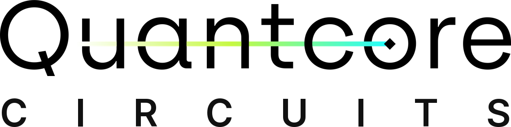

<p align="center">
  <picture>
    <source media="(prefers-color-scheme: dark)" srcset="https://raw.githubusercontent.com/Quantcore-Technologies/Quantcore-Circuits/main/assets/logo-circuits-white.png">
    
  </picture>
</p>

<p align="center">
  <a href="https://github.com/Quantcore-Technologies/Quantcore-Circuits/actions/workflows/ci.yml"></a>
  <a href="https://github.com/Quantcore-Technologies/Quantcore-Circuits/actions/workflows/docs.yml"></a>
  <a href="https://pypi.org/project/quantcore-circuits/"></a>
  <a href="https://pypi.org/project/quantcore-circuits/"></a>
  <a href="https://github.com/Quantcore-Technologies/Quantcore-Circuits/blob/main/LICENSE"></a>
</p>

# quantcore-circuits

quantcore-circuits is Quantcore's design loop for superconducting-qubit chips, built on
[KQCircuits](https://github.com/iqm-finland/KQCircuits). You draw a chip in KLayout or in Python, check it, estimate
its frequencies and couplings from a lumped circuit model (the LOM), simulate it in HFSS or Q3D, compare the two, tune
the geometry towards your targets and export the fab mask. One file, `design.json`, carries the chip through every
step. The command line is `qcc`.

## Design philosophy

Start cheap, spend solver time only where it pays, and let every result feed the next geometry:

**LAYOUT → LOM → EIGENMODE (per component) → FEM on the eigenmode's mesh → extract and analyse → feedback**

1. **Layout.** Draw the chip from real components with pins. The layout is the source of truth.
2. **LOM.** The layout becomes a lumped circuit in seconds (f_q, α, f_r, g, χ, κ). Fix the gross errors here.
3. **Eigenmode, component by component.** Cut each qubit–readout group out of the chip and solve its eigenmodes with
   the junctions as lumped inductors. Small boxes converge fast.
4. **FEM on the same mesh.** Reuse the eigenmode set-up for the driven and capacitance runs.
5. **Extract and analyse.** Read the results back, fill the LOM with the FEM values and compute the Hamiltonian
   parameters next to the LOM's estimates.
6. **Feedback.** Compare with the targets, propose the next geometry, rebuild, and repeat. Then export the fab mask.

## Install

You need Python 3.11 or newer. SQcircuit (in the `analysis` extra) needs PyTorch, so install the CPU build first:

```bash
pip install torch --index-url https://download.pytorch.org/whl/cpu
pip install "quantcore-circuits[all]"
qcc kqc-files        # once: KQCircuits' simulation scripts and label font (not in its PyPI package)
qcc selftest
```

`qcc kqc-files` downloads KQCircuits' own simulation scripts and label font for the installed `kqcircuits` version
from its GitHub release (the PyPI package does not include them; the HFSS / Q3D / Elmer export copies the scripts
into every job, and KQC's chip-frame labels use the font).
`qcc selftest` takes about half a minute. It checks the imports of every extra and builds, checks and exports a small
chip. Read any `[FAIL]` line it prints.

| Extra | Adds |
|---|---|
| (none) | KLayout Python package, KQCircuits, the library and the `qcc` command |
| `analysis` | Quantum Metal, pyEPR, scqubits, QuTiP, SQcircuit, QuCat |
| `sim` | gmsh, PyAEDT, scikit-rf |
| `notebook` | Jupyter kernel, notebook runner, matplotlib |
| `all` | `analysis` + `sim` + `notebook` |
| `dev` | pytest, ruff, pre-commit (see [CONTRIBUTING.md](https://github.com/Quantcore-Technologies/Quantcore-Circuits/blob/main/CONTRIBUTING.md)) |

The FEM solves need Ansys AEDT 2024 R1 or newer on Windows. Everything else (layout, DRC, LOM, analysis, the fab
mask) runs without it. Elmer and Palace input files are written, but solving with them is a future goal. A machine
without internet can use the offline wheelhouse, see
[the simulation PC page](https://quantcore-technologies.github.io/Quantcore-Circuits/overview/simulation-pc.html).

## The KLayout plugin

You need KLayout 0.30 or newer. In KLayout open **Tools → Manage Packages → Install New Packages**, search for
`quantcore-circuits` and install it. Restart KLayout: a **Quantcore** menu appears next to Help. If `qcc` is not on
your PATH, open **Quantcore → Settings…** and set **qcc executable** to the full path of `qcc` (for example
`C:\Users\<you>\miniconda3\envs\myenv\Scripts\qcc.exe`). More:
[the plugin guide](https://quantcore-technologies.github.io/Quantcore-Circuits/plugin/index.html) and the
[plugin branch](https://github.com/Quantcore-Technologies/Quantcore-Circuits/tree/klayout-plugin) of this repository.

## Quick start

This builds a feedline with two bond pads, one Xmon qubit and a readout resonator, checks it and makes its lumped
circuit. It writes `build/my_chip.oas` (open it in KLayout) and `my_chip.json` into the folder you run it from.

```python
from quantcore_circuits.designer import Designer

d = Designer("my_chip", box=(0, 0, 7500, 7500), live=False)   # live=True redraws KLayout after every change
pw = d.add("PAD_W", "BondPad", at=(1125, 3750), rot=270, edge="auto")
pe = d.add("PAD_E", "BondPad", at=(6375, 3750), rot=90, edge="auto")
fl = d.route("FL", pw.a, pe.a)                                # the feedline
q1 = d.add("Q1", "Xmon", at=(2975, 2200), cross_length=300, junction={"Lj_nH": 12, "Cj_fF": 2})
d.route("R1", q1.claw_n, fl.hanger(s=2000, length=300, side="right"), meander=4200)   # the readout resonator
d.show()                       # build the layout: build/my_chip.oas
d.save("my_chip.json")         # the design file
print(d.drc())                 # connectivity checks
print(list(d.lom().model.branches))   # the lumped circuit's elements
```

Next steps: the five tutorial notebooks in
[`examples/tutorials`](https://github.com/Quantcore-Technologies/Quantcore-Circuits/tree/main/examples/tutorials)
(start with tutorial 0), and the
[68 design notebooks](https://github.com/Quantcore-Technologies/Quantcore-Circuits/tree/main/examples/designs) that
rebuild published chips (IBM, Google, Qiskit Metal, KQC and more).

## Documentation

The docs are at <https://quantcore-technologies.github.io/Quantcore-Circuits/>.

- [Getting started](https://quantcore-technologies.github.io/Quantcore-Circuits/getting-started.html)
- [KLayout plugin](https://quantcore-technologies.github.io/Quantcore-Circuits/plugin/index.html)
- [Python library](https://quantcore-technologies.github.io/Quantcore-Circuits/library/index.html)
- [Tutorials](https://quantcore-technologies.github.io/Quantcore-Circuits/tutorials/index.html)
- [Design notebooks](https://quantcore-technologies.github.io/Quantcore-Circuits/designs/overview.html)
- [Component reference](https://quantcore-technologies.github.io/Quantcore-Circuits/components/cells/index.html)
- [FAQ](https://quantcore-technologies.github.io/Quantcore-Circuits/faq/index.html)

## Repository layout

| Folder | What |
|---|---|
| `src/` | The `quantcore_circuits` package: components, PDK, routing, LOM, simulation export, analysis, the `qcc` CLI |
| `kplugin/` | The KLayout plugin (also published as a Salt package) |
| `examples/` | Tutorials, 68 design notebooks, templates and example `design.json` files |
| `docs/` | The documentation (Sphinx + MyST) |
| `tests/` | The pytest suite (no GUI or solver needed for the fast tier) |
| `reviewer/` | Source of the live dashboard (Vite + React); the built app ships inside the package |
| `scripts/` | Docs generators, notebook checker, wheel and wheelhouse builders, install scripts |
| `requirements/` | Pinned dependency versions the tests run with |

## Contributing

Issues and pull requests are welcome. See
[CONTRIBUTING.md](https://github.com/Quantcore-Technologies/Quantcore-Circuits/blob/main/CONTRIBUTING.md) and the
[changelog](https://github.com/Quantcore-Technologies/Quantcore-Circuits/blob/main/CHANGELOG.md).

## License

GPL-3.0-or-later, see [LICENSE](https://github.com/Quantcore-Technologies/Quantcore-Circuits/blob/main/LICENSE). The
package builds on KQCircuits, which is GPL-3.0, so everything that links to it is distributed under the GPL.

## Acknowledgements

quantcore-circuits is a thin layer over excellent open-source work:
[KQCircuits](https://github.com/iqm-finland/KQCircuits) (geometry, routing, simulation export),
[Qiskit Metal / Quantum Metal](https://github.com/qiskit-community/qiskit-metal) (LOM),
[scqubits](https://github.com/scqubits/scqubits), [QuTiP](https://qutip.org),
[pyEPR](https://github.com/zlatko-minev/pyEPR), [SQcircuit](https://github.com/stanfordLINQS/SQcircuit),
[QuCat](https://github.com/qucat/qucat), [PyAEDT](https://github.com/ansys/pyaedt), [gmsh](https://gmsh.info) and
[KLayout](https://www.klayout.de).
