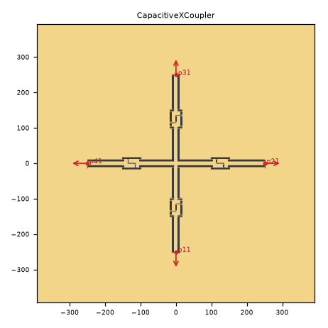

% generated by scripts/make_component_docs.py -- do not edit. Put hand-written notes in docs/components/notes/CapacitiveXCoupler.md (included below).

# CapacitiveXCoupler

Capacitive coupler for testing FEM computations.

**Source:** KQC (KQCircuits). **Category:** coupler. **Module:** `kqcircuits.elements.capacitive_x_coupler`.

:::{warning}
Legacy cell. KQC test element 'for testing FEM computations'; unused. Ports p11..p41 and a LOM model since 2026-11-15
:::

See also the [catalog](../CATALOG.md).

## Pins



Pin image (default parameters). Light = metal, dark = etched gap, colours = junction layers. A red dot and arrow is a pin and its direction (out of the cell); the red bar is the CPW width a + 2 b. Blue dot = a pin without direction. Units: µm.

| pin | x (µm) | y (µm) | direction (°) | a (µm) | b (µm) | purpose |
|---|---|---|---|---|---|---|
| `p11` | 0 | -250 | 270 | 10 | 6 | LOM node `p11` |
| `p21` | 250 | 0 | 0 | 10 | 6 | LOM node `p21` |
| `p31` | 0 | 250 | 90 | 10 | 6 | LOM node `p31` |
| `p41` | -250 | 0 | 180 | 10 | 6 | LOM node `p41` |

a, b: CPW centre width and gap where the pin declares them (`–` = not declared). Position and direction are in the cell's own frame (`at=(0, 0)`, `rot=0`).

**Notes from the catalog:** KQC draws no port refpoints, only its arm ends p11, p21, p31, p41 (KQC's own simulation ports): qcc gives them as CPW ports (element a/b) facing out along each arm (registry.KQC_EXTRA_PORTS, '+': S, E, N, W; 'x': the corners). LOM: each arm couples through its finger capacitor to the floating centre cross.

## Parameters

| name | default | unit | description |
|---|---|---|---|
| `a` | `10` | μm | Width of center conductor |
| `b` | `6` | μm | Width of gap |
| `r` | `100` | μm | Turn radius |
| `x_coupler_length` | `500` | – | Length of Capacitive X Coupler |
| `x_coupler_height` | `500` | – | Height of Capacitive X Coupler |
| `x_coupler_variant` | `"+"` | – | Coupler variant, either (+) or (x) |
| `remove_capacitors` | `false` | – | Remove capacitors from the X Coupler |
| `finger_number` | `2` | – | Number of fingers |
| `finger_width` | `10` | μm | Width of a finger |
| `finger_gap` | `3` | μm | Gap between the fingers |
| `finger_gap_end` | `3` | μm | Gap between the finger and other pad |

Electrically relevant parameters (sizes, gaps, junction, ports) come first, the rest follows.

## LOM model

The cell contributes to the lumped model:

| branch | type | nodes | value (estimate at defaults) |
|---|---|---|---|
| `C_X_p11` | C | p11 – c | estimate=4.01, unit=fF, estimate_source=analytic: interdigital (Igreja & Dias 2004) + finger-tip gaps, as FingerCapacitorSquare, estimate_kind=analytic, uncertainty=±25% |
| `C_X_p11_g` | C | p11 – gnd | estimate=19, unit=fF, estimate_source=rough: 98 µm of arm CPW + half the finger block, estimate_kind=rough, uncertainty=±50% |
| `C_X_p21` | C | p21 – c | estimate=4.01, unit=fF, estimate_source=analytic: interdigital (Igreja & Dias 2004) + finger-tip gaps, as FingerCapacitorSquare, estimate_kind=analytic, uncertainty=±25% |
| `C_X_p21_g` | C | p21 – gnd | estimate=19, unit=fF, estimate_source=rough: 98 µm of arm CPW + half the finger block, estimate_kind=rough, uncertainty=±50% |
| `C_X_p31` | C | p31 – c | estimate=4.01, unit=fF, estimate_source=analytic: interdigital (Igreja & Dias 2004) + finger-tip gaps, as FingerCapacitorSquare, estimate_kind=analytic, uncertainty=±25% |
| `C_X_p31_g` | C | p31 – gnd | estimate=19, unit=fF, estimate_source=rough: 98 µm of arm CPW + half the finger block, estimate_kind=rough, uncertainty=±50% |
| `C_X_p41` | C | p41 – c | estimate=4.01, unit=fF, estimate_source=analytic: interdigital (Igreja & Dias 2004) + finger-tip gaps, as FingerCapacitorSquare, estimate_kind=analytic, uncertainty=±25% |
| `C_X_p41_g` | C | p41 – gnd | estimate=19, unit=fF, estimate_source=rough: 98 µm of arm CPW + half the finger block, estimate_kind=rough, uncertainty=±50% |
| `C_X_c` | C | c – gnd | estimate=74, unit=fF, estimate_source=rough: inner arm CPW sections + half finger blocks, estimate_kind=rough, uncertainty=±50% |

Nodes: `c`, `p11`, `p21`, `p31`, `p41`.

## Simulation export notes

- C7: C-matrix nets without a design label (warning) (status: fixed; fix in sim_tools/builder.py (_cell_probes, label_unnamed); layouts/others/amplifiers.py (JtwpaChain.qcc_probes))

## How to use

In Python:

```python
from quantcore_circuits.designer import Designer

d = Designer("demo", box=(0, 0, 7500, 7500))
d.add("U1", "CapacitiveXCoupler", at=(3750, 3750), a=10)   # parameters: see the table above
d.add("PAD", "BondPad", at=(1125, 3750), rot=270)   # a launcher to connect to
d.route("L1", "PAD.a", "U1.p11")                # a CPW from the pad to the pin
```

Pin names go into `d.route(...)` as `INSTANCE.pin`, and into `snap=` / `to=` when placing. From the shell: `qcc components CapacitiveXCoupler` lists the pins; add `--schema` for the parameters.

In KLayout: Quantcore panel ▸ Components ▸ double-click the cell, then click on the layout to place it. Rotate and mirror before the click; use Connect on two pins to route.
