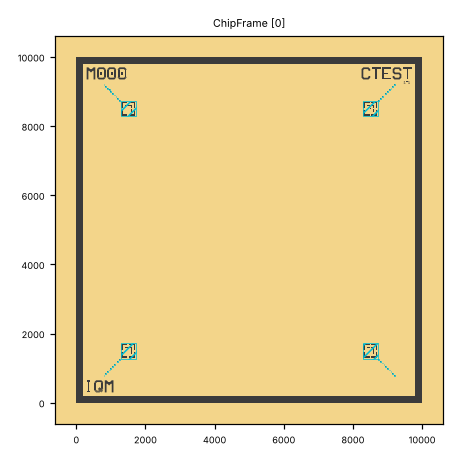

% generated by scripts/make_component_docs.py -- do not edit. Put hand-written notes in docs/components/notes/ChipFrame.md (included below).

# ChipFrame

The PCell declaration for a chip frame.

**Source:** KQC (KQCircuits). **Category:** marker. **Module:** `kqcircuits.elements.chip_frame`.

See also the [catalog](../CATALOG.md).

## Pins



Pin image (default parameters). Light = metal, dark = etched gap, colours = junction layers. A red dot and arrow is a pin and its direction (out of the cell); the red bar is the CPW width a + 2 b. Blue dot = a pin without direction. Units: µm.

No pins: this cell has no ports. Place it with `at=` / `rot=`.

## Parameters

| name | default | unit | description |
|---|---|---|---|
| `a` | `10` | μm | Width of center conductor |
| `b` | `6` | μm | Width of gap |
| `r` | `100` | μm | Turn radius |
| `dice_width` | `200` | μm | Dicing width |
| `frame_text_size` | `350` | µm | Label text size |
| `chip_dicing_width` | `10.0` | µm | Width of the chip dicing reference line |
| `chip_dicing_line_length` | `100.0` | µm | Length of the chip dicing reference line |
| `chip_dicing_gap_length` | `50.0` | µm | Gap between two chip dicing reference dashes |
| `face_label_size` | `75` | µm | Vertical size of character in face label |
| `dice_grid_margin` | `100` | – | Margin between dicing edge and ground grid |
| `name_mask` | `"M000"` | – | Name of the mask |
| `name_chip` | `"CTest"` | – | Name of the chip |
| `name_copy` | `null` | – | Name of the copy |
| `name_brand` | `"IQM"` | – | Name of the brand |
| `text_margin` | `100` | – | Margin for labels |
| `marker_dist` | `1500` | – | Marker distance from edges |
| `diagonal_squares` | `10` | – | Number of diagonal squares for the markers |
| `marker_types` | `["Marker Standard", "Marker Standard", "Marker Standard", "Marker Sta…` | – | Marker type for each chip corner, clockwise starting from lower left |
| `chip_dicing_in_base_metal` | `false` | – | Insert chip dicing lines in base metal addition |
| `face_label_show` | `true` | – | Show face label below variant label |
| `face_label_margin` | `50` | – | Margin for face label, fills ground grid avoidance around label |
| `face_label_x` | `100` | µm | X offset of face label, from top right corner of chip |
| `face_label_y` | `450` | µm | Y offset of face label, from top right corner of chip |

Electrically relevant parameters (sizes, gaps, junction, ports) come first, the rest follows.

## LOM model

none (a LOM build gives each pin its own bare node, without elements).

## How to use

In Python:

```python
from quantcore_circuits.designer import Designer

d = Designer("demo", box=(0, 0, 7500, 7500))
d.add("U1", "ChipFrame", at=(3750, 3750), a=10)   # parameters: see the table above
# no directed pin: place it with at= / rot=, or snap it with snap= / to=
```

Pin names go into `d.route(...)` as `INSTANCE.pin`, and into `snap=` / `to=` when placing. From the shell: `qcc components ChipFrame` lists the pins; add `--schema` for the parameters.

In KLayout: Quantcore panel ▸ Components ▸ double-click the cell, then click on the layout to place it. Rotate and mirror before the click; use Connect on two pins to route.
