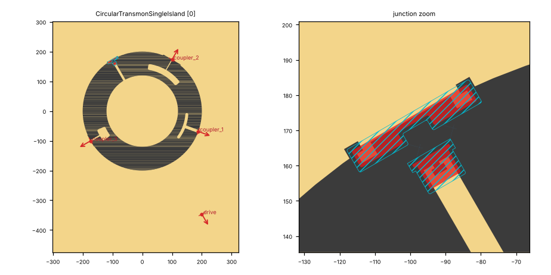

% generated by scripts/make_component_docs.py -- do not edit. Put hand-written notes in docs/components/notes/CircularTransmonSingleIsland.md (included below).

# CircularTransmonSingleIsland

The PCell declaration for a single island circular transmon.

**Source:** KQC (KQCircuits). **Category:** qubit. **Module:** `kqcircuits.qubits.circular_transmon_single_island`.

See also the [catalog](../CATALOG.md) and the [duplicates decisions](../DUPLICATES.md).

## Pins



Pin image (default parameters). Light = metal, dark = etched gap, colours = junction layers. A red dot and arrow is a pin and its direction (out of the cell); the red bar is the CPW width a + 2 b. Blue dot = a pin without direction. Units: µm.

| pin | x (µm) | y (µm) | direction (°) | a (µm) | b (µm) | purpose |
|---|---|---|---|---|---|---|
| `coupler_1` | 187.939 | -68.404 | 340 | 10 | 6 | coupler port (readout / bus); LOM node `coupler_1` |
| `coupler_2` | 100 | 173.205 | 60 | 3 | 32 | coupler port (readout / bus); LOM node `coupler_2` |
| `coupler_3` | -173.205 | -100 | 210 | 4.5 | 20 | coupler port (readout / bus); LOM node `coupler_3` |
| `drive` | 200 | -346.41 | 300 | 10 | 6 | drive / charge line end; control line (drive) in the LOM |

a, b: CPW centre width and gap where the pin declares them (`–` = not declared). Position and direction are in the cell's own frame (`at=(0, 0)`, `rot=0`).

## Parameters

| name | default | unit | description |
|---|---|---|---|
| `a` | `10` | μm | Width of center conductor |
| `b` | `6` | μm | Width of gap |
| `r` | `100` | μm | Turn radius |
| `mirror_squid` | `false` | – | Mirror SQUID by its Y axis |
| `junction_type` | `"Manhattan"` | – | Junction Type |
| `junction_width` | `0.02` | μm | Junction width for code generated element |
| `r_island` | `120` | μm | Qubit island radius |
| `ground_gap` | `80` | μm | Ground plane gap width |
| `squid_angle` | `120` | degrees | Angular position of the Josephson Junction/s, where the positive x-axis is 0 |
| `couplers_r` | `150` | μm | Radius of the couplers positioning |
| `couplers_a` | `[10, 3, 4.5]` | [μm] | Width of the coupler waveguide's center conductors |
| `couplers_b` | `[6, 32, 20]` | [μm] | Width of the coupler waveguide's gaps |
| `couplers_angle` | `[340, 60, 210]` | [degrees] | Positioning angles of the couplers, where 0deg corresponds to positive x-axis |
| `couplers_width` | `[10, 20, 30]` | [μm] | Radial widths of the arc couplers |
| `couplers_arc_amplitude` | `[35, 45, 15]` | [degrees] | Couplers angular extension |
| `drive_angle` | `300` | degrees | Angle of the drive port, where 0deg corresponds to positive x-axis |
| `loop_area` | `100` | μm^2 | Loop area |
| `fluxline_type` | `"Fluxline Standard"` | – | Fluxline Type |
| `drive_distance` | `400` | µm | Distance of the driveline, measured from qubit centre |

Electrically relevant parameters (sizes, gaps, junction, ports) come first, the rest follows.

## LOM model

The cell contributes to the lumped model:

| branch | type | nodes | value (estimate at defaults) |
|---|---|---|---|
| `C_X` | C | island – gnd | estimate=65.9, unit=fF, estimate_source=analytic: disk r=120 µm in a 80 µm ground gap (bent CPW), estimate_kind=analytic, uncertainty=±25% |
| `J_X` | SQUID | island – gnd | Lj_nH=–, Cj_fF=0, asym=0, flux_phi0=0 |
| `Cg_X_coupler_1` | C | island – coupler_1 | estimate=7, unit=fF, estimate_source=rough: arc 92 µm facing the island across 25 µm (CPS), estimate_kind=rough, uncertainty=±50% |
| `Cc_X_coupler_1` | C | coupler_1 – gnd | estimate=11, unit=fF, estimate_source=rough: arc outer edge (half CPW) + port lead, estimate_kind=rough, uncertainty=±50% |
| `Cg_X_coupler_2` | C | island – coupler_2 | estimate=11, unit=fF, estimate_source=rough: arc 118 µm facing the island across 20 µm (CPS), estimate_kind=rough, uncertainty=±50% |
| `Cc_X_coupler_2` | C | coupler_2 – gnd | estimate=9, unit=fF, estimate_source=rough: arc outer edge (half CPW) + port lead, estimate_kind=rough, uncertainty=±50% |
| `Cg_X_coupler_3` | C | island – coupler_3 | estimate=4.3, unit=fF, estimate_source=rough: arc 39 µm facing the island across 15 µm (CPS), estimate_kind=rough, uncertainty=±50% |
| `Cc_X_coupler_3` | C | coupler_3 – gnd | estimate=5.4, unit=fF, estimate_source=rough: arc outer edge (half CPW) + port lead, estimate_kind=rough, uncertainty=±50% |

Nodes: `island`, `coupler_1`, `coupler_2`, `coupler_3`.

- X: no junction.Lj_nH in the design; the qubit mode needs one to simulate

## Simulation export notes

- C10: route gap strip misses the cell's etch by < 1 nm at an angled / off-grid port (fab build) (status: fixed; fix in route/waveguide.py (joined_nodes, misses_etch); layouts/chips/design_chip.py (DesignChip._join_ends); assembly/plan.py (RoutePlan.joins))

Details: [SIM_EXPORT_AUDIT](../SIM_EXPORT_AUDIT.md).

## How to use

In Python:

```python
from quantcore_circuits.designer import Designer

d = Designer("demo", box=(0, 0, 7500, 7500))
d.add("U1", "CircularTransmonSingleIsland", at=(3750, 3750), a=10)   # parameters: see the table above
d.add("PAD", "BondPad", at=(1125, 3750), rot=270)   # a launcher to connect to
d.route("L1", "PAD.a", "U1.coupler_1")                # a CPW from the pad to the pin
```

Pin names go into `d.route(...)` as `INSTANCE.pin`, and into `snap=` / `to=` when placing. From the shell: `qcc components CircularTransmonSingleIsland` lists the pins; add `--schema` for the parameters.

In KLayout: Quantcore panel ▸ Components ▸ double-click the cell, then click on the layout to place it. Rotate and mirror before the click; use Connect on two pins to route.
