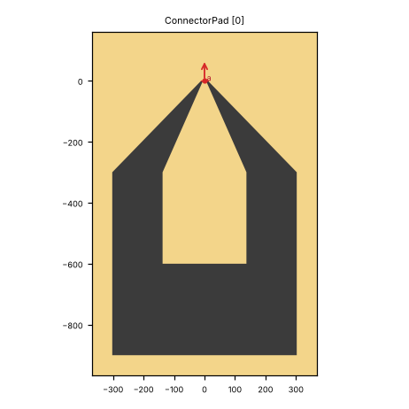

% generated by scripts/make_component_docs.py -- do not edit. Put hand-written notes in docs/components/notes/ConnectorPad.md (included below).

# ConnectorPad

Wire-bond pad tapering to a CPW (legacy "Connector Pad", v1); port ``a`` at the taper tip.

**Source:** Quantcore. **Category:** launcher. **Module:** `quantcore_circuits.layouts.others.connector_pads`.

:::{note}
Alias of [`BondPad`](BondPad.md): the same circuit, drawn differently. rounded=False = the Launcher polygon with a side gap b·pad_width/a and a back gap pad_height (no BondPad parameter set matches); rounded=True has no Launcher drawing; port a. BondPad / ConnectorPad keep their own 3/0 keep-out and lumped-port refpoints
:::

See also the [catalog](../CATALOG.md).

## Pins



Pin image (default parameters). Light = metal, dark = etched gap, colours = junction layers. A red dot and arrow is a pin and its direction (out of the cell); the red bar is the CPW width a + 2 b. Blue dot = a pin without direction. Units: µm.

| pin | x (µm) | y (µm) | direction (°) | a (µm) | b (µm) | purpose |
|---|---|---|---|---|---|---|
| `a` | 0 | 0 | 90 | 10 | 6 | CPW end; LOM node `pad` |

a, b: CPW centre width and gap where the pin declares them (`–` = not declared). Position and direction are in the cell's own frame (`at=(0, 0)`, `rot=0`).

## Parameters

| name | default | unit | description |
|---|---|---|---|
| `a` | `10` | μm | Width of center conductor |
| `b` | `6` | μm | Width of gap |
| `r` | `100` | μm | Turn radius |
| `pad_width` | `275` | μm | Pad width |
| `pad_height` | `300` | μm | Pad height |
| `taper_length` | `300` | μm | Taper length (legacy conn_height) |
| `rounded` | `false` | – | Rounded pad with a 200 µm CPW stub (legacy round) |

Electrically relevant parameters (sizes, gaps, junction, ports) come first, the rest follows.

## LOM model

The cell contributes to the lumped model:

| branch | type | nodes | value (estimate at defaults) |
|---|---|---|---|
| `Port_X` | R | pad – gnd | R_ohm=50 |

Nodes: `pad`.

## How to use

In Python:

```python
from quantcore_circuits.designer import Designer

d = Designer("demo", box=(0, 0, 7500, 7500))
d.add("U1", "ConnectorPad", at=(3750, 3750), a=10)   # parameters: see the table above
d.add("PAD", "BondPad", at=(1125, 3750), rot=270)   # a launcher to connect to
d.route("L1", "PAD.a", "U1.a")                # a CPW from the pad to the pin
```

Pin names go into `d.route(...)` as `INSTANCE.pin`, and into `snap=` / `to=` when placing. From the shell: `qcc components ConnectorPad` lists the pins; add `--schema` for the parameters.

In KLayout: Quantcore panel ▸ Components ▸ double-click the cell, then click on the layout to place it. Rotate and mirror before the click; use Connect on two pins to route.

GUI status (`kplugin/COMPONENTS_STATUS.md`): places ok, edit ok, connect ok, build ok.
