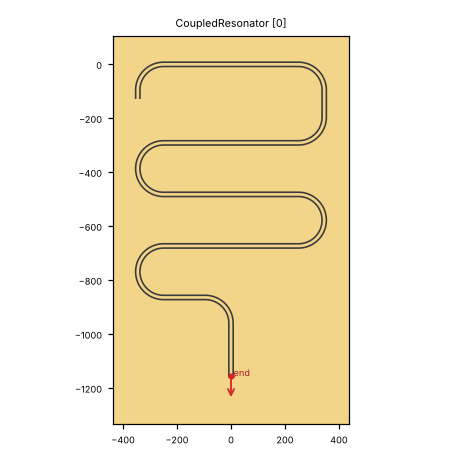

% generated by scripts/make_component_docs.py -- do not edit. Put hand-written notes in docs/components/notes/CoupledResonator.md (included below).

# CoupledResonator

λ/4 meander resonator with a straight coupler section on y = 0 (legacy ``Coupled Resonator``); port ``end``.

**Source:** Quantcore. **Category:** resonator. **Module:** `quantcore_circuits.layouts.others.legacy_resonators`.

See also the [catalog](../CATALOG.md) and the [duplicates decisions](../DUPLICATES.md).

## Pins



Pin image (default parameters). Light = metal, dark = etched gap, colours = junction layers. A red dot and arrow is a pin and its direction (out of the cell); the red bar is the CPW width a + 2 b. Blue dot = a pin without direction. Units: µm.

| pin | x (µm) | y (µm) | direction (°) | a (µm) | b (µm) | purpose |
|---|---|---|---|---|---|---|
| `end` | 0 | -1154.93 | 270 | 10 | 6 | far end of the line / resonator (see the notes); LOM node `res` |

a, b: CPW centre width and gap where the pin declares them (`–` = not declared). Position and direction are in the cell's own frame (`at=(0, 0)`, `rot=0`).

**Notes from the catalog:** 'end' is an open end: with ground=True the gap cap lies beyond the port, so anything joined there galvanically is cut off (ground=False leaves the end for a connection).

## Parameters

| name | default | unit | description |
|---|---|---|---|
| `a` | `10` | μm | Width of center conductor |
| `b` | `6` | μm | Width of gap |
| `r` | `100` | μm | Turn radius |
| `width` | `500` | μm | Meander width (straight run between arcs) |
| `arc_length` | `300` | μm | Arc length of a meander turn (radius = arc_length / π) |
| `neck_length` | `400` | μm | Neck length |
| `cgap` | `6` | μm | Coupling gap (ground strip around the shorted end) |
| `clength` | `500` | μm | Coupling length |
| `ground` | `true` | – | Open far end with a gap cap (False: end left for a connection) |
| `cpw_len` | `4000` | μm | Length of the resonator |
| `arc_points` | `256` | – | Points per arc (legacy n) |
| `flip` | `true` | – | Flip the meander direction |
| `tail` | `true` | – | Tail |
| `tail_len` | `0` | μm | Extra tail length |
| `tail_end` | `false` | – | Tail on the coupler end |

Electrically relevant parameters (sizes, gaps, junction, ports) come first, the rest follows.

## LOM model

The cell contributes to the lumped model:

- no lumped branches

| line | node | length (µm) | a (µm) | b (µm) | ends |
|---|---|---|---|---|---|
| `X` | `res` | 3999.993 | 10 | 6 | short / open |

Nodes: `res`.

## Simulation export notes

- C8: GDS polygon with > 4095 points (XY record > 0x8000 bytes) (status: partly fixed; fix in sim_tools/builder.py (FaceMetal.max_points, DesignSimulation.simplified_region, split_large_polygons); sim_tools/geometry_check.py)

Details: [SIM_EXPORT_AUDIT](../SIM_EXPORT_AUDIT.md).

## How to use

In Python:

```python
from quantcore_circuits.designer import Designer

d = Designer("demo", box=(0, 0, 7500, 7500))
d.add("U1", "CoupledResonator", at=(3750, 3750), a=10)   # parameters: see the table above
d.add("PAD", "BondPad", at=(1125, 3750), rot=270)   # a launcher to connect to
d.route("L1", "PAD.a", "U1.end")                # a CPW from the pad to the pin
```

Pin names go into `d.route(...)` as `INSTANCE.pin`, and into `snap=` / `to=` when placing. From the shell: `qcc components CoupledResonator` lists the pins; add `--schema` for the parameters.

In KLayout: Quantcore panel ▸ Components ▸ double-click the cell, then click on the layout to place it. Rotate and mirror before the click; use Connect on two pins to route.

GUI status (`kplugin/COMPONENTS_STATUS.md`): places ok, edit ok, connect ok, build ok. end port is a capacitive tail, not galvanic: use the hanger for a readout (see README).
