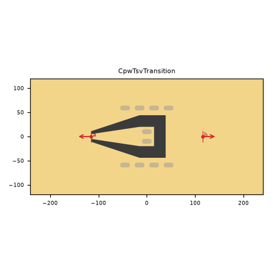

% generated by scripts/make_component_docs.py -- do not edit. Put hand-written notes in docs/components/notes/CpwTsvTransition.md (included below).

# CpwTsvTransition

CPW transition through one chip: a pad on each face, joined by signal TSVs, with ground TSVs around them.

**Source:** Quantcore. **Category:** flip_chip. **Module:** `quantcore_circuits.layouts.others.flip_chip`.

See also the [catalog](../CATALOG.md).

## Pins



Pin image (default parameters). Light = metal, dark = etched gap, colours = junction layers. A red dot and arrow is a pin and its direction (out of the cell); the red bar is the CPW width a + 2 b. Blue dot = a pin without direction. Units: µm.

| pin | x (µm) | y (µm) | direction (°) | a (µm) | b (µm) | purpose |
|---|---|---|---|---|---|---|
| `a` | -115 | 0 | 180 | 10 | 6 | CPW end; LOM node `line` |
| `b` | 115 | 0 | 0 | 10 | 6 | CPW end; LOM node `line` |

a, b: CPW centre width and gap where the pin declares them (`–` = not declared). Position and direction are in the cell's own frame (`at=(0, 0)`, `rot=0`).

**Notes from the catalog:** port 'a' is on face_ids[0] (the front pad), 'b' on the other side of the same chip (1t1 → 1b1, 2b1 → 2t1); a route to either is drawn on that port's face. Set face_ids=['2b1'] for a TSV through the top chip. LOM: one conductor (tapers + pad length; the via height is not modelled).

## Parameters

| name | default | unit | description |
|---|---|---|---|
| `a` | `10` | μm | Width of center conductor |
| `b` | `6` | μm | Width of gap |
| `r` | `100` | μm | Turn radius |
| `taper_length` | `100` | μm | Front taper length (0: port at the pad) |
| `taper_length_back` | `100` | μm | Back taper length (0: port at the pad) |
| `pad_width` | `40` | μm | Pad centre-conductor width |
| `pad_gap` | `24` | μm | Pad gap to ground (also closes the pad) |
| `pad_length` | `30` | μm | Pad length along the line |
| `n_ground_vias_per_side` | `4` | – | Ground TSVs on each side of the pad |
| `ground_via_pitch` | `30` | μm | Ground TSV pitch along the line |
| `ground_via_distance` | `15` | μm | Ground TSV centres from the pad gap's outer edge |
| `tsv_elliptical_width` | `20` | μm | TSV elliptical width |
| `n_signal_vias` | `2` | – | Signal TSVs in the pad |
| `signal_via_pitch` | `20` | μm | Signal TSV pitch across the line |
| `tsv_type` | `"Tsv Ellipse"` | – | TSV type |
| `tsv_diameter` | `10` | μm | TSV diameter |
| `tsv_margin` | `30` | μm | TSV margin |
| `a2` | `-1` | μm | Width of center conductor on the other end |
| `b2` | `-1` | μm | Width of gap on the other end |

Electrically relevant parameters (sizes, gaps, junction, ports) come first, the rest follows.

## LOM model

The cell contributes to the lumped model:

- no lumped branches

| line | node | length (µm) | a (µm) | b (µm) | ends |
|---|---|---|---|---|---|
| `X` | `line` | 230 | 10 | 6 | short / short |

Nodes: `line`.

## How to use

In Python:

```python
from quantcore_circuits.designer import Designer

d = Designer("demo", box=(0, 0, 7500, 7500))
d.add("U1", "CpwTsvTransition", at=(3750, 3750), a=10)   # parameters: see the table above
d.add("PAD", "BondPad", at=(1125, 3750), rot=270)   # a launcher to connect to
d.route("L1", "PAD.a", "U1.a")                # a CPW from the pad to the pin
```

Pin names go into `d.route(...)` as `INSTANCE.pin`, and into `snap=` / `to=` when placing. From the shell: `qcc components CpwTsvTransition` lists the pins; add `--schema` for the parameters.

In KLayout: Quantcore panel ▸ Components ▸ double-click the cell, then click on the layout to place it. Rotate and mirror before the click; use Connect on two pins to route.

GUI status: not listed in `kplugin/COMPONENTS_STATUS.md`.
