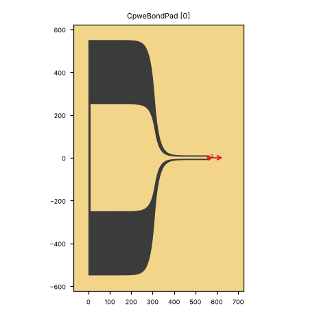

% generated by scripts/make_component_docs.py -- do not edit. Put hand-written notes in docs/components/notes/CpweBondPad.md (included below).

# CpweBondPad

Bond pad: open end ``tl``, wide line ``bl`` (``pad_width``/``pad_gap``), taper ``btl`` to the CPW ``a``/``b``

**Source:** Quantcore. **Category:** launcher. **Module:** `quantcore_circuits.layouts.others.cpwe`.

:::{note}
Alias of [`BondPad`](BondPad.md): the same circuit, drawn differently. taper_type 0 = the Launcher polygon rotated 180° and shifted (XOR 0); taper_type 1–3 differ; port a
:::

See also the [catalog](../CATALOG.md) and the [duplicates decisions](../DUPLICATES.md).

## Pins



Pin image (default parameters). Light = metal, dark = etched gap, colours = junction layers. A red dot and arrow is a pin and its direction (out of the cell); the red bar is the CPW width a + 2 b. Blue dot = a pin without direction. Units: µm.

| pin | x (µm) | y (µm) | direction (°) | a (µm) | b (µm) | purpose |
|---|---|---|---|---|---|---|
| `a` | 560 | 0 | 0 | 10 | 6 | CPW end; LOM node `pad` |

a, b: CPW centre width and gap where the pin declares them (`–` = not declared). Position and direction are in the cell's own frame (`at=(0, 0)`, `rot=0`).

## Parameters

| name | default | unit | description |
|---|---|---|---|
| `a` | `10` | μm | Width of center conductor |
| `b` | `6` | μm | Width of gap |
| `r` | `100` | μm | Turn radius |
| `pad_width` | `500` | μm | Pad centre width (legacy wb) |
| `pad_gap` | `300` | μm | Pad gap (legacy sb) |
| `end_length` | `10` | μm | Open-end length (legacy tl) |
| `pad_length` | `50` | μm | Pad length before the taper (legacy bl) |
| `taper_length` | `500` | μm | Taper length (legacy btl) |
| `taper_type` | `3` | – | Taper profile: 0 linear, 1–3 exponential (legacy t_type) |
| `weight` | `25` | – | Exponent weight of the taper |
| `mirror` | `false` | – | Mirrored: taper first, pad at the +x end |
| `markers` | `false` | – | Alignment crosses beside the taper end |

Electrically relevant parameters (sizes, gaps, junction, ports) come first, the rest follows.

## LOM model

The cell contributes to the lumped model:

| branch | type | nodes | value (estimate at defaults) |
|---|---|---|---|
| `Port_X` | R | pad – gnd | R_ohm=50 |

Nodes: `pad`.

## How to use

In Python:

```python
from quantcore_circuits.designer import Designer

d = Designer("demo", box=(0, 0, 7500, 7500))
d.add("U1", "CpweBondPad", at=(3750, 3750), a=10)   # parameters: see the table above
d.add("PAD", "BondPad", at=(1125, 3750), rot=270)   # a launcher to connect to
d.route("L1", "PAD.a", "U1.a")                # a CPW from the pad to the pin
```

Pin names go into `d.route(...)` as `INSTANCE.pin`, and into `snap=` / `to=` when placing. From the shell: `qcc components CpweBondPad` lists the pins; add `--schema` for the parameters.

In KLayout: Quantcore panel ▸ Components ▸ double-click the cell, then click on the layout to place it. Rotate and mirror before the click; use Connect on two pins to route.

GUI status (`kplugin/COMPONENTS_STATUS.md`): places ok, edit ok, connect ok, build ok.
