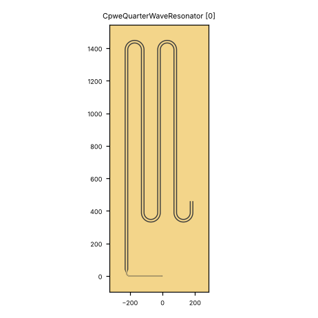

% generated by scripts/make_component_docs.py -- do not edit. Put hand-written notes in docs/components/notes/CpweQuarterWaveResonator.md (included below).

# CpweQuarterWaveResonator

λ/4 resonator capacitively coupled through an open-ended arm parallel to the feedline (legacy

**Source:** Quantcore. **Category:** resonator. **Module:** `quantcore_circuits.layouts.others.cpwe`.

See also the [catalog](../CATALOG.md) and the [duplicates decisions](../DUPLICATES.md).

## Pins



Pin image (default parameters). Light = metal, dark = etched gap, colours = junction layers. A red dot and arrow is a pin and its direction (out of the cell); the red bar is the CPW width a + 2 b. Blue dot = a pin without direction. Units: µm.

No pins: this cell has no ports. Place it with `at=` / `rot=`.

## Parameters

| name | default | unit | description |
|---|---|---|---|
| `a` | `10` | μm | Width of center conductor |
| `b` | `6` | μm | Width of gap |
| `r` | `100` | μm | Turn radius |
| `cap_width` | `3` | μm | Coupler centre width (legacy wcap) |
| `cap_gap` | `1.6` | μm | Coupler gap (legacy scap) |
| `cap_length` | `200` | μm | Coupler length (legacy cap_len) |
| `cap_radius` | `20` | μm | Coupler bend radius (legacy cap_rad) |
| `taper_length` | `20` | μm | Taper to the resonator CPW (legacy t_len) |
| `meander_radius` | `50` | μm | Meander radius (legacy m_radius) |
| `meander_length` | `1000` | μm | Meander straight length (legacy m_length) |
| `meanders` | `2` | – | Meander periods (legacy m_n) |
| `excess_1` | `300` | μm | Extra length before the meander (legacy ex1) |
| `excess_2` | `70.26554` | μm | Extra length after the meander (legacy ex2) |
| `flip` | `true` | – | Mirror (legacy flip) |

Electrically relevant parameters (sizes, gaps, junction, ports) come first, the rest follows.

## LOM model

The cell contributes to the lumped model:

- no lumped branches

| line | node | length (µm) | a (µm) | b (µm) | ends |
|---|---|---|---|---|---|
| `X` | `res` | 5300 | 10 | 6 | open / short |

Nodes: `res`.

- X: λ/4 of 5300 µm (drawn); coupler arm CPW differs from the line CPW

## Simulation export notes

- C8: GDS polygon with > 4095 points (XY record > 0x8000 bytes) (status: partly fixed; fix in sim_tools/builder.py (FaceMetal.max_points, DesignSimulation.simplified_region, split_large_polygons); sim_tools/geometry_check.py)

Details: [SIM_EXPORT_AUDIT](../SIM_EXPORT_AUDIT.md).

## How to use

In Python:

```python
from quantcore_circuits.designer import Designer

d = Designer("demo", box=(0, 0, 7500, 7500))
d.add("U1", "CpweQuarterWaveResonator", at=(3750, 3750), a=10)   # parameters: see the table above
# no directed pin: place it with at= / rot=, or snap it with snap= / to=
```

Pin names go into `d.route(...)` as `INSTANCE.pin`, and into `snap=` / `to=` when placing. From the shell: `qcc components CpweQuarterWaveResonator` lists the pins; add `--schema` for the parameters.

In KLayout: Quantcore panel ▸ Components ▸ double-click the cell, then click on the layout to place it. Rotate and mirror before the click; use Connect on two pins to route.

GUI status (`kplugin/COMPONENTS_STATUS.md`): places ok, edit ok, connect n/a (no directed port), build ok. no ports (a coupler arm only); lambda/4 for CPWE chips, place it next to the line by hand.
