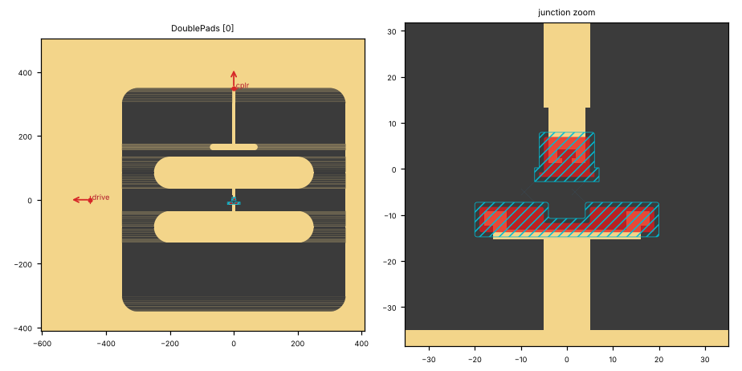

% generated by scripts/make_component_docs.py -- do not edit. Put hand-written notes in docs/components/notes/DoublePads.md (included below).

# DoublePads

A two-island qubit, consisting of two rounded rectangles shunted by a junction, with one capacitive coupler.

**Source:** KQC (KQCircuits). **Category:** qubit. **Module:** `kqcircuits.qubits.double_pads`.

See also the [catalog](../CATALOG.md) and the [duplicates decisions](../DUPLICATES.md).

## Pins



Pin image (default parameters). Light = metal, dark = etched gap, colours = junction layers. A red dot and arrow is a pin and its direction (out of the cell); the red bar is the CPW width a + 2 b. Blue dot = a pin without direction. Units: µm.

| pin | x (µm) | y (µm) | direction (°) | a (µm) | b (µm) | purpose |
|---|---|---|---|---|---|---|
| `cplr` | 0 | 350 | 90 | 10 | 6 | coupler port (readout / bus); LOM node `cplr` |
| `drive` | -450 | 0 | 180 | 10 | 6 | drive / charge line end; control line (drive) in the LOM |

a, b: CPW centre width and gap where the pin declares them (`–` = not declared). Position and direction are in the cell's own frame (`at=(0, 0)`, `rot=0`).

## Parameters

| name | default | unit | description |
|---|---|---|---|
| `a` | `10` | μm | Width of center conductor |
| `b` | `6` | μm | Width of gap |
| `r` | `100` | μm | Turn radius |
| `mirror_squid` | `false` | – | Mirror SQUID by its Y axis |
| `junction_type` | `"Manhattan"` | – | Junction Type |
| `junction_width` | `0.02` | μm | Junction width for code generated element |
| `ground_gap` | `[700, 700]` | – | Width, height of the ground gap (µm, µm) |
| `ground_gap_r` | `50` | μm | Ground gap rounding radius |
| `coupler_extent` | `[150, 20]` | – | Width, height of the coupler (µm, µm) |
| `coupler_r` | `10` | μm | Coupler rounding radius |
| `coupler_a` | `10` | μm | Width of the coupler waveguide center conductor |
| `coupler_offset` | `20` | μm | Distance from first qubit island to coupler |
| `squid_offset` | `0` | μm | Offset between SQUID center and qubit center |
| `island1_extent` | `[500, 100]` | – | Width, height of the first qubit island (µm, µm) |
| `island1_r` | `50` | μm | First qubit island rounding radius |
| `island2_extent` | `[500, 100]` | – | Width, height of the second qubit island (µm, µm) |
| `island2_r` | `50` | μm | Second qubit island rounding radius |
| `island1_taper_width` | `10` | µm | First qubit island tapering width on the island side |
| `island1_taper_junction_width` | `10` | µm | First qubit island tapering width on the junction side |
| `island2_taper_width` | `10` | µm | Second qubit island tapering width on the island side |
| `island2_taper_junction_width` | `10` | µm | Second qubit island tapering width on the junction side |
| `island_island_gap` | `70` | µm | Island to island gap distance |
| `with_squid` | `true` | – | Boolean whether to include the squid |
| `finger_overshoot` | `1.0` | μm | Length of fingers after the junction. |
| `include_base_metal_gap` | `true` | – | Include base metal gap layer |
| `separate_junctions` | `true` | – | Junctions to separate layer |
| `finger_overlap` | `0.2` | μm | Length of fingers inside the pads |
| `width` | `22.0` | μm | Width of the junction element. |
| `pad_height` | `6.0` | μm | Height of the junction pad. |
| `pad_width` | `12.0` | μm | Width of the junction pad. |
| `pad_to_pad_separation` | `6.0` | μm | Pad separation. |
| `pad_rounding_radius` | `0.5` | μm | Rounding radius of the junction pad. |
| `single_junction` | `false` | – | Disable the second junction |
| `loop_area` | `100` | μm^2 | Loop area |
| `fluxline_type` | `"Fluxline Standard"` | – | Fluxline Type |
| `drive_position` | `[-450, 0]` | – | Coordinate for the drive port (µm, µm) |
| `include_base_metal_addition` | `true` | – | Include base metal addition layer. |
| `shadow_margin` | `1.0` | μm | Shadow layer margin near the the pads |
| `offset_compensation` | `0` | μm | Junction lead offset from junction width |
| `mirror_offset` | `false` | – | Move the junction lead offset to the other lead |
| `height` | `22.0` | μm | Height of the junction element. |
| `x_offset` | `0` | μm | Horizontal junction offset. |
| `compact_geometry` | `false` | – | Compact geometry for metal addition. |

Electrically relevant parameters (sizes, gaps, junction, ports) come first, the rest follows.

## LOM model

The cell contributes to the lumped model:

| branch | type | nodes | value (estimate at defaults) |
|---|---|---|---|
| `C_X_1` | C | island1 – gnd | estimate=53.7, unit=fF, estimate_source=analytic: coupled strips in a ground slot (Simons ch. 7) + short-edge CPW, estimate_kind=analytic, uncertainty=±25% |
| `C_X_2` | C | island2 – gnd | estimate=53.7, unit=fF, estimate_source=analytic: coupled strips in a ground slot (Simons ch. 7) + short-edge CPW, estimate_kind=analytic, uncertainty=±25% |
| `C_X_12` | C | island1 – island2 | estimate=27.6, unit=fF, estimate_source=analytic: coupled strips in a ground slot (Simons ch. 7) + short-edge CPW, estimate_kind=analytic, uncertainty=±25% |
| `J_X` | SQUID | island1 – island2 | Lj_nH=–, Cj_fF=0, asym=0, flux_phi0=0 |
| `Cg_X_cplr` | C | island1 – cplr | estimate=13.8, unit=fF, estimate_source=analytic: coupler 150×20 µm facing island1 across 20 µm (CPS), estimate_kind=analytic, uncertainty=±25% |
| `Cc_X_cplr` | C | cplr – gnd | estimate=7.6, unit=fF, estimate_source=rough: coupler pad in the qubit ground gap, estimate_kind=rough, uncertainty=±50% |

Nodes: `island1`, `island2`, `cplr`.

- X: no junction.Lj_nH in the design; the qubit mode needs one to simulate
- X: floating transmon; island2 ↔ coupler capacitance neglected (screened by island1)

## How to use

In Python:

```python
from quantcore_circuits.designer import Designer

d = Designer("demo", box=(0, 0, 7500, 7500))
d.add("U1", "DoublePads", at=(3750, 3750), a=10)   # parameters: see the table above
d.add("PAD", "BondPad", at=(1125, 3750), rot=270)   # a launcher to connect to
d.route("L1", "PAD.a", "U1.cplr")                # a CPW from the pad to the pin
```

Pin names go into `d.route(...)` as `INSTANCE.pin`, and into `snap=` / `to=` when placing. From the shell: `qcc components DoublePads` lists the pins; add `--schema` for the parameters.

In KLayout: Quantcore panel ▸ Components ▸ double-click the cell, then click on the layout to place it. Rotate and mirror before the click; use Connect on two pins to route.
