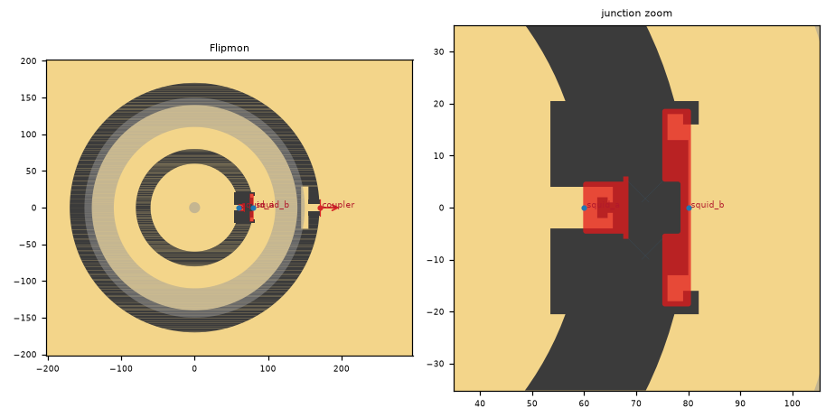

% generated by scripts/make_component_docs.py -- do not edit. Put hand-written notes in docs/components/notes/Flipmon.md (included below).

# Flipmon

Circular flip-chip transmon (QPDK ``flipmon_with_bbox``), optionally with its plate readout coupler.

**Source:** Quantcore. **Category:** qubit. **Module:** `quantcore_circuits.layouts.qubits.qpdk_cells`.

See also the [catalog](../CATALOG.md).

## Pins



Pin image (default parameters). Light = metal, dark = etched gap, colours = junction layers. A red dot and arrow is a pin and its direction (out of the cell); the red bar is the CPW width a + 2 b. Blue dot = a pin without direction. Units: µm.

| pin | x (µm) | y (µm) | direction (°) | a (µm) | b (µm) | purpose |
|---|---|---|---|---|---|---|
| `coupler` | 170 | 0 | 0 | 10 | 6 | coupler port (readout / bus); LOM node `cplr` |
| `squid_a` | 60 | 0 | none | 10 | 6 | junction pins (the LOM's L_J); LOM node `island2` |
| `squid_b` | 80 | 0 | none | 10 | 6 | junction pins (the LOM's L_J); LOM node `island1` |

Pins with direction `none`: `squid_a`, `squid_b`. They mark a point (a junction lead, a pad centre), not a CPW end. The KLayout ghost draws them as boxes. A route can start there only where the notes say so; it cannot be snapped to.

a, b: CPW centre width and gap where the pin declares them (`–` = not declared). Position and direction are in the cell's own frame (`at=(0, 0)`, `rot=0`).

**Notes from the catalog:** QPDK flipmon_with_bbox (MIT). Face 2b1 (top-chip disc, its etch, the bump) is on KQC face-2b1 layers, which the PDK maps to 800/0+ (flip-chip). Port 'coupler' is on the M1 etch edge, 13 µm beyond QPDK's plate port o1 at defaults.

## Parameters

| name | default | unit | description |
|---|---|---|---|
| `a` | `10` | μm | Width of center conductor |
| `b` | `6` | μm | Width of gap |
| `r` | `100` | μm | Turn radius |
| `mirror_squid` | `false` | – | Mirror SQUID by its Y axis |
| `junction_type` | `"Manhattan"` | – | Junction Type |
| `junction_width` | `0.02` | μm | Junction width for code generated element |
| `inner_circle_radius` | `60` | μm | Inner disc radius (M1) |
| `outer_ring_radius` | `110` | μm | Outer ring centre radius (M1) |
| `outer_ring_width` | `60` | μm | Outer ring width (M1) |
| `top_circle_radius` | `110` | μm | Top disc radius (M2, face 1) |
| `m1_etch_extension_gap` | `30` | μm | M1 etch radius beyond the ring |
| `m2_etch_extension_gap` | `40` | μm | M2 etch radius beyond the top disc |
| `junction_position_rotation` | `0` | ° | Junction angle around the centre |
| `junction_params` | `"{}"` | – | Junction cell parameters (JSON dict) |
| `with_coupler` | `true` | – | Draw the plate readout coupler and its port |
| `coupler_width` | `10` | μm | Coupler plate radial width |
| `coupler_length` | `58` | μm | Coupler plate length (tangential) |
| `coupler_offset` | `10` | μm | Coupler plate centre beyond the ring's outer edge |
| `coupler_etch_margin` | `2` | μm | Etch margin around the plate |
| `loop_area` | `100` | μm^2 | Loop area |
| `fluxline_type` | `"Fluxline Standard"` | – | Fluxline Type |
| `bump_diameter` | `15` | μm | Indium bump diameter |

Electrically relevant parameters (sizes, gaps, junction, ports) come first, the rest follows.

## LOM model

The cell contributes to the lumped model:

| branch | type | nodes | value (estimate at defaults) |
|---|---|---|---|
| `C_X_1` | C | island1 – gnd | estimate=83.3, unit=fF, estimate_source=analytic: ring 80–140 µm, outer edge as half CPW (30 µm gap), estimate_kind=analytic, uncertainty=±25% |
| `C_X_12` | C | island1 – island2 | estimate=46, unit=fF, estimate_source=rough: disc–ring facing edges as coplanar strips along the mean circumference, estimate_kind=rough, uncertainty=±50% |
| `C_X_2` | C | island2 – gnd | estimate=5.1, unit=fF, estimate_source=rough: M1 disc to ground screened by the ring, estimate_kind=rough, uncertainty=±50% |
| `C_X_12_flip` | C | island1 – island2 | estimate=20, unit=fF, estimate_source=rough: M2 disc r 110 over the M1 ring: parallel plate, 17907 µm² across an assumed 8 µm vacuum gap, estimate_kind=rough, uncertainty=±50% |
| `C_X_2_top` | C | island2 – gnd | estimate=71, unit=fF, estimate_source=rough: M2 disc r 110 in its 40 µm top-face gap (single-face formula), estimate_kind=rough, uncertainty=±50% |
| `J_X` | SQUID | island1 – island2 | Lj_nH=6.734, Cj_fF=15, asym=0, flux_phi0=0 |
| `Cg_X_cplr` | C | island1 – cplr | estimate=6.43, unit=fF, estimate_source=analytic: plate 58×10 µm facing the ring across 5 µm (CPS), estimate_kind=analytic, uncertainty=±25% |
| `Cc_X_cplr` | C | cplr – gnd | estimate=7.4, unit=fF, estimate_source=rough: plate in the M1 etch + its lead, estimate_kind=rough, uncertainty=±50% |

Nodes: `island1`, `island2`, `cplr`.

- X: M2 top disc (face 2b1) counted in island2 across an assumed 8 µm flip-chip gap (rough; PDK v2 does not fabricate face 2b1); coupler ↔ disc C neglected (screened by the ring)

## Simulation export notes

- C1: Sim junction pads overlap / end on a curved island in a narrow gap (status: fixed; fix in layouts/junctions/sim_gap.py; layouts/qubits/qpdk_cells.py; layouts/qubits/sqdmetal_cells.py)
- C2: indium bump in a one-face simulation is a PEC pillar to the top of the box (status: fixed; fix in sim_tools/builder.py)

## How to use

In Python:

```python
from quantcore_circuits.designer import Designer

d = Designer("demo", box=(0, 0, 7500, 7500))
d.add("U1", "Flipmon", at=(3750, 3750), a=10)   # parameters: see the table above
d.add("PAD", "BondPad", at=(1125, 3750), rot=270)   # a launcher to connect to
d.route("L1", "PAD.a", "U1.coupler")                # a CPW from the pad to the pin
```

Pin names go into `d.route(...)` as `INSTANCE.pin`, and into `snap=` / `to=` when placing. From the shell: `qcc components Flipmon` lists the pins; add `--schema` for the parameters.

In KLayout: Quantcore panel ▸ Components ▸ double-click the cell, then click on the layout to place it. Rotate and mirror before the click; use Connect on two pins to route.

GUI status (`kplugin/COMPONENTS_STATUS.md`): places ok, edit ok, connect ok, build ok. ports without direction: squid_a, squid_b (ghost draws boxes).
