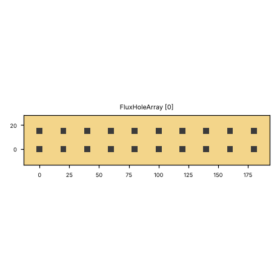

% generated by scripts/make_component_docs.py -- do not edit. Put hand-written notes in docs/components/notes/FluxHoleArray.md (included below).

# FluxHoleArray

Array of square flux-trapping holes in the ground plane (legacy chips' ``flux_holes``).

**Source:** Quantcore. **Category:** other. **Module:** `quantcore_circuits.layouts.others.cpw_segment`.

:::{note}
Alias of [`FluxHoles`](FluxHoles.md): the same circuit, drawn differently. the array's hole centres as FluxHoles' list (XOR 0); no circuit elements
:::

See also the [catalog](../CATALOG.md) and the [duplicates decisions](../DUPLICATES.md).

## Pins



Pin image (default parameters). Light = metal, dark = etched gap, colours = junction layers. A red dot and arrow is a pin and its direction (out of the cell); the red bar is the CPW width a + 2 b. Blue dot = a pin without direction. Units: µm.

No pins: this cell has no ports. Place it with `at=` / `rot=`.

## Parameters

| name | default | unit | description |
|---|---|---|---|
| `a` | `10` | μm | Width of center conductor |
| `b` | `6` | μm | Width of gap |
| `r` | `100` | μm | Turn radius |
| `hole_size` | `5` | μm | Hole size |
| `pitch_x` | `20` | μm | Pitch in x |
| `pitch_y` | `15` | μm | Pitch in y |
| `nx` | `10` | – | Holes in x |
| `ny` | `2` | – | Holes in y |

Electrically relevant parameters (sizes, gaps, junction, ports) come first, the rest follows.

## LOM model

The cell contributes to the lumped model:

- no lumped branches

## How to use

In Python:

```python
from quantcore_circuits.designer import Designer

d = Designer("demo", box=(0, 0, 7500, 7500))
d.add("U1", "FluxHoleArray", at=(3750, 3750), a=10)   # parameters: see the table above
# no directed pin: place it with at= / rot=, or snap it with snap= / to=
```

Pin names go into `d.route(...)` as `INSTANCE.pin`, and into `snap=` / `to=` when placing. From the shell: `qcc components FluxHoleArray` lists the pins; add `--schema` for the parameters.

In KLayout: Quantcore panel ▸ Components ▸ double-click the cell, then click on the layout to place it. Rotate and mirror before the click; use Connect on two pins to route.

GUI status (`kplugin/COMPONENTS_STATUS.md`): places ok, edit ok, connect n/a (no directed port), build ok. no ports.
