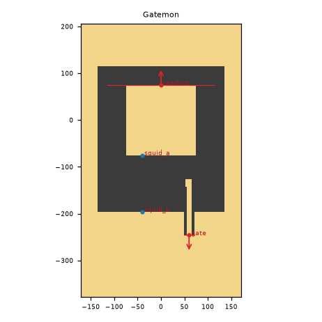

% generated by scripts/make_component_docs.py -- do not edit. Put hand-written notes in docs/components/notes/Gatemon.md (included below).

# Gatemon

Carbon-nanotube gatemon island in an etched pocket with a gate feed (QPDK ``gatemon``), M1 only.

**Source:** Quantcore. **Category:** qubit. **Module:** `quantcore_circuits.layouts.qubits.qpdk_cells`.

See also the [catalog](../CATALOG.md).

## Pins



Pin image (default parameters). Light = metal, dark = etched gap, colours = junction layers. A red dot and arrow is a pin and its direction (out of the cell); the red bar is the CPW width a + 2 b. Blue dot = a pin without direction. Units: µm.

| pin | x (µm) | y (µm) | direction (°) | a (µm) | b (µm) | purpose |
|---|---|---|---|---|---|---|
| `gate` | 60 | -246 | 270 | 10 | 6 | gate line end; LOM node `gate` |
| `readout` | 0 | 75 | 90 | 150 | 40 | readout coupling; LOM node `island` |
| `squid_a` | -40 | -75 | none | 10 | 6 | junction pins (the LOM's L_J); LOM node `island` |
| `squid_b` | -40 | -196 | none | 10 | 6 | junction pins (the LOM's L_J); grounded in the LOM |

Pins with direction `none`: `squid_a`, `squid_b`. They mark a point (a junction lead, a pad centre), not a CPW end. The KLayout ghost draws them as boxes. A route can start there only where the notes say so; it cannot be snapped to.

a, b: CPW centre width and gap where the pin declares them (`–` = not declared). Position and direction are in the cell's own frame (`at=(0, 0)`, `rot=0`).

**Notes from the catalog:** QPDK gatemon (MIT): M1 plus the CNT contacts, nanotube, hBN, Al patches and top gate on the proposed layers 600-604/0 (qpdk_cells.GATEMON_LAYERS; no fab numbers yet, draw_process_layers=False for M1 only). Port 'readout' is the island edge (a = island width, b = pocket_gap_top), not a CPW end: snap it to GatemonCoupler.qubit.

## Parameters

| name | default | unit | description |
|---|---|---|---|
| `a` | `10` | μm | Width of center conductor |
| `b` | `6` | μm | Width of gap |
| `r` | `100` | μm | Turn radius |
| `island_size` | `[150, 150]` | [μm, μm] | Island (width, height) |
| `pocket_gap` | `60` | μm | Island to pocket side walls |
| `pocket_gap_top` | `40` | μm | Island to the readout side of the pocket |
| `electrode_size` | `[60, 60]` | [μm, μm] | Nb/Au landing pad (width, height) |
| `electrode_spacing` | `100` | μm | Gap between the landing pads |
| `lead_width` | `2` | μm | Contact stem width |
| `junction_length` | `1` | μm | Gap between the contact tips |
| `junction_width` | `0.002` | μm | Nanotube placement width |
| `junction_offset` | `20` | μm | Stems to weak link (x) |
| `hbn_size` | `[80, 80]` | [μm, μm] | hBN footprint (width, height) |
| `size_patch` | `[60, 50]` | [μm, μm] | Al reconnection patch (width, height) |
| `gate_tip_width` | `16` | μm | Top-gate tip width |
| `gate_tip_gap` | `5` | μm | hBN to M1 gate landing clearance |
| `gate_length` | `50` | μm | M1 gate CPW beyond the pocket |
| `nanotube_contact_overlap` | `0.5` | μm | Tube overlap onto each contact |
| `electrode_offset` | `-40` | μm | Contact stems x relative to the island |
| `gate_offset` | `100` | μm | Stems to the M1 gate feed (x) |
| `draw_process_layers` | `true` | – | Draw contacts, nanotube, hBN, patches and top gate (proposed fab 600–604/0) |

Electrically relevant parameters (sizes, gaps, junction, ports) come first, the rest follows.

## LOM model

The cell contributes to the lumped model:

| branch | type | nodes | value (estimate at defaults) |
|---|---|---|---|
| `C_X` | C | island – gnd | estimate=51.1, unit=fF, estimate_source=analytic: 150×150 µm island in its pocket (60 µm sides, 40 µm readout side), estimate_kind=analytic, uncertainty=±25% |
| `J_X` | JJ | island – gnd | Lj_nH=–, Cj_fF=0 |
| `Cgate_X` | C | island – gate | estimate=0.2, unit=fF, estimate_source=rough: M1 gate tip beside the junction, below the island (rough, ±100 %), estimate_kind=rough, uncertainty=±50% |
| `C_X_gate` | C | gate – gnd | estimate=16, unit=fF, estimate_source=rough: gate feed CPW, estimate_kind=rough, uncertainty=±50% |

Nodes: `island`, `gate`.

- X: no junction.Lj_nH in the design; the qubit mode needs one to simulate
- X: the CNT junction is not drawn; modelled as a JJ with the design's junction values

## How to use

In Python:

```python
from quantcore_circuits.designer import Designer

d = Designer("demo", box=(0, 0, 7500, 7500))
d.add("U1", "Gatemon", at=(3750, 3750), a=10)   # parameters: see the table above
d.add("PAD", "BondPad", at=(1125, 3750), rot=270)   # a launcher to connect to
d.route("L1", "PAD.a", "U1.gate")                # a CPW from the pad to the pin
```

Pin names go into `d.route(...)` as `INSTANCE.pin`, and into `snap=` / `to=` when placing. From the shell: `qcc components Gatemon` lists the pins; add `--schema` for the parameters.

In KLayout: Quantcore panel ▸ Components ▸ double-click the cell, then click on the layout to place it. Rotate and mirror before the click; use Connect on two pins to route.

GUI status (`kplugin/COMPONENTS_STATUS.md`): places ok, edit ok, connect ok, build ok. ports without direction: squid_a, squid_b (ghost draws boxes).
