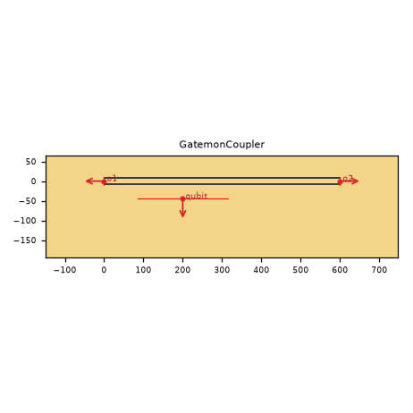

% generated by scripts/make_component_docs.py -- do not edit. Put hand-written notes in docs/components/notes/GatemonCoupler.md (included below).

# GatemonCoupler

Straight CPW ``o1`` → ``o2`` with a capacitive island reference port ``qubit`` (QPDK ``gatemon_coupler``).

**Source:** Quantcore. **Category:** coupler. **Module:** `quantcore_circuits.layouts.others.qpdk_cells`.

See also the [catalog](../CATALOG.md).

## Pins



Pin image (default parameters). Light = metal, dark = etched gap, colours = junction layers. A red dot and arrow is a pin and its direction (out of the cell); the red bar is the CPW width a + 2 b. Blue dot = a pin without direction. Units: µm.

| pin | x (µm) | y (µm) | direction (°) | a (µm) | b (µm) | purpose |
|---|---|---|---|---|---|---|
| `o1` | 0 | 0 | 180 | 10 | 6 | LOM node `line` |
| `o2` | 600 | 0 | 0 | 10 | 6 | LOM node `line` |
| `qubit` | 200 | -45 | 270 | 150 | 40 | LOM node `qubit` |

a, b: CPW centre width and gap where the pin declares them (`–` = not declared). Position and direction are in the cell's own frame (`at=(0, 0)`, `rot=0`).

**Notes from the catalog:** QPDK gatemon_coupler (MIT). Port 'qubit' is a capacitive reference plane (a = island_width, b = pocket_gap_top), not a CPW end: snap a Gatemon 'readout' to it.

## Parameters

| name | default | unit | description |
|---|---|---|---|
| `a` | `10` | μm | Width of center conductor |
| `b` | `6` | μm | Width of gap |
| `r` | `100` | μm | Turn radius |
| `length` | `600` | μm | Line length |
| `coupling_position` | `200` | μm | Island centre measured from o1 |
| `island_width` | `150` | μm | Island width (reference plane) |
| `pocket_gap_top` | `40` | μm | Island edge to conductor edge |
| `coupling_capacitance` | `5.4` | fF | Nominal line-island capacitance (LOM) |
| `qubit_side` | `"bottom"` | – | Island side of the line |

Electrically relevant parameters (sizes, gaps, junction, ports) come first, the rest follows.

## LOM model

The cell contributes to the lumped model:

| branch | type | nodes | value (estimate at defaults) |
|---|---|---|---|
| `Cg_X` | C | line – qubit | estimate=5.4, unit=fF, estimate_source=rough: QPDK nominal coupling_capacitance (cell parameter), estimate_kind=rough, uncertainty=±50% |

| line | node | length (µm) | a (µm) | b (µm) | ends |
|---|---|---|---|---|---|
| `X` | `line` | 600 | 10 | 6 | short / short |

Nodes: `line`, `qubit`.

## How to use

In Python:

```python
from quantcore_circuits.designer import Designer

d = Designer("demo", box=(0, 0, 7500, 7500))
d.add("U1", "GatemonCoupler", at=(3750, 3750), a=10)   # parameters: see the table above
d.add("PAD", "BondPad", at=(1125, 3750), rot=270)   # a launcher to connect to
d.route("L1", "PAD.a", "U1.o1")                # a CPW from the pad to the pin
```

Pin names go into `d.route(...)` as `INSTANCE.pin`, and into `snap=` / `to=` when placing. From the shell: `qcc components GatemonCoupler` lists the pins; add `--schema` for the parameters.

In KLayout: Quantcore panel ▸ Components ▸ double-click the cell, then click on the layout to place it. Rotate and mirror before the click; use Connect on two pins to route.

GUI status (`kplugin/COMPONENTS_STATUS.md`): places ok, edit ok, connect ok, build ok.
