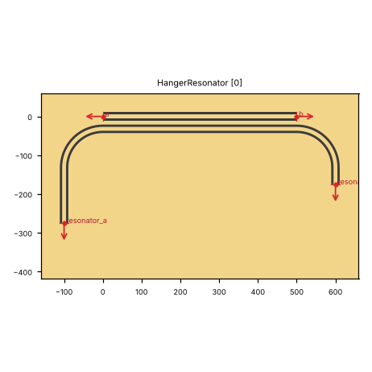

% generated by scripts/make_component_docs.py -- do not edit. Put hand-written notes in docs/components/notes/HangerResonator.md (included below).

# HangerResonator

Hanger Resonator

**Source:** KQC (KQCircuits). **Category:** resonator. **Module:** `kqcircuits.elements.hanger_resonator`.

See also the [catalog](../CATALOG.md).

## Pins



Pin image (default parameters). Light = metal, dark = etched gap, colours = junction layers. A red dot and arrow is a pin and its direction (out of the cell); the red bar is the CPW width a + 2 b. Blue dot = a pin without direction. Units: µm.

| pin | x (µm) | y (µm) | direction (°) | a (µm) | b (µm) | purpose |
|---|---|---|---|---|---|---|
| `a` | 0 | 0 | 180 | 10 | 6 | CPW end; LOM node `pl` |
| `b` | 500 | 0 | 0 | 10 | 6 | CPW end; LOM node `pl` |
| `resonator_a` | -100 | -274.92 | 270 | 10 | 6 | LOM node `res` |
| `resonator_b` | 600 | -174.92 | 270 | 10 | 6 | LOM node `res` |

a, b: CPW centre width and gap where the pin declares them (`–` = not declared). Position and direction are in the cell's own frame (`at=(0, 0)`, `rot=0`).

## Parameters

| name | default | unit | description |
|---|---|---|---|
| `a` | `10` | μm | Width of center conductor |
| `b` | `6` | μm | Width of gap |
| `r` | `100` | μm | Turn radius |
| `coupling_length` | `500` | μm | Length of the resonator center part (coupling) |
| `head_length` | `300` | μm | Length of the resonator left waveguide (head) |
| `resonator_length` | `1000` | μm | Total length of the resonator |
| `ground_width` | `10` | μm | Trace width of middle ground |
| `res_a` | `10` | μm | Trace width of resonator line |
| `res_b` | `6` | μm | Gap width of resonator line |

Electrically relevant parameters (sizes, gaps, junction, ports) come first, the rest follows.

## LOM model

The cell contributes to the lumped model:

- no lumped branches

| line | node | length (µm) | a (µm) | b (µm) | ends |
|---|---|---|---|---|---|
| `X` | `res` | 1000 | 10 | 6 | short / short |

Nodes: `pl`, `res`.

## How to use

In Python:

```python
from quantcore_circuits.designer import Designer

d = Designer("demo", box=(0, 0, 7500, 7500))
d.add("U1", "HangerResonator", at=(3750, 3750), a=10)   # parameters: see the table above
d.add("PAD", "BondPad", at=(1125, 3750), rot=270)   # a launcher to connect to
d.route("L1", "PAD.a", "U1.a")                # a CPW from the pad to the pin
```

Pin names go into `d.route(...)` as `INSTANCE.pin`, and into `snap=` / `to=` when placing. From the shell: `qcc components HangerResonator` lists the pins; add `--schema` for the parameters.

In KLayout: Quantcore panel ▸ Components ▸ double-click the cell, then click on the layout to place it. Rotate and mirror before the click; use Connect on two pins to route.
