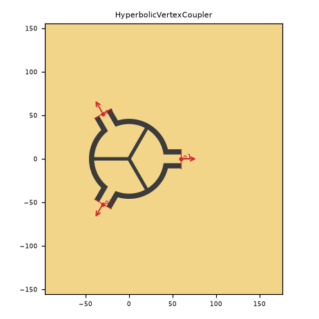

% generated by scripts/make_component_docs.py -- do not edit. Put hand-written notes in docs/components/notes/HyperbolicVertexCoupler.md (included below).

# HyperbolicVertexCoupler

``q``-pin capacitive disk coupler at a hyperbolic-lattice vertex (QPDK ``hyperbolic_vertex_coupler``).

**Source:** Quantcore. **Category:** coupler. **Module:** `quantcore_circuits.layouts.others.qpdk_cells`.

See also the [catalog](../CATALOG.md) and the [duplicates decisions](../DUPLICATES.md).

## Pins



Pin image (default parameters). Light = metal, dark = etched gap, colours = junction layers. A red dot and arrow is a pin and its direction (out of the cell); the red bar is the CPW width a + 2 b. Blue dot = a pin without direction. Units: µm.

| pin | x (µm) | y (µm) | direction (°) | a (µm) | b (µm) | purpose |
|---|---|---|---|---|---|---|
| `o1` | 60 | 0 | 0 | 10 | 6 | LOM node `o1` |
| `o2` | -30 | 51.962 | 120 | 10 | 6 | LOM node `o2` |
| `o3` | -30 | -51.962 | 240 | 10 | 6 | LOM node `o3` |

a, b: CPW centre width and gap where the pin declares them (`–` = not declared). Position and direction are in the cell's own frame (`at=(0, 0)`, `rot=0`).

## Parameters

| name | default | unit | description |
|---|---|---|---|
| `a` | `10` | μm | Width of center conductor |
| `b` | `6` | μm | Width of gap |
| `r` | `100` | μm | Turn radius |
| `pin_radius` | `40` | μm | Disk radius |
| `pin_gap` | `4` | μm | Radial gap between pins |
| `ground_gap` | `6` | μm | Disk to ground clearance |
| `lead_length` | `20` | μm | CPW lead beyond the disk |
| `q` | `3` | – | Number of pins |
| `rotation` | `0` | ° | Direction of pin 0 |

Electrically relevant parameters (sizes, gaps, junction, ports) come first, the rest follows.

## LOM model

The cell contributes to the lumped model:

| branch | type | nodes | value (estimate at defaults) |
|---|---|---|---|
| `C_X_o1` | C | o1 – gnd | estimate=14, unit=fF, estimate_source=rough: pin arc (1/3 of a r 40 disk edge) + lead, estimate_kind=rough, uncertainty=±50% |
| `C_X_o2` | C | o2 – gnd | estimate=14, unit=fF, estimate_source=rough: pin arc (1/3 of a r 40 disk edge) + lead, estimate_kind=rough, uncertainty=±50% |
| `C_X_o3` | C | o3 – gnd | estimate=14, unit=fF, estimate_source=rough: pin arc (1/3 of a r 40 disk edge) + lead, estimate_kind=rough, uncertainty=±50% |
| `C_X_o1_o2` | C | o1 – o2 | estimate=5.7, unit=fF, estimate_source=rough: radial edges (40 µm) across the 4 µm pin gap (CPS), estimate_kind=rough, uncertainty=±50% |
| `C_X_o2_o3` | C | o2 – o3 | estimate=5.7, unit=fF, estimate_source=rough: radial edges (40 µm) across the 4 µm pin gap (CPS), estimate_kind=rough, uncertainty=±50% |
| `C_X_o3_o1` | C | o3 – o1 | estimate=5.7, unit=fF, estimate_source=rough: radial edges (40 µm) across the 4 µm pin gap (CPS), estimate_kind=rough, uncertainty=±50% |

Nodes: `o1`, `o2`, `o3`.

## Simulation export notes

- ctx: scratch-context routing fallback (not an export issue) (status: context)

Details: [SIM_EXPORT_AUDIT](../SIM_EXPORT_AUDIT.md).

## How to use

In Python:

```python
from quantcore_circuits.designer import Designer

d = Designer("demo", box=(0, 0, 7500, 7500))
d.add("U1", "HyperbolicVertexCoupler", at=(3750, 3750), a=10)   # parameters: see the table above
d.add("PAD", "BondPad", at=(1125, 3750), rot=270)   # a launcher to connect to
d.route("L1", "PAD.a", "U1.o1")                # a CPW from the pad to the pin
```

Pin names go into `d.route(...)` as `INSTANCE.pin`, and into `snap=` / `to=` when placing. From the shell: `qcc components HyperbolicVertexCoupler` lists the pins; add `--schema` for the parameters.

In KLayout: Quantcore panel ▸ Components ▸ double-click the cell, then click on the layout to place it. Rotate and mirror before the click; use Connect on two pins to route.

GUI status (`kplugin/COMPONENTS_STATUS.md`): places ok, edit ok, connect ok, build ok.
