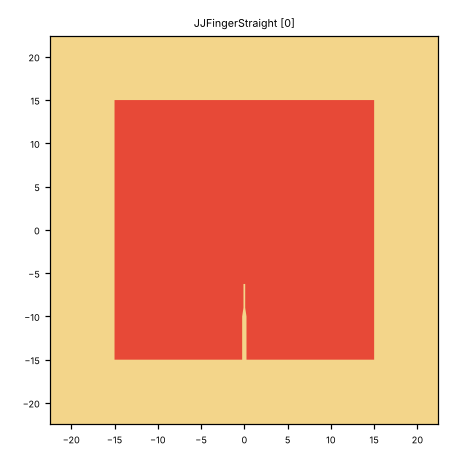

% generated by scripts/make_component_docs.py -- do not edit. Put hand-written notes in docs/components/notes/JJFingerStraight.md (included below).

# JJFingerStraight

Straight junction finger (legacy "JJ_finger Top"), on ``SIS_junction`` (2/0).

**Source:** Quantcore. **Category:** shape. **Module:** `quantcore_circuits.layouts.junctions.jj_fingers`.

See also the [catalog](../CATALOG.md).

## Pins



Pin image (default parameters). Light = metal, dark = etched gap, colours = junction layers. A red dot and arrow is a pin and its direction (out of the cell); the red bar is the CPW width a + 2 b. Blue dot = a pin without direction. Units: µm.

No pins: this cell has no ports. Place it with `at=` / `rot=`.

## Parameters

| name | default | unit | description |
|---|---|---|---|
| `a` | `10` | μm | Width of center conductor |
| `b` | `6` | μm | Width of gap |
| `r` | `100` | μm | Turn radius |
| `finger_width` | `0.2` | μm | Finger width (legacy finger_width) |
| `pad_height` | `3.0` | μm | Pad height (legacy pad_height) |
| `pad_width` | `0.5` | μm | Pad width (legacy pad_width) |
| `finger_length` | `3.0` | μm | Finger length (legacy finger_length) |
| `window_width` | `30.0` | μm | Window width (legacy width) |
| `negative` | `true` | – | Negative: window minus finger (legacy negative / Fab) |
| `invert` | `false` | – | Flip (legacy invert) |
| `x` | `0.0` | μm | Finger offset in x (legacy x) |
| `window_height` | `30.0` | μm | Window height (legacy height) |
| `y` | `-10.0` | μm | Finger offset in y (legacy y) |

Electrically relevant parameters (sizes, gaps, junction, ports) come first, the rest follows.

## LOM model

none (a LOM build gives each pin its own bare node, without elements).

## How to use

In Python:

```python
from quantcore_circuits.designer import Designer

d = Designer("demo", box=(0, 0, 7500, 7500))
d.add("U1", "JJFingerStraight", at=(3750, 3750), a=10)   # parameters: see the table above
# no directed pin: place it with at= / rot=, or snap it with snap= / to=
```

Pin names go into `d.route(...)` as `INSTANCE.pin`, and into `snap=` / `to=` when placing. From the shell: `qcc components JJFingerStraight` lists the pins; add `--schema` for the parameters.

In KLayout: Quantcore panel ▸ Components ▸ double-click the cell, then click on the layout to place it. Rotate and mirror before the click; use Connect on two pins to route.

GUI status (`kplugin/COMPONENTS_STATUS.md`): places ok, edit ok, connect n/a (no directed port), build ok. no ports.
