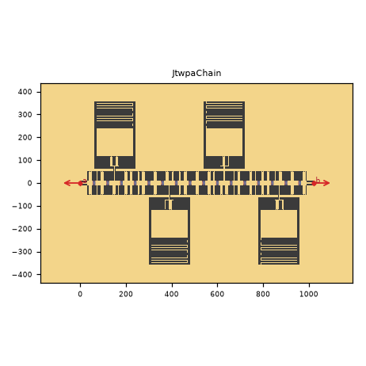

% generated by scripts/make_component_docs.py -- do not edit. Put hand-written notes in docs/components/notes/JtwpaChain.md (included below).

# JtwpaChain

Series chain of ``cells`` trilayer junctions along +x (4WM JTWPA; twpa-sim ``jtwpa4wm``; QPDK resonantly

**Source:** Quantcore. **Category:** waveguide. **Module:** `quantcore_circuits.layouts.others.amplifiers`.

See also the [catalog](../CATALOG.md).

## Pins



Pin image (default parameters). Light = metal, dark = etched gap, colours = junction layers. A red dot and arrow is a pin and its direction (out of the cell); the red bar is the CPW width a + 2 b. Blue dot = a pin without direction. Units: µm.

| pin | x (µm) | y (µm) | direction (°) | a (µm) | b (µm) | purpose |
|---|---|---|---|---|---|---|
| `a` | 0 | 0 | 180 | 10 | 6 | CPW end; LOM node `n0` |
| `b` | 1020 | 0 | 0 | 10 | 6 | CPW end; LOM node `n16` |

a, b: CPW centre width and gap where the pin declares them (`–` = not declared). Position and direction are in the cell's own frame (`at=(0, 0)`, `rot=0`).

## Parameters

| name | default | unit | description |
|---|---|---|---|
| `a` | `10` | μm | Width of center conductor |
| `b` | `6` | μm | Width of gap |
| `r` | `100` | μm | Turn radius |
| `lead_length` | `30` | μm | CPW lead at each end |
| `island_width` | `20` | μm | Island (centre line) width |
| `junction_gap` | `12` | μm | Cut between islands (junction window height) |
| `junction_type` | `"Quantcore Junction"` | – | Junction (trilayer cell) |
| `junction_params` | `"{}"` | – | Trilayer junction cell parameters (JSON dict) |
| `shunt_fingers` | `4` | – | Island fingers per side per full island |
| `shunt_finger_length` | `40` | μm | Shunt finger length |
| `shunt_finger_width` | `2` | μm | Shunt finger width |
| `shunt_gap` | `2` | μm | Gap between shunt fingers / to the walls |
| `coupling_fingers` | `10` | – | Coupling capacitor fingers |
| `coupling_finger_length` | `40` | μm | Coupling finger length |
| `resonator_pad` | `[160, 120]` | – | Resonator pad (width along x, height), µm |
| `resonator_gap` | `10` | μm | Pad / inductor clearance in the resonator pocket |
| `inductor_width` | `2` | μm | Meander inductor strip width |
| `inductor_turns` | `10` | – | Meander inductor turns |
| `inductor_height` | `120` | μm | Meander inductor height (pad to wall) |
| `cells` | `16` | – | Junctions in the chain |
| `cell_pitch` | `60` | μm | Junction pitch |
| `resonator_every` | `4` | – | A resonator on every M-th node (0 = none) |
| `resonator_offset` | `2` | – | First resonator node |
| `wall` | `10` | μm | Ground wall between the trench and a resonator pocket |

Electrically relevant parameters (sizes, gaps, junction, ports) come first, the rest follows.

## LOM model

The cell contributes to the lumped model:

| branch | type | nodes | value (estimate at defaults) |
|---|---|---|---|
| `Cg_X_0` | C | n0 – gnd | estimate=16.8, unit=fF, estimate_source=analytic: shunt fingers (IDC, Igreja–Dias), estimate_kind=analytic, uncertainty=±25% |
| `Cg_X_1` | C | n1 – gnd | estimate=31.9, unit=fF, estimate_source=analytic: shunt fingers (IDC, Igreja–Dias), estimate_kind=analytic, uncertainty=±25% |
| `Cg_X_2` | C | n2 – gnd | estimate=16, unit=fF, estimate_source=analytic: shunt fingers (IDC, Igreja–Dias), estimate_kind=analytic, uncertainty=±25% |
| `Cg_X_3` | C | n3 – gnd | estimate=31.9, unit=fF, estimate_source=analytic: shunt fingers (IDC, Igreja–Dias), estimate_kind=analytic, uncertainty=±25% |
| `Cg_X_4` | C | n4 – gnd | estimate=31.9, unit=fF, estimate_source=analytic: shunt fingers (IDC, Igreja–Dias), estimate_kind=analytic, uncertainty=±25% |
| `Cg_X_5` | C | n5 – gnd | estimate=31.9, unit=fF, estimate_source=analytic: shunt fingers (IDC, Igreja–Dias), estimate_kind=analytic, uncertainty=±25% |
| `Cg_X_6` | C | n6 – gnd | estimate=16, unit=fF, estimate_source=analytic: shunt fingers (IDC, Igreja–Dias), estimate_kind=analytic, uncertainty=±25% |
| `Cg_X_7` | C | n7 – gnd | estimate=31.9, unit=fF, estimate_source=analytic: shunt fingers (IDC, Igreja–Dias), estimate_kind=analytic, uncertainty=±25% |
| `Cg_X_8` | C | n8 – gnd | estimate=31.9, unit=fF, estimate_source=analytic: shunt fingers (IDC, Igreja–Dias), estimate_kind=analytic, uncertainty=±25% |
| `Cg_X_9` | C | n9 – gnd | estimate=31.9, unit=fF, estimate_source=analytic: shunt fingers (IDC, Igreja–Dias), estimate_kind=analytic, uncertainty=±25% |
| `Cg_X_10` | C | n10 – gnd | estimate=16, unit=fF, estimate_source=analytic: shunt fingers (IDC, Igreja–Dias), estimate_kind=analytic, uncertainty=±25% |
| `Cg_X_11` | C | n11 – gnd | estimate=31.9, unit=fF, estimate_source=analytic: shunt fingers (IDC, Igreja–Dias), estimate_kind=analytic, uncertainty=±25% |
| `Cg_X_12` | C | n12 – gnd | estimate=31.9, unit=fF, estimate_source=analytic: shunt fingers (IDC, Igreja–Dias), estimate_kind=analytic, uncertainty=±25% |
| `Cg_X_13` | C | n13 – gnd | estimate=31.9, unit=fF, estimate_source=analytic: shunt fingers (IDC, Igreja–Dias), estimate_kind=analytic, uncertainty=±25% |
| `Cg_X_14` | C | n14 – gnd | estimate=16, unit=fF, estimate_source=analytic: shunt fingers (IDC, Igreja–Dias), estimate_kind=analytic, uncertainty=±25% |
| `Cg_X_15` | C | n15 – gnd | estimate=31.9, unit=fF, estimate_source=analytic: shunt fingers (IDC, Igreja–Dias), estimate_kind=analytic, uncertainty=±25% |
| `Cg_X_16` | C | n16 – gnd | estimate=16.8, unit=fF, estimate_source=analytic: shunt fingers (IDC, Igreja–Dias), estimate_kind=analytic, uncertainty=±25% |
| `J_X_0` | JJ | n0 – n1 | Lj_nH=6.734, Cj_fF=15 |
| `J_X_1` | JJ | n1 – n2 | Lj_nH=6.734, Cj_fF=15 |
| `J_X_2` | JJ | n2 – n3 | Lj_nH=6.734, Cj_fF=15 |
| `J_X_3` | JJ | n3 – n4 | Lj_nH=6.734, Cj_fF=15 |
| `J_X_4` | JJ | n4 – n5 | Lj_nH=6.734, Cj_fF=15 |
| `J_X_5` | JJ | n5 – n6 | Lj_nH=6.734, Cj_fF=15 |
| `J_X_6` | JJ | n6 – n7 | Lj_nH=6.734, Cj_fF=15 |
| `J_X_7` | JJ | n7 – n8 | Lj_nH=6.734, Cj_fF=15 |
| `J_X_8` | JJ | n8 – n9 | Lj_nH=6.734, Cj_fF=15 |
| `J_X_9` | JJ | n9 – n10 | Lj_nH=6.734, Cj_fF=15 |
| `J_X_10` | JJ | n10 – n11 | Lj_nH=6.734, Cj_fF=15 |
| `J_X_11` | JJ | n11 – n12 | Lj_nH=6.734, Cj_fF=15 |
| `J_X_12` | JJ | n12 – n13 | Lj_nH=6.734, Cj_fF=15 |
| `J_X_13` | JJ | n13 – n14 | Lj_nH=6.734, Cj_fF=15 |
| `J_X_14` | JJ | n14 – n15 | Lj_nH=6.734, Cj_fF=15 |
| `J_X_15` | JJ | n15 – n16 | Lj_nH=6.734, Cj_fF=15 |
| `Cc_X_2` | C | n2 – r2 | estimate=17.9, unit=fF, estimate_source=analytic: coupling IDC (Igreja–Dias), estimate_kind=analytic, uncertainty=±25% |
| `Cr_X_2` | C | r2 – gnd | estimate=72, unit=fF, estimate_source=rough: resonator pad to its pocket, estimate_kind=rough, uncertainty=±50% |
| `Lr_X_2` | L | r2 – gnd | L_nH=2.769, L_k_nH=0.099 |
| `Cc_X_6` | C | n6 – r6 | estimate=17.9, unit=fF, estimate_source=analytic: coupling IDC (Igreja–Dias), estimate_kind=analytic, uncertainty=±25% |
| `Cr_X_6` | C | r6 – gnd | estimate=72, unit=fF, estimate_source=rough: resonator pad to its pocket, estimate_kind=rough, uncertainty=±50% |
| `Lr_X_6` | L | r6 – gnd | L_nH=2.769, L_k_nH=0.099 |
| `Cc_X_10` | C | n10 – r10 | estimate=17.9, unit=fF, estimate_source=analytic: coupling IDC (Igreja–Dias), estimate_kind=analytic, uncertainty=±25% |
| `Cr_X_10` | C | r10 – gnd | estimate=72, unit=fF, estimate_source=rough: resonator pad to its pocket, estimate_kind=rough, uncertainty=±50% |
| `Lr_X_10` | L | r10 – gnd | L_nH=2.769, L_k_nH=0.099 |
| `Cc_X_14` | C | n14 – r14 | estimate=17.9, unit=fF, estimate_source=analytic: coupling IDC (Igreja–Dias), estimate_kind=analytic, uncertainty=±25% |
| `Cr_X_14` | C | r14 – gnd | estimate=72, unit=fF, estimate_source=rough: resonator pad to its pocket, estimate_kind=rough, uncertainty=±50% |
| `Lr_X_14` | L | r14 – gnd | L_nH=2.769, L_k_nH=0.099 |

Nodes: `n0`, `n1`, `n2`, `n3`, `n4`, `n5`, `n6`, `n7`, `n8`, `n9`, `n10`, `n11`, `n12`, `n13`, `n14`, `n15`, `n16`, `r2`, `r6`, `r10`, `r14`.

- X: JTWPA chain of 16 junctions (L_J 6.73442 nH, drawn Quantcore Junction (PDK junction rule)), 4 loading resonators; simulate the ladder with analysis.amplifiers (QuCat is limited to a few junctions)

## Simulation export notes

- C7: C-matrix nets without a design label (warning) (status: fixed; fix in sim_tools/builder.py (_cell_probes, label_unnamed); layouts/others/amplifiers.py (JtwpaChain.qcc_probes))

## How to use

In Python:

```python
from quantcore_circuits.designer import Designer

d = Designer("demo", box=(0, 0, 7500, 7500))
d.add("U1", "JtwpaChain", at=(3750, 3750), a=10)   # parameters: see the table above
d.add("PAD", "BondPad", at=(1125, 3750), rot=270)   # a launcher to connect to
d.route("L1", "PAD.a", "U1.a")                # a CPW from the pad to the pin
```

Pin names go into `d.route(...)` as `INSTANCE.pin`, and into `snap=` / `to=` when placing. From the shell: `qcc components JtwpaChain` lists the pins; add `--schema` for the parameters.

In KLayout: Quantcore panel ▸ Components ▸ double-click the cell, then click on the layout to place it. Rotate and mirror before the click; use Connect on two pins to route.

GUI status (`kplugin/COMPONENTS_STATUS.md`): places ok, edit ok, connect ok, build ok.
