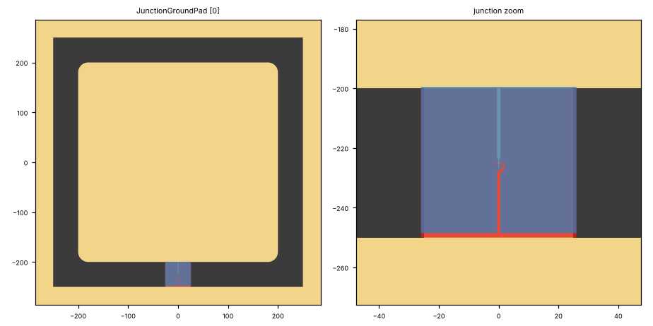

% generated by scripts/make_component_docs.py -- do not edit. Put hand-written notes in docs/components/notes/JunctionGroundPad.md (included below).

# JunctionGroundPad

Rounded probe pad joined to ground by a bridge carrying a trilayer junction (legacy ``testPad.py``).

**Source:** Quantcore. **Category:** test_structure. **Module:** `quantcore_circuits.layouts.others.test_pads`.

See also the [catalog](../CATALOG.md) and the [duplicates decisions](../DUPLICATES.md).

## Pins



Pin image (default parameters). Light = metal, dark = etched gap, colours = junction layers. A red dot and arrow is a pin and its direction (out of the cell); the red bar is the CPW width a + 2 b. Blue dot = a pin without direction. Units: µm.

No pins: this cell has no ports. Place it with `at=` / `rot=`.

## Parameters

| name | default | unit | description |
|---|---|---|---|
| `a` | `10` | μm | Width of center conductor |
| `b` | `6` | μm | Width of gap |
| `r` | `100` | μm | Turn radius |
| `box_size` | `500` | μm | Etch window size |
| `pad_size` | `400` | μm | Pad size |
| `pad_r_inner` | `40` | μm | Pad inner corner radius |
| `pad_r_outer` | `20` | μm | Pad outer corner radius |
| `bridge_width` | `50` | μm | Width of the bridge to ground |
| `junction_y` | `-225` | μm | Junction position on the bridge (y) |
| `finger_width` | `0.26` | μm | Straight finger width (legacy 0.2·size + 0.06) |
| `second_finger_width` | `0.2` | μm | Bent finger width |
| `corner_points` | `64` | – | Points per full circle of the pad corners |

Electrically relevant parameters (sizes, gaps, junction, ports) come first, the rest follows.

## LOM model

none (a LOM build gives each pin its own bare node, without elements).

## How to use

In Python:

```python
from quantcore_circuits.designer import Designer

d = Designer("demo", box=(0, 0, 7500, 7500))
d.add("U1", "JunctionGroundPad", at=(3750, 3750), a=10)   # parameters: see the table above
# no directed pin: place it with at= / rot=, or snap it with snap= / to=
```

Pin names go into `d.route(...)` as `INSTANCE.pin`, and into `snap=` / `to=` when placing. From the shell: `qcc components JunctionGroundPad` lists the pins; add `--schema` for the parameters.

In KLayout: Quantcore panel ▸ Components ▸ double-click the cell, then click on the layout to place it. Rotate and mirror before the click; use Connect on two pins to route.

GUI status (`kplugin/COMPONENTS_STATUS.md`): places ok, edit ok, connect n/a (no directed port), build ok. no ports.
