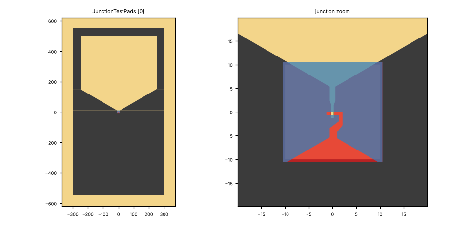

% generated by scripts/make_component_docs.py -- do not edit. Put hand-written notes in docs/components/notes/JunctionTestPads.md (included below).

# JunctionTestPads

Two probe pads with a trilayer junction between their tips (legacy ``testPad_*`` / ``xtp_testpads``).

**Source:** Quantcore. **Category:** test_structure. **Module:** `quantcore_circuits.layouts.others.test_pads`.

See also the [catalog](../CATALOG.md).

## Pins



Pin image (default parameters). Light = metal, dark = etched gap, colours = junction layers. A red dot and arrow is a pin and its direction (out of the cell); the red bar is the CPW width a + 2 b. Blue dot = a pin without direction. Units: µm.

No pins: this cell has no ports. Place it with `at=` / `rot=`.

**Notes from the catalog:** the legacy QWri test-pad block (Quantcore). KQC's test-structure factory of the same name is kqcircuits.test_structures.junction_test_pads.junction_test_pads.JunctionTestPads (dotted path).

## Parameters

| name | default | unit | description |
|---|---|---|---|
| `a` | `10` | μm | Width of center conductor |
| `b` | `6` | μm | Width of gap |
| `r` | `100` | μm | Turn radius |
| `upper_pad_width` | `500` | μm | Upper pad width |
| `upper_pad_height` | `400` | μm | Upper pad height |
| `lower_pad_width` | `500` | μm | Lower pad width |
| `lower_pad_height` | `400` | μm | Lower pad height |
| `upper_pad_trim` | `50` | μm | Upper pad shortened by (towards the window edge) |
| `lower_pad_trim` | `50` | μm | Lower pad shortened by (towards the window edge) |
| `junction_width` | `20` | μm | Junction window width |
| `junction_height` | `20` | μm | Junction window height |
| `finger_origin` | `5` | μm | Pad tip distance from the junction |
| `finger_width` | `0.5` | μm | Straight finger width |
| `second_finger_width` | `0.6` | μm | Bent finger width |
| `straight_finger_y` | `-2.4` | μm | Straight finger offset (legacy y) |
| `straight_pad_width` | `1.2` | μm | Straight finger lead width |
| `straight_finger_length` | `3` | μm | Straight finger length |
| `bent_finger_x` | `0.2` | μm | Bent finger offset (legacy x) |
| `bent_finger_y` | `-3.4` | μm | Bent finger offset (legacy y) |
| `bent_pad_width` | `1.6` | μm | Bent finger lead width |
| `bent_finger_length` | `3` | μm | Bent finger length |
| `hsq_width` | `0.2` | μm | HSQ box width |
| `label_size` | `100` | μm | Label height |
| `middle_height` | `300` | μm | Distance between the pads (junction region) |
| `box_extra` | `100` | μm | Etch window wider than the upper pad by |
| `box_height` | `0` | μm | Etch window height (0 = pads + middle) |
| `bent_conn_height` | `0.5` | μm | Bent finger connection height |
| `with_hsq` | `true` | – | Draw HSQ sidewall boxes |
| `hsq_overlap` | `0.045` | μm | HSQ overlap onto the finger |
| `hsq_y_offset` | `-0.85` | μm | HSQ box centre offset (legacy y_off) |
| `hsq_extra_low` | `0.1` | μm | HSQ box extra length below |
| `hsq_extra_high` | `0.2` | μm | HSQ box extra length above |
| `spacer_gradient` | `true` | – | Spacer gradient: 51–53/0 dose levels inside the HSQ (width / 3 strips) |
| `label` | `""` | – | Text etched above the pads (empty = none) |
| `label_pos` | `[-140, 400]` | μm | Label position [x, y] |

Electrically relevant parameters (sizes, gaps, junction, ports) come first, the rest follows.

## LOM model

none (a LOM build gives each pin its own bare node, without elements).

## How to use

In Python:

```python
from quantcore_circuits.designer import Designer

d = Designer("demo", box=(0, 0, 7500, 7500))
d.add("U1", "JunctionTestPads", at=(3750, 3750), a=10)   # parameters: see the table above
# no directed pin: place it with at= / rot=, or snap it with snap= / to=
```

Pin names go into `d.route(...)` as `INSTANCE.pin`, and into `snap=` / `to=` when placing. From the shell: `qcc components JunctionTestPads` lists the pins; add `--schema` for the parameters.

In KLayout: Quantcore panel ▸ Components ▸ double-click the cell, then click on the layout to place it. Rotate and mirror before the click; use Connect on two pins to route.

GUI status (`kplugin/COMPONENTS_STATUS.md`): places ok, edit ok, connect n/a (no directed port), build ok. no ports.
