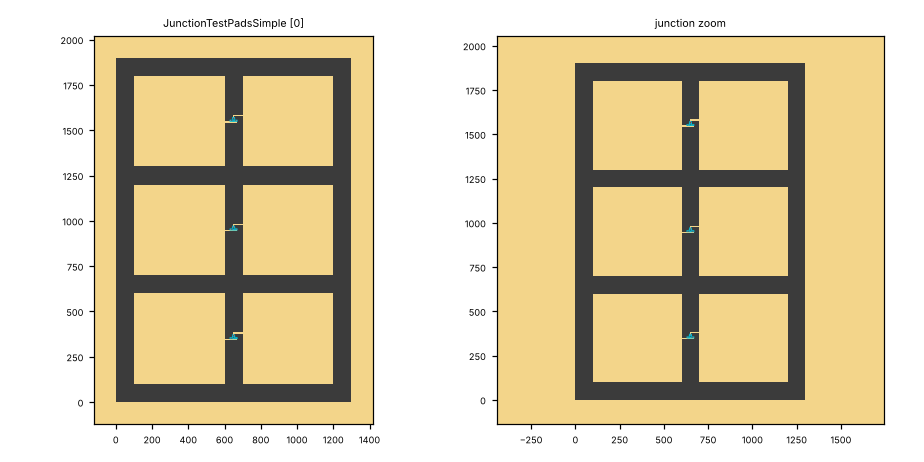

% generated by scripts/make_component_docs.py -- do not edit. Put hand-written notes in docs/components/notes/JunctionTestPadsSimple.md (included below).

# JunctionTestPadsSimple

Junction test structures.

**Source:** KQC (KQCircuits). **Category:** test_structure. **Module:** `kqcircuits.test_structures.junction_test_pads.junction_test_pads_simple`.

See also the [catalog](../CATALOG.md) and the [duplicates decisions](../DUPLICATES.md).

## Pins



Pin image (default parameters). Light = metal, dark = etched gap, colours = junction layers. A red dot and arrow is a pin and its direction (out of the cell); the red bar is the CPW width a + 2 b. Blue dot = a pin without direction. Units: µm.

No pins: this cell has no ports. Place it with `at=` / `rot=`.

## Parameters

| name | default | unit | description |
|---|---|---|---|
| `a` | `10` | μm | Width of center conductor |
| `b` | `6` | μm | Width of gap |
| `r` | `100` | μm | Turn radius |
| `pad_width` | `500` | μm | Pad width |
| `area_width` | `1300` | μm | Area width |
| `junctions_horizontal` | `true` | – | Horizontal (True) or vertical (False) junctions |
| `pad_spacing` | `100` | μm | Spacing between different pad pairs |
| `only_pads` | `false` | – | Only produce pads, no junctions |
| `pad_configuration` | `"2-port"` | – | Pad configuration |
| `junction_width_steps` | `[0, 0]` | μm, μm | Automatically generate junction widths [start, step] |
| `junction_widths` | `[]` | – | Optional junction widths for individual junctions |
| `junction_test_pads_type` | `"Junction Test Pads Simple"` | – | Type of junction test pads |
| `mirror_squid` | `false` | – | Mirror SQUID by its Y axis |
| `junction_type` | `"Manhattan"` | – | Junction Type |
| `junction_width` | `0.02` | μm | Junction width for code generated element |
| `finger_overshoot` | `1.0` | μm | Length of fingers after the junction. |
| `include_base_metal_gap` | `true` | – | Include base metal gap layer |
| `separate_junctions` | `true` | – | Junctions to separate layer |
| `finger_overlap` | `0.2` | μm | Length of fingers inside the pads |
| `single_junction` | `false` | – | Disable the second junction |
| `area_height` | `1900` | μm | Area height |
| `loop_area` | `100` | μm^2 | Loop area |
| `shadow_margin` | `1.0` | μm | Shadow layer margin near the the pads |
| `compact_geometry` | `false` | – | Compact geometry for metal addition. |
| `offset_compensation` | `0` | μm | Junction lead offset from junction width |
| `mirror_offset` | `false` | – | Move the junction lead offset to the other lead |

Electrically relevant parameters (sizes, gaps, junction, ports) come first, the rest follows.

## LOM model

none (a LOM build gives each pin its own bare node, without elements).

## How to use

In Python:

```python
from quantcore_circuits.designer import Designer

d = Designer("demo", box=(0, 0, 7500, 7500))
d.add("U1", "JunctionTestPadsSimple", at=(3750, 3750), a=10)   # parameters: see the table above
# no directed pin: place it with at= / rot=, or snap it with snap= / to=
```

Pin names go into `d.route(...)` as `INSTANCE.pin`, and into `snap=` / `to=` when placing. From the shell: `qcc components JunctionTestPadsSimple` lists the pins; add `--schema` for the parameters.

In KLayout: Quantcore panel ▸ Components ▸ double-click the cell, then click on the layout to place it. Rotate and mirror before the click; use Connect on two pins to route.
