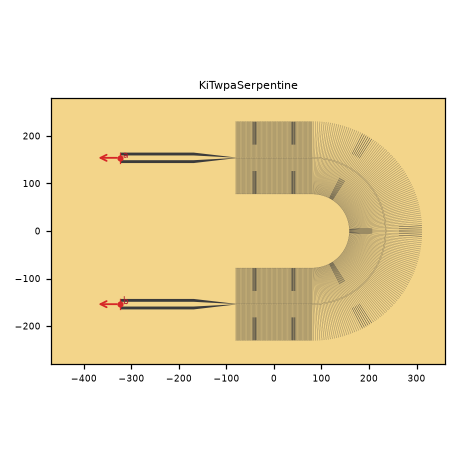

% generated by scripts/make_component_docs.py -- do not edit. Put hand-written notes in docs/components/notes/KiTwpaSerpentine.md (included below).

# KiTwpaSerpentine

Kinetic-inductance TWPA serpentine (twpa-sim ``KITLayout`` / ``kit.primitives``, the NY CREATES research

**Source:** Quantcore. **Category:** waveguide. **Module:** `quantcore_circuits.layouts.others.amplifiers`.

See also the [catalog](../CATALOG.md).

## Pins



Pin image (default parameters). Light = metal, dark = etched gap, colours = junction layers. A red dot and arrow is a pin and its direction (out of the cell); the red bar is the CPW width a + 2 b. Blue dot = a pin without direction. Units: µm.

| pin | x (µm) | y (µm) | direction (°) | a (µm) | b (µm) | purpose |
|---|---|---|---|---|---|---|
| `a` | -324 | 154 | 180 | 10 | 6 | CPW end; LOM node `line` |
| `b` | -324 | -154 | 180 | 10 | 6 | CPW end; LOM node `line` |

a, b: CPW centre width and gap where the pin declares them (`–` = not declared). Position and direction are in the cell's own frame (`at=(0, 0)`, `rot=0`).

## Parameters

| name | default | unit | description |
|---|---|---|---|
| `a` | `10` | μm | Width of center conductor |
| `b` | `6` | μm | Width of gap |
| `r` | `100` | μm | Turn radius |
| `turn_periods` | `3` | – | Supercells per U-turn |
| `spine_width` | `0.58` | μm | Spine width |
| `spine_gap` | `0.5` | μm | Spine gap |
| `finger_width` | `0.5` | μm | Finger width |
| `finger_gap` | `0.25` | μm | Finger gap |
| `finger_length` | `75.5` | μm | Finger length |
| `loaded_finger_length` | `27.5` | μm | Loaded finger length |
| `turn_radius` | `154` | μm | Turn radius (row spacing / 2) |
| `taper_cells` | `6` | – | Turn taper cells |
| `launch_taper_length` | `88` | μm | Launch taper (spine → a/b) |
| `launch_length` | `155` | μm | Launch straight (a/b) to the port |
| `sheet_inductance_pH_sq` | `0.0` | – | Film sheet kinetic inductance for the ladder (0 = PDK film) |
| `rows` | `2` | – | Rows |
| `periods_per_row` | `2` | – | Supercells per row |
| `unloaded_cells` | `48` | – | Unloaded cells per supercell (even) |
| `loaded_cells` | `6` | – | Loaded cells per supercell |
| `pitch` | `1.5` | μm | Cell pitch |
| `bias_ratio` | `0.2` | – | Turn sheet-square bias ratio |
| `arc_points` | `513` | – | Points on a turn arc |

Electrically relevant parameters (sizes, gaps, junction, ports) come first, the rest follows.

## LOM model

The cell contributes to the lumped model:

- no lumped branches

| line | node | length (µm) | a (µm) | b (µm) | ends |
|---|---|---|---|---|---|
| `X` | `line` | 567 | 0.58 | 0.5 | open / open |

Nodes: `line`.

- X: KI-TWPA ladder of 378 cells, L 1.01 pH/cell (kinetic 29.8% at 0.116 pH/□), C 23.6 fF/cell, Z ≈ 7 Ω (analysis.amplifiers for dispersion and gain)

## Simulation export notes

- C6: eigenmode 50 Ω edge port without a polygon (box edge on a bend / taper / narrow line) (status: fixed; fix in sim_tools/builder.py (straighten_box, edge_port_ok, crossing_square))

## How to use

In Python:

```python
from quantcore_circuits.designer import Designer

d = Designer("demo", box=(0, 0, 7500, 7500))
d.add("U1", "KiTwpaSerpentine", at=(3750, 3750), a=10)   # parameters: see the table above
d.add("PAD", "BondPad", at=(1125, 3750), rot=270)   # a launcher to connect to
d.route("L1", "PAD.a", "U1.a")                # a CPW from the pad to the pin
```

Pin names go into `d.route(...)` as `INSTANCE.pin`, and into `snap=` / `to=` when placing. From the shell: `qcc components KiTwpaSerpentine` lists the pins; add `--schema` for the parameters.

In KLayout: Quantcore panel ▸ Components ▸ double-click the cell, then click on the layout to place it. Rotate and mirror before the click; use Connect on two pins to route.

GUI status (`kplugin/COMPONENTS_STATUS.md`): places ok, edit ok, connect ok, build ok. no etched outline (bbox only ghost).
