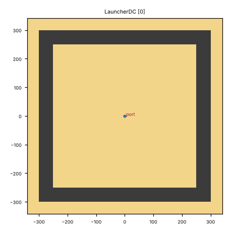

% generated by scripts/make_component_docs.py -- do not edit. Put hand-written notes in docs/components/notes/LauncherDC.md (included below).

# LauncherDC

The PCell declaration for a DC launcher for connecting wirebonds.

**Source:** KQC (KQCircuits). **Category:** launcher. **Module:** `kqcircuits.elements.launcher_dc`.

See also the [catalog](../CATALOG.md) and the [duplicates decisions](../DUPLICATES.md).

## Pins



Pin image (default parameters). Light = metal, dark = etched gap, colours = junction layers. A red dot and arrow is a pin and its direction (out of the cell); the red bar is the CPW width a + 2 b. Blue dot = a pin without direction. Units: µm.

| pin | x (µm) | y (µm) | direction (°) | a (µm) | b (µm) | purpose |
|---|---|---|---|---|---|---|
| `port` | 0 | 0 | none | 10 | 6 | launcher pad (RF port); LOM node `pad` |

Pins with direction `none`: `port`. They mark a point (a junction lead, a pad centre), not a CPW end. The KLayout ghost draws them as boxes. A route can start there only where the notes say so; it cannot be snapped to.

a, b: CPW centre width and gap where the pin declares them (`–` = not declared). Position and direction are in the cell's own frame (`at=(0, 0)`, `rot=0`).

**Notes from the catalog:** DC pad: its one port 'port' sits at the pad centre with no direction (KQC adds no corner; the square pad is symmetric). Place it with at=/rot=; a route may start or end there (it leaves toward its next node); it cannot be snapped to. For an RF launcher with a directed port use Launcher or BondPad.

## Parameters

| name | default | unit | description |
|---|---|---|---|
| `a` | `10` | μm | Width of center conductor |
| `b` | `6` | μm | Width of gap |
| `r` | `100` | μm | Turn radius |
| `width` | `500` | μm | Pad width |

Electrically relevant parameters (sizes, gaps, junction, ports) come first, the rest follows.

## LOM model

The cell contributes to the lumped model:

| branch | type | nodes | value (estimate at defaults) |
|---|---|---|---|
| `Port_X` | R | pad – gnd | R_ohm=50 |

Nodes: `pad`.

## How to use

In Python:

```python
from quantcore_circuits.designer import Designer

d = Designer("demo", box=(0, 0, 7500, 7500))
d.add("U1", "LauncherDC", at=(3750, 3750), a=10)   # parameters: see the table above
# no directed pin: place it with at= / rot=, or snap it with snap= / to=
```

Pin names go into `d.route(...)` as `INSTANCE.pin`, and into `snap=` / `to=` when placing. From the shell: `qcc components LauncherDC` lists the pins; add `--schema` for the parameters.

In KLayout: Quantcore panel ▸ Components ▸ double-click the cell, then click on the layout to place it. Rotate and mirror before the click; use Connect on two pins to route.
