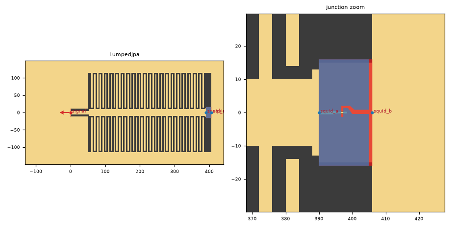

% generated by scripts/make_component_docs.py -- do not edit. Put hand-written notes in docs/components/notes/LumpedJpa.md (included below).

# LumpedJpa

Lumped JPA: a trilayer junction or SQUID to ground, shunted by an interdigital capacitor (twpa-sim ``jpa`` /

**Source:** Quantcore. **Category:** resonator. **Module:** `quantcore_circuits.layouts.others.amplifiers`.

See also the [catalog](../CATALOG.md) and the [duplicates decisions](../DUPLICATES.md).

## Pins



Pin image (default parameters). Light = metal, dark = etched gap, colours = junction layers. A red dot and arrow is a pin and its direction (out of the cell); the red bar is the CPW width a + 2 b. Blue dot = a pin without direction. Units: µm.

| pin | x (µm) | y (µm) | direction (°) | a (µm) | b (µm) | purpose |
|---|---|---|---|---|---|---|
| `signal` | 0 | 0 | 180 | 10 | 6 | signal line end; LOM node `island` |
| `squid_a` | 390 | 0 | none | 10 | 6 | junction pins (the LOM's L_J) |
| `squid_b` | 406 | 0 | none | 10 | 6 | junction pins (the LOM's L_J) |

Pins with direction `none`: `squid_a`, `squid_b`. They mark a point (a junction lead, a pad centre), not a CPW end. The KLayout ghost draws them as boxes. A route can start there only where the notes say so; it cannot be snapped to.

a, b: CPW centre width and gap where the pin declares them (`–` = not declared). Position and direction are in the cell's own frame (`at=(0, 0)`, `rot=0`).

## Parameters

| name | default | unit | description |
|---|---|---|---|
| `a` | `10` | μm | Width of center conductor |
| `b` | `6` | μm | Width of gap |
| `r` | `100` | μm | Turn radius |
| `coupling` | `"capacitive"` | – | Coupling to the signal line |
| `junction_type` | `"Quantcore Junction"` | – | Junction (trilayer cell) |
| `junction_params` | `"{}"` | – | Trilayer junction cell parameters (JSON dict) |
| `lead_length` | `50` | μm | CPW lead from the port to the pocket |
| `spine_width` | `20` | μm | Island spine width |
| `shunt_fingers` | `20` | – | Island fingers per side |
| `finger_length` | `100` | μm | Finger length |
| `finger_width` | `4` | μm | Finger width |
| `finger_gap` | `4` | μm | Gap between fingers (and all island clearances) |
| `junction_gap` | `16` | μm | Junction gap (window height) |
| `tap_width` | `4` | μm | Inductive coupling strip width |
| `tap_pad` | `[20, 24]` | – | Inductive coupling tap pad (length along x, width), µm |
| `flux_length` | `200` | μm | Flux line length (port to short) |
| `flux_gap` | `2` | μm | Ground strip between the pocket and the flux line gap |
| `flux_line` | `false` | – | Draw a shorted flux / pump line past the junction (capacitive) |
| `flux_offset` | `20` | μm | Flux short beyond the junction axis |
| `flux_phi0` | `0.0` | Φ0 | Static flux bias of a SQUID (LOM) |

Electrically relevant parameters (sizes, gaps, junction, ports) come first, the rest follows.

## LOM model

The cell contributes to the lumped model:

| branch | type | nodes | value (estimate at defaults) |
|---|---|---|---|
| `C_X` | C | island – gnd | estimate=392, unit=fF, estimate_source=analytic: 2 × IDC (41 fingers 4/4 µm, overlap 96 µm, Igreja–Dias) + spine ends, estimate_kind=analytic, uncertainty=±25% |
| `J_X` | JJ | island – gnd | Lj_nH=6.734, Cj_fF=15 |

Nodes: `island`.

- X: lumped JPA, C_shunt ≈ 392 fF (analytic IDC)

## Simulation export notes

- C4: galvanic lead port shorted to ground / leaving the box (status: fixed; fix in sim_tools/builder.py (lead_open_ends, galvanic_routes, build_simulation))

Details: [SIM_EXPORT_AUDIT](../SIM_EXPORT_AUDIT.md).

## How to use

In Python:

```python
from quantcore_circuits.designer import Designer

d = Designer("demo", box=(0, 0, 7500, 7500))
d.add("U1", "LumpedJpa", at=(3750, 3750), a=10)   # parameters: see the table above
d.add("PAD", "BondPad", at=(1125, 3750), rot=270)   # a launcher to connect to
d.route("L1", "PAD.a", "U1.signal")                # a CPW from the pad to the pin
```

Pin names go into `d.route(...)` as `INSTANCE.pin`, and into `snap=` / `to=` when placing. From the shell: `qcc components LumpedJpa` lists the pins; add `--schema` for the parameters.

In KLayout: Quantcore panel ▸ Components ▸ double-click the cell, then click on the layout to place it. Rotate and mirror before the click; use Connect on two pins to route.

GUI status (`kplugin/COMPONENTS_STATUS.md`): places ok, edit ok, connect ok, build ok. ports without direction: squid_a, squid_b (ghost draws boxes).
