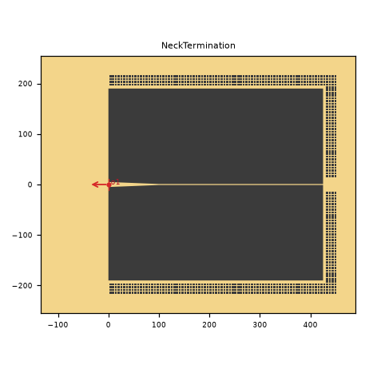

% generated by scripts/make_component_docs.py -- do not edit. Put hand-written notes in docs/components/notes/NeckTermination.md (included below).

# NeckTermination

Shorted CPW end through a taper and a narrow neck in an etched window (QPDK ``neck_termination``).

**Source:** Quantcore. **Category:** termination. **Module:** `quantcore_circuits.layouts.others.qpdk_cells`.

See also the [catalog](../CATALOG.md) and the [duplicates decisions](../DUPLICATES.md).

## Pins



Pin image (default parameters). Light = metal, dark = etched gap, colours = junction layers. A red dot and arrow is a pin and its direction (out of the cell); the red bar is the CPW width a + 2 b. Blue dot = a pin without direction. Units: µm.

| pin | x (µm) | y (µm) | direction (°) | a (µm) | b (µm) | purpose |
|---|---|---|---|---|---|---|
| `o1` | 0 | 0 | 180 | 10 | 6 | LOM node `line` |

a, b: CPW centre width and gap where the pin declares them (`–` = not declared). Position and direction are in the cell's own frame (`at=(0, 0)`, `rot=0`).

## Parameters

| name | default | unit | description |
|---|---|---|---|
| `a` | `10` | μm | Width of center conductor |
| `b` | `6` | μm | Width of gap |
| `r` | `100` | μm | Turn radius |
| `taper_length` | `100` | μm | Taper length |
| `taper_shape` | `"linear"` | – | Taper profile |
| `neck_width` | `2` | μm | Neck width |
| `neck_length` | `325` | μm | Neck length |
| `window_width` | `380` | μm | Etched window width (across the line) |
| `trap_hole_size` | `4` | μm | Trap hole side |
| `trap_hole_rows` | `4` | – | Rows of flux-trap holes around the window (0 = none) |
| `trap_hole_pitch` | `5.5` | μm | Trap hole pitch |
| `trap_hole_offset` | `6` | μm | Ground strip between window and first hole row |
| `trap_hole_keepout` | `24` | μm | Hole-free column on the neck axis at the far end |

Electrically relevant parameters (sizes, gaps, junction, ports) come first, the rest follows.

## LOM model

The cell contributes to the lumped model:

- no lumped branches

| line | node | length (µm) | a (µm) | b (µm) | ends |
|---|---|---|---|---|---|
| `X` | `line` | 1278.834 | 10 | 6 | short / short |

Nodes: `line`.

- X: taper 100 µm + neck 325 µm counted as 1279 µm of 10/6 µm CPW (L' ratio 3.14 for the neck; rough: no neck L_k beyond the CPW formula, no C of the window)

## Simulation export notes

- C8: GDS polygon with > 4095 points (XY record > 0x8000 bytes) (status: partly fixed; fix in sim_tools/builder.py (FaceMetal.max_points, DesignSimulation.simplified_region, split_large_polygons); sim_tools/geometry_check.py)

Details: [SIM_EXPORT_AUDIT](../SIM_EXPORT_AUDIT.md).

## How to use

In Python:

```python
from quantcore_circuits.designer import Designer

d = Designer("demo", box=(0, 0, 7500, 7500))
d.add("U1", "NeckTermination", at=(3750, 3750), a=10)   # parameters: see the table above
d.add("PAD", "BondPad", at=(1125, 3750), rot=270)   # a launcher to connect to
d.route("L1", "PAD.a", "U1.o1")                # a CPW from the pad to the pin
```

Pin names go into `d.route(...)` as `INSTANCE.pin`, and into `snap=` / `to=` when placing. From the shell: `qcc components NeckTermination` lists the pins; add `--schema` for the parameters.

In KLayout: Quantcore panel ▸ Components ▸ double-click the cell, then click on the layout to place it. Rotate and mirror before the click; use Connect on two pins to route.

GUI status (`kplugin/COMPONENTS_STATUS.md`): places ok, edit ok, connect ok, build ok.
