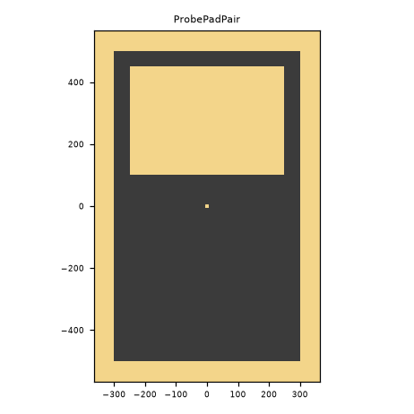

% generated by scripts/make_component_docs.py -- do not edit. Put hand-written notes in docs/components/notes/ProbePadPair.md (included below).

# ProbePadPair

Probe-pad pair of the chip_11m junction test array (legacy ``chip_11m_TestJJ16x_pads.create_testPad``, whose

**Source:** Quantcore. **Category:** test_structure. **Module:** `quantcore_circuits.layouts.others.test_pads`.

See also the [catalog](../CATALOG.md) and the [duplicates decisions](../DUPLICATES.md).

## Pins



Pin image (default parameters). Light = metal, dark = etched gap, colours = junction layers. A red dot and arrow is a pin and its direction (out of the cell); the red bar is the CPW width a + 2 b. Blue dot = a pin without direction. Units: µm.

No pins: this cell has no ports. Place it with `at=` / `rot=`.

**Notes from the catalog:** chip_11m's commented-out probe pads (DC test structure, no ports, no circuit model): upper pad in 1/0, lower pad in the 3/0 second metal (qcc_keepout); junction_type 'Trilayer Junction Compact' puts the JX_500 junction in the cut-out.

## Parameters

| name | default | unit | description |
|---|---|---|---|
| `a` | `10` | μm | Width of center conductor |
| `b` | `6` | μm | Width of gap |
| `r` | `100` | μm | Turn radius |
| `pad_width` | `500` | μm | Pad width |
| `upper_pad_height` | `400` | μm | Upper (base-metal) pad height |
| `lower_pad_height` | `400` | μm | Lower (second-metal) pad height |
| `pad_trim` | `50` | μm | Pads shortened by (towards the window edge) |
| `junction_type` | `"No Squid"` | – | Junction in the cut-out: none (legacy) or a trilayer cell |
| `junction_params` | `"{}"` | – | Junction cell parameters (JSON dict) |
| `middle_height` | `200` | μm | Distance between the pads (junction region) |
| `window_extra` | `100` | μm | Window wider than the pads by |
| `cutout` | `11` | μm | Centre cut-out (junction site) size |

Electrically relevant parameters (sizes, gaps, junction, ports) come first, the rest follows.

## LOM model

none (a LOM build gives each pin its own bare node, without elements).

## How to use

In Python:

```python
from quantcore_circuits.designer import Designer

d = Designer("demo", box=(0, 0, 7500, 7500))
d.add("U1", "ProbePadPair", at=(3750, 3750), a=10)   # parameters: see the table above
# no directed pin: place it with at= / rot=, or snap it with snap= / to=
```

Pin names go into `d.route(...)` as `INSTANCE.pin`, and into `snap=` / `to=` when placing. From the shell: `qcc components ProbePadPair` lists the pins; add `--schema` for the parameters.

In KLayout: Quantcore panel ▸ Components ▸ double-click the cell, then click on the layout to place it. Rotate and mirror before the click; use Connect on two pins to route.

GUI status (`kplugin/COMPONENTS_STATUS.md`): places ok, edit ok, connect n/a (no directed port), build ok. no ports.
