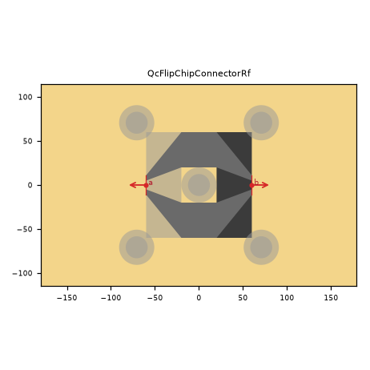

% generated by scripts/make_component_docs.py -- do not edit. Put hand-written notes in docs/components/notes/QcFlipChipConnectorRf.md (included below).

# QcFlipChipConnectorRf

KQC's flip-chip bump transition (FlipChipConnectorRf) with a bump size and named ports a and b.

**Source:** Quantcore. **Category:** flip_chip. **Module:** `quantcore_circuits.layouts.others.flip_chip`.

See also the [catalog](../CATALOG.md).

## Pins



Pin image (default parameters). Light = metal, dark = etched gap, colours = junction layers. A red dot and arrow is a pin and its direction (out of the cell); the red bar is the CPW width a + 2 b. Blue dot = a pin without direction. Units: µm.

| pin | x (µm) | y (µm) | direction (°) | a (µm) | b (µm) | purpose |
|---|---|---|---|---|---|---|
| `a` | -60 | 0 | 180 | 10 | 6 | CPW end; LOM node `line` |
| `b` | 60 | 0 | 0 | 10 | 6 | CPW end; LOM node `line` |

a, b: CPW centre width and gap where the pin declares them (`–` = not declared). Position and direction are in the cell's own frame (`at=(0, 0)`, `rot=0`).

**Notes from the catalog:** port 'a' is on face_ids[0], 'b' on face_ids[1] (default 1t1 → 2b1); a route to either is drawn on that port's face. bump_diameter / ubm_diameter size the signal bump, n_ground_bumps is 4 (KQC's) or 0. LOM: one conductor through the bump.

## Parameters

| name | default | unit | description |
|---|---|---|---|
| `a` | `10` | μm | Width of center conductor |
| `b` | `6` | μm | Width of gap |
| `r` | `100` | μm | Turn radius |
| `n_ground_bumps` | `4` | – | Ground bumps around the transition (4: KQC's, 0: none) |
| `inter_bump_distance` | `100` | μm | Distance between In bumps |
| `output_rotation` | `180` | degrees | Rotation of output port w.r.t. input port |
| `connector_a` | `40` | μm | Conductor width at the connector area |
| `connector_b` | `40` | μm | Gap width at the connector area |
| `round_connector` | `false` | – | Use round connector shape |
| `n_center_bumps` | `1` | – | Number of center bumps in series |
| `bump_type` | `"Flip Chip Connector Dc"` | – | Bump type |
| `a2` | `-1` | μm | Width of center conductor on the other end |
| `b2` | `-1` | μm | Width of gap on the other end |
| `ubm_diameter` | `40` | μm | Under-bump metalization diameter |
| `bump_diameter` | `25` | μm | Bump diameter |

Electrically relevant parameters (sizes, gaps, junction, ports) come first, the rest follows.

## LOM model

The cell contributes to the lumped model:

- no lumped branches

| line | node | length (µm) | a (µm) | b (µm) | ends |
|---|---|---|---|---|---|
| `X` | `line` | 120 | 10 | 6 | short / short |

Nodes: `line`.

## How to use

In Python:

```python
from quantcore_circuits.designer import Designer

d = Designer("demo", box=(0, 0, 7500, 7500))
d.add("U1", "QcFlipChipConnectorRf", at=(3750, 3750), a=10)   # parameters: see the table above
d.add("PAD", "BondPad", at=(1125, 3750), rot=270)   # a launcher to connect to
d.route("L1", "PAD.a", "U1.a")                # a CPW from the pad to the pin
```

Pin names go into `d.route(...)` as `INSTANCE.pin`, and into `snap=` / `to=` when placing. From the shell: `qcc components QcFlipChipConnectorRf` lists the pins; add `--schema` for the parameters.

In KLayout: Quantcore panel ▸ Components ▸ double-click the cell, then click on the layout to place it. Rotate and mirror before the click; use Connect on two pins to route.

GUI status: not listed in `kplugin/COMPONENTS_STATUS.md`.
