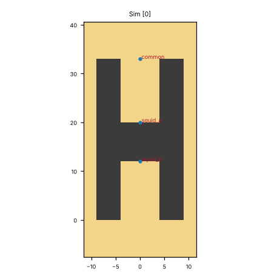

% generated by scripts/make_component_docs.py -- do not edit. Put hand-written notes in docs/components/notes/Sim.md (included below).

# Sim

The PCell declaration for a simulation type SQUID.

**Source:** KQC (KQCircuits). **Category:** junction. **Module:** `kqcircuits.junctions.sim`.

See also the [catalog](../CATALOG.md).

## Pins



Pin image (default parameters). Light = metal, dark = etched gap, colours = junction layers. A red dot and arrow is a pin and its direction (out of the cell); the red bar is the CPW width a + 2 b. Blue dot = a pin without direction. Units: µm.

| pin | x (µm) | y (µm) | direction (°) | a (µm) | b (µm) | purpose |
|---|---|---|---|---|---|---|
| `common` | 0 | 33 | none | 10 | 6 | junction lead (the LOM's L_J branch); LOM node `j` |
| `squid_a` | 0 | 20 | none | 10 | 6 | junction pins (the LOM's L_J); LOM node `j` |
| `squid_b` | 0 | 12 | none | 10 | 6 | junction pins (the LOM's L_J); grounded in the LOM |

Pins with direction `none`: `common`, `squid_a`, `squid_b`. They mark a point (a junction lead, a pad centre), not a CPW end. The KLayout ghost draws them as boxes. A route can start there only where the notes say so; it cannot be snapped to.

a, b: CPW centre width and gap where the pin declares them (`–` = not declared). Position and direction are in the cell's own frame (`at=(0, 0)`, `rot=0`).

## Parameters

| name | default | unit | description |
|---|---|---|---|
| `a` | `10` | μm | Width of center conductor |
| `b` | `6` | μm | Width of gap |
| `r` | `100` | μm | Turn radius |
| `junction_type` | `"Sim"` | – | Junction Type |
| `junction_width` | `0.02` | μm | Junction width for code generated element |

Electrically relevant parameters (sizes, gaps, junction, ports) come first, the rest follows.

## LOM model

The cell contributes to the lumped model:

| branch | type | nodes | value (estimate at defaults) |
|---|---|---|---|
| `J_X` | JJ | j – gnd | Lj_nH=–, Cj_fF=0 |

Nodes: `j`.

## Simulation export notes

- C3: junction sub-cell simulated on its own (status: fixed; fix in sim_tools/builder.py (is_junction_cell, _is_qubit, build_simulation); sim_tools/subset.py (has_junction))

## How to use

In Python:

```python
from quantcore_circuits.designer import Designer

d = Designer("demo", box=(0, 0, 7500, 7500))
d.add("U1", "Sim", at=(3750, 3750), a=10)   # parameters: see the table above
# no directed pin: place it with at= / rot=, or snap it with snap= / to=
```

Pin names go into `d.route(...)` as `INSTANCE.pin`, and into `snap=` / `to=` when placing. From the shell: `qcc components Sim` lists the pins; add `--schema` for the parameters.

In KLayout: Quantcore panel ▸ Components ▸ double-click the cell, then click on the layout to place it. Rotate and mirror before the click; use Connect on two pins to route.
