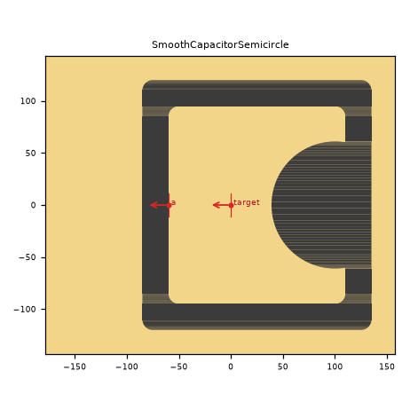

% generated by scripts/make_component_docs.py -- do not edit. Put hand-written notes in docs/components/notes/SmoothCapacitorSemicircle.md (included below).

# SmoothCapacitorSemicircle

Coupling pad with a semicircular bite, placed on a qubit pin (SQDMetal ``Smooth_Capacitor_Semicircle``).

**Source:** Quantcore. **Category:** capacitor. **Module:** `quantcore_circuits.layouts.others.sqdmetal_cells`.

See also the [catalog](../CATALOG.md) and the [duplicates decisions](../DUPLICATES.md).

## Pins



Pin image (default parameters). Light = metal, dark = etched gap, colours = junction layers. A red dot and arrow is a pin and its direction (out of the cell); the red bar is the CPW width a + 2 b. Blue dot = a pin without direction. Units: µm.

| pin | x (µm) | y (µm) | direction (°) | a (µm) | b (µm) | purpose |
|---|---|---|---|---|---|---|
| `a` | -60 | 0 | 180 | 10 | 6 | CPW end; LOM node `pad` |
| `target` | 0 | 0 | 180 | 10 | 6 | LOM node `target` |

a, b: CPW centre width and gap where the pin declares them (`–` = not declared). Position and direction are in the cell's own frame (`at=(0, 0)`, `rot=0`).

**Notes from the catalog:** SQDMetal Smooth_Capacitor_Semicircle (Apache-2.0). Port 'target' is a placement reference: snap it to the qubit pin (SQDMetal start_pin); routes start at 'a' (set lead_length to reach the pocket edge).

## Parameters

| name | default | unit | description |
|---|---|---|---|
| `a` | `10` | μm | Width of center conductor |
| `b` | `6` | μm | Width of gap |
| `r` | `100` | μm | Turn radius |
| `rect_width` | `190` | μm | Pad width (across) |
| `rect_length` | `170` | μm | Pad length (towards the bite) |
| `semi_radius` | `61` | μm | Semicircle radius |
| `gap_side` | `25` | μm | Clearance at the sides |
| `gap_front` | `25` | μm | Clearance towards the bite |
| `gap_back` | `25` | μm | Clearance behind the pad |
| `trace_width` | `10` | μm | Width of the trace at port a |
| `fillet_radius` | `10` | μm | Corner fillet radius (0 = sharp) |
| `lead_length` | `0` | μm | CPW lead from the pad's back edge to port a |
| `circle_offset` | `-10` | μm | Semicircle centre beyond the pad front |
| `orientation` | `0` | ° | Rotation of the drawing about the target pin |
| `fillet_resolution` | `16` | – | Fillet points per quarter circle |

Electrically relevant parameters (sizes, gaps, junction, ports) come first, the rest follows.

## LOM model

The cell contributes to the lumped model:

| branch | type | nodes | value (estimate at defaults) |
|---|---|---|---|
| `C_X` | C | pad – target | estimate=27, unit=fF, estimate_source=rough: semicircle arc 192 µm around the qubit pad end, assumed 5 µm gap (CPS), estimate_kind=rough, uncertainty=±50% |
| `C_X_pad` | C | pad – gnd | estimate=59, unit=fF, estimate_source=rough: 190×170 µm pad in its clearance + lead, estimate_kind=rough, uncertainty=±50% |

Nodes: `pad`, `target`.

## How to use

In Python:

```python
from quantcore_circuits.designer import Designer

d = Designer("demo", box=(0, 0, 7500, 7500))
d.add("U1", "SmoothCapacitorSemicircle", at=(3750, 3750), a=10)   # parameters: see the table above
d.add("PAD", "BondPad", at=(1125, 3750), rot=270)   # a launcher to connect to
d.route("L1", "PAD.a", "U1.a")                # a CPW from the pad to the pin
```

Pin names go into `d.route(...)` as `INSTANCE.pin`, and into `snap=` / `to=` when placing. From the shell: `qcc components SmoothCapacitorSemicircle` lists the pins; add `--schema` for the parameters.

In KLayout: Quantcore panel ▸ Components ▸ double-click the cell, then click on the layout to place it. Rotate and mirror before the click; use Connect on two pins to route.

GUI status (`kplugin/COMPONENTS_STATUS.md`): places ok, edit ok, connect ok, build ok.
