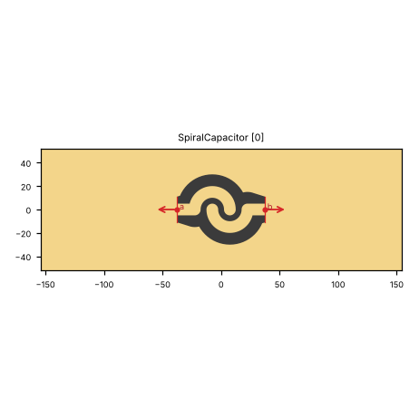

% generated by scripts/make_component_docs.py -- do not edit. Put hand-written notes in docs/components/notes/SpiralCapacitor.md (included below).

# SpiralCapacitor

The PCell declaration for a spiral capacitor.

**Source:** KQC (KQCircuits). **Category:** capacitor. **Module:** `kqcircuits.elements.spiral_capacitor`.

See also the [catalog](../CATALOG.md) and the [duplicates decisions](../DUPLICATES.md).

## Pins



Pin image (default parameters). Light = metal, dark = etched gap, colours = junction layers. A red dot and arrow is a pin and its direction (out of the cell); the red bar is the CPW width a + 2 b. Blue dot = a pin without direction. Units: µm.

| pin | x (µm) | y (µm) | direction (°) | a (µm) | b (µm) | purpose |
|---|---|---|---|---|---|---|
| `a` | -37.5 | 0 | 180 | 10 | 6 | CPW end; LOM node `a` |
| `b` | 37.5 | 0 | 0 | 10 | 6 | CPW end; LOM node `b` |

a, b: CPW centre width and gap where the pin declares them (`–` = not declared). Position and direction are in the cell's own frame (`at=(0, 0)`, `rot=0`).

## Parameters

| name | default | unit | description |
|---|---|---|---|
| `a` | `10` | μm | Width of center conductor |
| `b` | `6` | μm | Width of gap |
| `r` | `100` | μm | Turn radius |
| `finger_width2` | `-1` | μm | Width of a finger on the right |
| `ground_gap2` | `-1` | μm | Gap between ground and finger on the right |
| `spiral_angle` | `180` | degrees | Angle of spiral in degrees |
| `spiral_angle2` | `-1` | degrees | Angle of spiral in degrees on the right |
| `ground_gap` | `10` | μm | Gap between ground and finger |
| `finger_width` | `10` | μm | Width of a finger |
| `finger_gap` | `5` | μm | Gap between the fingers |
| `rotation` | `-1` | degrees | Waveguide rotation in degrees |
| `rotation2` | `-1` | degrees | Waveguide rotation in degrees on the right |
| `a2` | `-1` | μm | Width of center conductor on the other end |
| `b2` | `-1` | μm | Width of gap on the other end |

Electrically relevant parameters (sizes, gaps, junction, ports) come first, the rest follows.

## LOM model

The cell contributes to the lumped model:

| branch | type | nodes | value (estimate at defaults) |
|---|---|---|---|
| `C_X` | C | a – b | estimate=7.1, unit=fF, estimate_source=rough: spiral fingers ≈ 75 µm of coplanar strips, estimate_kind=rough, uncertainty=±50% |
| `C_X_a` | C | a – gnd | estimate=4.8, unit=fF, estimate_source=rough: outer spiral edge to ground, estimate_kind=rough, uncertainty=±50% |
| `C_X_b` | C | b – gnd | estimate=4.8, unit=fF, estimate_source=rough: outer spiral edge to ground, estimate_kind=rough, uncertainty=±50% |

Nodes: `a`, `b`.

## How to use

In Python:

```python
from quantcore_circuits.designer import Designer

d = Designer("demo", box=(0, 0, 7500, 7500))
d.add("U1", "SpiralCapacitor", at=(3750, 3750), a=10)   # parameters: see the table above
d.add("PAD", "BondPad", at=(1125, 3750), rot=270)   # a launcher to connect to
d.route("L1", "PAD.a", "U1.a")                # a CPW from the pad to the pin
```

Pin names go into `d.route(...)` as `INSTANCE.pin`, and into `snap=` / `to=` when placing. From the shell: `qcc components SpiralCapacitor` lists the pins; add `--schema` for the parameters.

In KLayout: Quantcore panel ▸ Components ▸ double-click the cell, then click on the layout to place it. Rotate and mirror before the click; use Connect on two pins to route.
