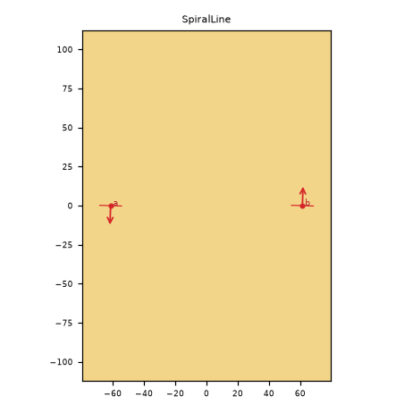

% generated by scripts/make_component_docs.py -- do not edit. Put hand-written notes in docs/components/notes/SpiralLine.md (included below).

# SpiralLine

Spiral line by angle (legacy ``draw.spiral``): Archimedean, Fermat or double Fermat; ports ``a`` / ``b``.

**Source:** Quantcore. **Category:** resonator. **Module:** `quantcore_circuits.layouts.others.spirals`.

See also the [catalog](../CATALOG.md).

## Pins



Pin image (default parameters). Light = metal, dark = etched gap, colours = junction layers. A red dot and arrow is a pin and its direction (out of the cell); the red bar is the CPW width a + 2 b. Blue dot = a pin without direction. Units: µm.

| pin | x (µm) | y (µm) | direction (°) | a (µm) | b (µm) | purpose |
|---|---|---|---|---|---|---|
| `a` | -61.399 | 0 | 268.17 | 2 | 6 | CPW end; LOM node `line` |
| `b` | 61.399 | 0 | 88.17 | 2 | 6 | CPW end; LOM node `line` |

a, b: CPW centre width and gap where the pin declares them (`–` = not declared). Position and direction are in the cell's own frame (`at=(0, 0)`, `rot=0`).

**Notes from the catalog:** legacy draw.spiral (Archimedean / Fermat / double Fermat by angle; the legacy double-Fermat typo y_bls/y1s fixed). Ports 'a'/'b' at the path ends face along the tangent (not Manhattan); metal by default: place it on a pocket (pocket_margin, or metal:Rectangle subtract). LOM: an open-ended line of the drawn length (rough, no kinetic inductance).

## Parameters

| name | default | unit | description |
|---|---|---|---|
| `a` | `10` | μm | Width of center conductor |
| `b` | `6` | μm | Width of gap |
| `r` | `100` | μm | Turn radius |
| `start_angle` | `0.0` | rad | Start angle |
| `end_angle` | `37.69911184307752` | rad | End angle (6 turns = 12π) |
| `width` | `2` | μm | Line width (legacy w) |
| `spiral_type` | `"double_fermat"` | – | Spiral |
| `spiral_r` | `10` | μm | Spiral scale (Archimedean: r = spiral_r·φ; Fermat: r = spiral_r·√φ) |
| `points` | `1000` | – | Points (legacy npoints; per arm for the double Fermat) |
| `metal` | `true` | – | Metal line (base_metal_addition); False: etched (legacy 1/0) |
| `pocket_margin` | `0` | μm | Own square pocket beyond the spiral (0 = none) |

Electrically relevant parameters (sizes, gaps, junction, ports) come first, the rest follows.

## LOM model

The cell contributes to the lumped model:

- no lumped branches

| line | node | length (µm) | a (µm) | b (µm) | ends |
|---|---|---|---|---|---|
| `X` | `line` | 3102.706 | 2 | 3.117 | open / open |

Nodes: `line`.

- X: spiral line 3103 µm (gap = mean turn spacing 3.1 µm; rough; kinetic L as a CPW)

## Simulation export notes

- C6: eigenmode 50 Ω edge port without a polygon (box edge on a bend / taper / narrow line) (status: fixed; fix in sim_tools/builder.py (straighten_box, edge_port_ok, crossing_square))

## How to use

In Python:

```python
from quantcore_circuits.designer import Designer

d = Designer("demo", box=(0, 0, 7500, 7500))
d.add("U1", "SpiralLine", at=(3750, 3750), a=10)   # parameters: see the table above
d.add("PAD", "BondPad", at=(1125, 3750), rot=270)   # a launcher to connect to
d.route("L1", "PAD.a", "U1.a")                # a CPW from the pad to the pin
```

Pin names go into `d.route(...)` as `INSTANCE.pin`, and into `snap=` / `to=` when placing. From the shell: `qcc components SpiralLine` lists the pins; add `--schema` for the parameters.

In KLayout: Quantcore panel ▸ Components ▸ double-click the cell, then click on the layout to place it. Rotate and mirror before the click; use Connect on two pins to route.

GUI status (`kplugin/COMPONENTS_STATUS.md`): places ok, edit ok, connect made, build refused (routing error shown; Undo), build ok. ports are 2 um CPW and 1.8 deg off-axis: a Connect to a 10/6 BondPad cannot route (error shown, Undo).
