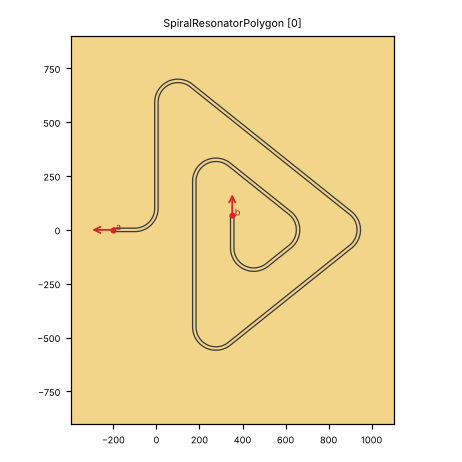

% generated by scripts/make_component_docs.py -- do not edit. Put hand-written notes in docs/components/notes/SpiralResonatorPolygon.md (included below).

# SpiralResonatorPolygon

The PCell declaration for a polygon shaped spiral resonator.

**Source:** KQC (KQCircuits). **Category:** resonator. **Module:** `kqcircuits.elements.spiral_resonator_polygon`.

See also the [catalog](../CATALOG.md).

## Pins



Pin image (default parameters). Light = metal, dark = etched gap, colours = junction layers. A red dot and arrow is a pin and its direction (out of the cell); the red bar is the CPW width a + 2 b. Blue dot = a pin without direction. Units: µm.

| pin | x (µm) | y (µm) | direction (°) | a (µm) | b (µm) | purpose |
|---|---|---|---|---|---|---|
| `a` | -200 | 0 | 180 | 10 | 6 | CPW end; LOM node `res` |
| `b` | 352.228 | 67.13 | 90 | 10 | 6 | CPW end; LOM node `res` |

a, b: CPW centre width and gap where the pin declares them (`–` = not declared). Position and direction are in the cell's own frame (`at=(0, 0)`, `rot=0`).

## Parameters

| name | default | unit | description |
|---|---|---|---|
| `a` | `10` | μm | Width of center conductor |
| `b` | `6` | μm | Width of gap |
| `r` | `100` | μm | Turn radius |
| `length` | `5000` | μm | Resonator length |
| `auto_spacing` | `true` | – | Use automatic spacing |
| `include_connector_length` | `false` | – | Include connector length |
| `manual_spacing` | `[300]` | [μm] | Manual spacing pattern |
| `bridge_spacing` | `0` | μm | Airbridge spacing |
| `term1` | `0` | μm | Termination length start |
| `term2` | `0` | μm | Termination length end |
| `bridge_width` | `40` | μm | Bridge width |
| `pad_length` | `40` | μm | Pad length |
| `bridge_length` | `44` | μm | Bridge length (from pad to pad) |
| `n_bridges_pattern` | `[0]` | – | Pattern for number of airbridges on edges |
| `connector_dist` | `-1` | µm | Face to face connector distance from beginning |
| `connector_a` | `40` | μm | Conductor width at the connector area |
| `connector_b` | `40` | μm | Gap width at the connector area |
| `round_connector` | `false` | – | Use round connector shape |
| `airbridge_type` | `"Airbridge Rectangular"` | – | Airbridge type |
| `include_bumps` | `true` | – | Include bumps |
| `ubm_diameter` | `40` | μm | Under-bump metalization diameter |
| `bump_diameter` | `25` | μm | Bump diameter |
| `bump_type` | `"Flip Chip Connector Dc"` | – | Bump type |

Electrically relevant parameters (sizes, gaps, junction, ports) come first, the rest follows.

## LOM model

The cell contributes to the lumped model:

- no lumped branches

| line | node | length (µm) | a (µm) | b (µm) | ends |
|---|---|---|---|---|---|
| `X` | `res` | 5000 | 10 | 6 | short / short |

Nodes: `res`.

## Simulation export notes

- C7: C-matrix nets without a design label (warning) (status: fixed; fix in sim_tools/builder.py (_cell_probes, label_unnamed); layouts/others/amplifiers.py (JtwpaChain.qcc_probes))

## How to use

In Python:

```python
from quantcore_circuits.designer import Designer

d = Designer("demo", box=(0, 0, 7500, 7500))
d.add("U1", "SpiralResonatorPolygon", at=(3750, 3750), a=10)   # parameters: see the table above
d.add("PAD", "BondPad", at=(1125, 3750), rot=270)   # a launcher to connect to
d.route("L1", "PAD.a", "U1.a")                # a CPW from the pad to the pin
```

Pin names go into `d.route(...)` as `INSTANCE.pin`, and into `snap=` / `to=` when placing. From the shell: `qcc components SpiralResonatorPolygon` lists the pins; add `--schema` for the parameters.

In KLayout: Quantcore panel ▸ Components ▸ double-click the cell, then click on the layout to place it. Rotate and mirror before the click; use Connect on two pins to route.
