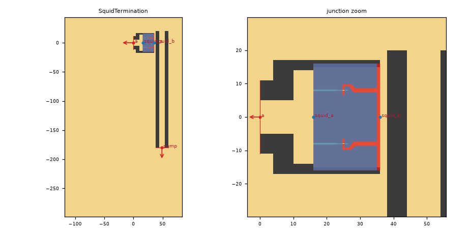

% generated by scripts/make_component_docs.py -- do not edit. Put hand-written notes in docs/components/notes/SquidTermination.md (included below).

# SquidTermination

CPW lead shorted to ground through a trilayer SQUID, with a shorted pump / flux line (QPDK ``squid_termination``

**Source:** Quantcore. **Category:** termination. **Module:** `quantcore_circuits.layouts.others.amplifiers`.

See also the [catalog](../CATALOG.md).

## Pins



Pin image (default parameters). Light = metal, dark = etched gap, colours = junction layers. A red dot and arrow is a pin and its direction (out of the cell); the red bar is the CPW width a + 2 b. Blue dot = a pin without direction. Units: µm.

| pin | x (µm) | y (µm) | direction (°) | a (µm) | b (µm) | purpose |
|---|---|---|---|---|---|---|
| `a` | 0 | 0 | 180 | 10 | 6 | CPW end; LOM node `lead` |
| `pump` | 49 | -180 | 270 | 10 | 6 | control line (flux) in the LOM |
| `squid_a` | 16 | 0 | none | 10 | 6 | junction pins (the LOM's L_J) |
| `squid_b` | 36 | 0 | none | 10 | 6 | junction pins (the LOM's L_J) |

Pins with direction `none`: `squid_a`, `squid_b`. They mark a point (a junction lead, a pad centre), not a CPW end. The KLayout ghost draws them as boxes. A route can start there only where the notes say so; it cannot be snapped to.

a, b: CPW centre width and gap where the pin declares them (`–` = not declared). Position and direction are in the cell's own frame (`at=(0, 0)`, `rot=0`).

## Parameters

| name | default | unit | description |
|---|---|---|---|
| `a` | `10` | μm | Width of center conductor |
| `b` | `6` | μm | Width of gap |
| `r` | `100` | μm | Turn radius |
| `lead_length` | `10` | μm | CPW lead length |
| `junction_gap` | `20` | μm | Pocket length along the lead (the junction window height) |
| `pocket_width` | `34` | μm | Pocket width across the lead |
| `junction_type` | `"Quantcore Squid"` | – | Junction across the pocket (trilayer cell) |
| `junction_params` | `"{}"` | – | Trilayer junction cell parameters (JSON dict) |
| `pump_length` | `200` | μm | Pump line length (port to short) |
| `pump_gap` | `2` | μm | Ground strip between the pocket and the pump line gap |
| `head` | `[6, 28]` | – | Landing head at the lead end in the pocket (length, width), µm |
| `flux_phi0` | `0.0` | Φ0 | Static flux bias of the SQUID (LOM) |
| `pump_line` | `true` | – | Draw the shorted pump / flux line |
| `pump_offset` | `20` | μm | Pump short beyond the SQUID axis |

Electrically relevant parameters (sizes, gaps, junction, ports) come first, the rest follows.

## LOM model

The cell contributes to the lumped model:

- no lumped branches

| line | node | length (µm) | a (µm) | b (µm) | ends |
|---|---|---|---|---|---|
| `X` | `lead` | 15412.596 | 10 | 6 | short / short |

Nodes: `lead`.

- X: SQUID L_s = 6.734 nH at Φ = 0 Φ0 (drawn Quantcore Squid (PDK junction rule)) → 15397 µm of 10/6 µm CPW at the shorted end (L' 437 nH/m incl. kinetic); the SQUID's Kerr / three-wave mixing is not in the lumped circuit (analysis.amplifiers)

## Simulation export notes

- C9: SquidTermination lead shorted to ground in the drawn cell (fab build too) (status: fixed; fix in layouts/others/amplifiers.py (SquidTermination.build))

## How to use

In Python:

```python
from quantcore_circuits.designer import Designer

d = Designer("demo", box=(0, 0, 7500, 7500))
d.add("U1", "SquidTermination", at=(3750, 3750), a=10)   # parameters: see the table above
d.add("PAD", "BondPad", at=(1125, 3750), rot=270)   # a launcher to connect to
d.route("L1", "PAD.a", "U1.a")                # a CPW from the pad to the pin
```

Pin names go into `d.route(...)` as `INSTANCE.pin`, and into `snap=` / `to=` when placing. From the shell: `qcc components SquidTermination` lists the pins; add `--schema` for the parameters.

In KLayout: Quantcore panel ▸ Components ▸ double-click the cell, then click on the layout to place it. Rotate and mirror before the click; use Connect on two pins to route.

GUI status (`kplugin/COMPONENTS_STATUS.md`): places ok, edit ok, connect ok, build ok. ports without direction: squid_a, squid_b (ghost draws boxes).
