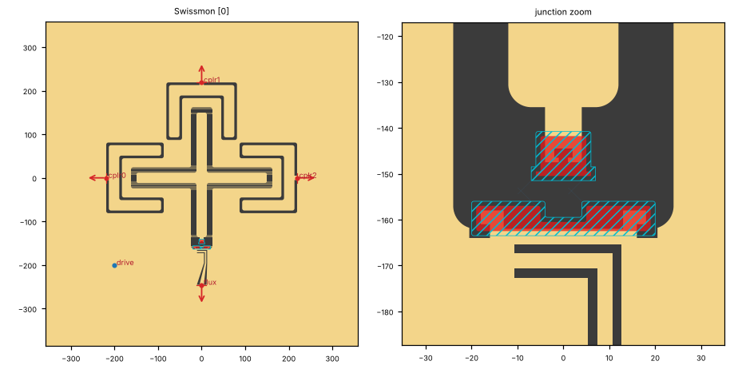

% generated by scripts/make_component_docs.py -- do not edit. Put hand-written notes in docs/components/notes/Swissmon.md (included below).

# Swissmon

The PCell declaration for a Swissmon qubit.

**Source:** KQC (KQCircuits). **Category:** qubit. **Module:** `kqcircuits.qubits.swissmon`.

See also the [catalog](../CATALOG.md).

## Pins



Pin image (default parameters). Light = metal, dark = etched gap, colours = junction layers. A red dot and arrow is a pin and its direction (out of the cell); the red bar is the CPW width a + 2 b. Blue dot = a pin without direction. Units: µm.

| pin | x (µm) | y (µm) | direction (°) | a (µm) | b (µm) | purpose |
|---|---|---|---|---|---|---|
| `cplr0` | -219 | 0 | 180 | 10 | 6 | coupler port (readout / bus); LOM node `cplr0` |
| `cplr1` | 0 | 219 | 90 | 10 | 6 | coupler port (readout / bus); LOM node `cplr1` |
| `cplr2` | 219 | 0 | 0 | 10 | 6 | coupler port (readout / bus); LOM node `cplr2` |
| `drive` | -200 | -200 | none | 10 | 6 | drive / charge line end; control line (drive) in the LOM |
| `flux` | 0 | -245.333 | 270 | 10 | 6 | flux line end; control line (flux) in the LOM |

Pins with direction `none`: `drive`. They mark a point (a junction lead, a pad centre), not a CPW end. The KLayout ghost draws them as boxes. A route can start there only where the notes say so; it cannot be snapped to.

a, b: CPW centre width and gap where the pin declares them (`–` = not declared). Position and direction are in the cell's own frame (`at=(0, 0)`, `rot=0`).

**Notes from the catalog:** port 'drive' has no direction with default parameters (KQC puts no port_drive_corner). Coupler ports 'cplr0..2' have a = port_width[i]; the qubit's own gap around them is wider than b.

## Parameters

| name | default | unit | description |
|---|---|---|---|
| `a` | `10` | μm | Width of center conductor |
| `b` | `6` | μm | Width of gap |
| `r` | `100` | μm | Turn radius |
| `mirror_squid` | `false` | – | Mirror SQUID by its Y axis |
| `junction_type` | `"Manhattan"` | – | Junction Type |
| `junction_width` | `0.02` | μm | Junction width for code generated element |
| `arm_length` | `[150.0, 150.0, 150.0, 150.0]` | – | Arm length (um, WNES)) |
| `arm_width` | `[24, 24, 24, 24]` | – | Arm metal width (um, WNES) |
| `gap_width` | `[12, 12, 12, 12]` | – | Arm gap width (um, WNES) |
| `cpl_width` | `[24, 24, 24]` | – | Coupler width (um, WNE) |
| `cpl_length` | `[120, 120, 120]` | – | Coupler lengths (um, WNE) |
| `cpl_gap` | `[102, 102, 102]` | – | Coupler gap (um, WNE) |
| `port_width` | `[10, 10, 10]` | – | Port width (um, WNE) |
| `island_r` | `5` | μm | Center island rounding radius |
| `loop_area` | `100` | μm^2 | Loop area |
| `fluxline_type` | `"Fluxline Standard"` | – | Fluxline Type |
| `cpl_b` | `[6, 6, 6]` | – | Coupler gap to ground (um, WNE) |
| `cl_offset` | `[200, 200]` | – | Chargeline offset (um, um) |

Electrically relevant parameters (sizes, gaps, junction, ports) come first, the rest follows.

## LOM model

The cell contributes to the lumped model:

| branch | type | nodes | value (estimate at defaults) |
|---|---|---|---|
| `C_X` | C | island – gnd | estimate=78.4, unit=fF, estimate_source=analytic: CPW-arm cross (24/12 µm) × 0.874 Xmon Q3D anchor, estimate_kind=analytic, uncertainty=±25% |
| `J_X` | SQUID | island – gnd | Lj_nH=6.734, Cj_fF=15, asym=0, flux_phi0=0 |
| `Cg_X_cplr0` | C | island – cplr0 | estimate=3.8, unit=fF, estimate_source=rough: Xmon claw calibration at the coupler length (screened coupler), estimate_kind=rough, uncertainty=±50% |
| `Cc_X_cplr0` | C | cplr0 – gnd | estimate=69.3, unit=fF, estimate_source=analytic: horseshoe as CPW 24/6 µm × 366 µm, estimate_kind=analytic, uncertainty=±25% |
| `Cg_X_cplr1` | C | island – cplr1 | estimate=3.8, unit=fF, estimate_source=rough: Xmon claw calibration at the coupler length (screened coupler), estimate_kind=rough, uncertainty=±50% |
| `Cc_X_cplr1` | C | cplr1 – gnd | estimate=69.3, unit=fF, estimate_source=analytic: horseshoe as CPW 24/6 µm × 366 µm, estimate_kind=analytic, uncertainty=±25% |
| `Cg_X_cplr2` | C | island – cplr2 | estimate=3.8, unit=fF, estimate_source=rough: Xmon claw calibration at the coupler length (screened coupler), estimate_kind=rough, uncertainty=±50% |
| `Cc_X_cplr2` | C | cplr2 – gnd | estimate=69.3, unit=fF, estimate_source=analytic: horseshoe as CPW 24/6 µm × 366 µm, estimate_kind=analytic, uncertainty=±25% |

Nodes: `island`, `cplr0`, `cplr1`, `cplr2`.

## How to use

In Python:

```python
from quantcore_circuits.designer import Designer

d = Designer("demo", box=(0, 0, 7500, 7500))
d.add("U1", "Swissmon", at=(3750, 3750), a=10)   # parameters: see the table above
d.add("PAD", "BondPad", at=(1125, 3750), rot=270)   # a launcher to connect to
d.route("L1", "PAD.a", "U1.cplr0")                # a CPW from the pad to the pin
```

Pin names go into `d.route(...)` as `INSTANCE.pin`, and into `snap=` / `to=` when placing. From the shell: `qcc components Swissmon` lists the pins; add `--schema` for the parameters.

In KLayout: Quantcore panel ▸ Components ▸ double-click the cell, then click on the layout to place it. Rotate and mirror before the click; use Connect on two pins to route.
