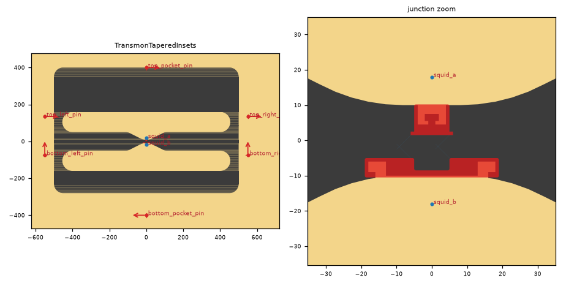

% generated by scripts/make_component_docs.py -- do not edit. Put hand-written notes in docs/components/notes/TransmonTaperedInsets.md (included below).

# TransmonTaperedInsets

Floating tapered-pad transmon in a filleted pocket (SQDMetal ``TransmonTaperedInsets``).

**Source:** Quantcore. **Category:** qubit. **Module:** `quantcore_circuits.layouts.qubits.sqdmetal_cells`.

See also the [catalog](../CATALOG.md) and the [duplicates decisions](../DUPLICATES.md).

## Pins



Pin image (default parameters). Light = metal, dark = etched gap, colours = junction layers. A red dot and arrow is a pin and its direction (out of the cell); the red bar is the CPW width a + 2 b. Blue dot = a pin without direction. Units: µm.

| pin | x (µm) | y (µm) | direction (°) | a (µm) | b (µm) | purpose |
|---|---|---|---|---|---|---|
| `bottom_left_pin` | -550 | -75 | 90 | 10 | 6 | LOM node `island2` |
| `bottom_pocket_pin` | 0 | -400 | 180 | 10 | 6 | grounded in the LOM |
| `bottom_right_pin` | 550 | -75 | 90 | 10 | 6 | LOM node `island2` |
| `squid_a` | 0 | 18 | none | 10 | 6 | junction pins (the LOM's L_J); LOM node `island1` |
| `squid_b` | 0 | -18 | none | 10 | 6 | junction pins (the LOM's L_J); LOM node `island2` |
| `top_left_pin` | -550 | 135 | 0 | 10 | 6 | LOM node `island1` |
| `top_pocket_pin` | 0 | 400 | 0 | 10 | 6 | grounded in the LOM |
| `top_right_pin` | 550 | 135 | 0 | 10 | 6 | LOM node `island1` |

Pins with direction `none`: `squid_a`, `squid_b`. They mark a point (a junction lead, a pad centre), not a CPW end. The KLayout ghost draws them as boxes. A route can start there only where the notes say so; it cannot be snapped to.

a, b: CPW centre width and gap where the pin declares them (`–` = not declared). Position and direction are in the cell's own frame (`at=(0, 0)`, `rot=0`).

**Notes from the catalog:** SQDMetal TransmonTaperedInsets (Apache-2.0). The corner and pocket pins keep SQDMetal's normals (top_*_pin +x, bottom_*_pin +y, top_pocket_pin +x, bottom_pocket_pin -x): placement marks in or at the pocket, not CPW ends. Connection-pad ports are CPW ends.

## Parameters

| name | default | unit | description |
|---|---|---|---|
| `a` | `10` | μm | Width of center conductor |
| `b` | `6` | μm | Width of gap |
| `r` | `100` | μm | Turn radius |
| `mirror_squid` | `false` | – | Mirror SQUID by its Y axis |
| `junction_type` | `"Manhattan"` | – | Junction Type |
| `junction_width` | `0.02` | μm | Junction width for code generated element |
| `inductor_width` | `20` | μm | Junction line width |
| `inductor_height` | `36` | μm | Junction line length |
| `junction_pin_inset` | `0` | μm | Junction pins inset from the pad edge |
| `pad_gap` | `100` | μm | Gap between the pads |
| `pad_width` | `800` | μm | Pad width (x, without the round ends) |
| `pad_height` | `110` | μm | Pad height (y) |
| `pocket_width` | `1000` | μm | Pocket width |
| `taper_width_top` | `40` | μm | Taper width at the junction |
| `taper_width_base` | `200` | μm | Taper width at the pad |
| `taper_height` | `40` | μm | Taper height (0 = no taper) |
| `taper_fillet_radius` | `3` | μm | Taper corner radius |
| `junction_position` | `"center"` | – | Junction position (SQDMetal junction_centered True / False / 'left') |
| `junction_x_offset` | `0` | μm | Junction offset from the pad end (right / left) |
| `inset_width` | `0` | μm | Inset width (0 = none) |
| `inset_fillet_radius` | `10` | μm | Inset corner radius |
| `fillet_radius` | `50` | μm | Pad fillet radius |
| `fillet_radius_gap` | `50` | μm | Pocket corner radius |
| `coupled_pad_height` | `0` | μm | Coupler teeth height (0 = none) |
| `coupled_pad_width` | `0` | μm | Coupler teeth width |
| `coupled_pad_gap` | `0` | μm | Gap between the coupler teeth |
| `connection_pads` | `"{}"` | – | Connection pads (JSON {name: {options}}) |
| `junction_params` | `"{}"` | – | Junction cell parameters (JSON dict) |
| `loop_area` | `100` | μm^2 | Loop area |
| `fluxline_type` | `"Fluxline Standard"` | – | Fluxline Type |
| `chrgln_pin_x_offset` | `30` | μm | Corner pins: offset along y from the pad centre line |
| `chrgln_pin_y_offset` | `50` | μm | Corner pins: offset along x from the pocket edge |
| `pocket_height` | `800` | μm | Pocket height |
| `pocket_lower_tighten` | `120` | μm | Pocket shortened from below by |
| `inset_depth` | `100` | μm | Inset depth |
| `fillet_resolution` | `16` | – | Fillet points per quarter circle |

Electrically relevant parameters (sizes, gaps, junction, ports) come first, the rest follows.

## LOM model

The cell contributes to the lumped model:

| branch | type | nodes | value (estimate at defaults) |
|---|---|---|---|
| `C_X_1` | C | island1 – gnd | estimate=92.7, unit=fF, estimate_source=analytic: 910×110 µm pads across 100 µm in a 1000×800 µm pocket (coupled strips + CPW), estimate_kind=analytic, uncertainty=±25% |
| `C_X_2` | C | island2 – gnd | estimate=106, unit=fF, estimate_source=analytic: 910×110 µm pads across 100 µm in a 1000×800 µm pocket (coupled strips + CPW), estimate_kind=analytic, uncertainty=±25% |
| `C_X_12` | C | island1 – island2 | estimate=44.4, unit=fF, estimate_source=analytic: 910×110 µm pads across 100 µm in a 1000×800 µm pocket (coupled strips + CPW), estimate_kind=analytic, uncertainty=±25% |
| `J_X` | SQUID | island1 – island2 | Lj_nH=–, Cj_fF=0, asym=0, flux_phi0=0 |

Nodes: `island1`, `island2`.

- X: no junction.Lj_nH in the design; the qubit mode needs one to simulate

## Simulation export notes

- C1: Sim junction pads overlap / end on a curved island in a narrow gap (status: fixed; fix in layouts/junctions/sim_gap.py; layouts/qubits/qpdk_cells.py; layouts/qubits/sqdmetal_cells.py)

Details: [SIM_EXPORT_AUDIT](../SIM_EXPORT_AUDIT.md).

## How to use

In Python:

```python
from quantcore_circuits.designer import Designer

d = Designer("demo", box=(0, 0, 7500, 7500))
d.add("U1", "TransmonTaperedInsets", at=(3750, 3750), a=10)   # parameters: see the table above
d.add("PAD", "BondPad", at=(1125, 3750), rot=270)   # a launcher to connect to
d.route("L1", "PAD.a", "U1.bottom_left_pin")                # a CPW from the pad to the pin
```

Pin names go into `d.route(...)` as `INSTANCE.pin`, and into `snap=` / `to=` when placing. From the shell: `qcc components TransmonTaperedInsets` lists the pins; add `--schema` for the parameters.

In KLayout: Quantcore panel ▸ Components ▸ double-click the cell, then click on the layout to place it. Rotate and mirror before the click; use Connect on two pins to route.

GUI status (`kplugin/COMPONENTS_STATUS.md`): places ok, edit ok, connect ok, build ok. ports without direction: squid_a, squid_b (ghost draws boxes).
