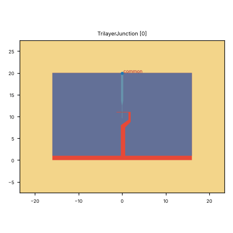

% generated by scripts/make_component_docs.py -- do not edit. Put hand-written notes in docs/components/notes/TrilayerJunction.md (included below).

# TrilayerJunction

Single Nb trilayer cross junction (legacy ``xjc_junction_TL_mod.create_junction``).

**Source:** Quantcore. **Category:** junction. **Module:** `quantcore_circuits.layouts.junctions.trilayer`.

:::{note}
Alias of [`QuantcoreJunction`](QuantcoreJunction.md): the same circuit, drawn differently. finger_width 0.5, second_finger_width 0.6, clearer True = QuantcoreJunction (XOR 0)
:::

See also the [catalog](../CATALOG.md) and the [duplicates decisions](../DUPLICATES.md).

## Pins



Pin image (default parameters). Light = metal, dark = etched gap, colours = junction layers. A red dot and arrow is a pin and its direction (out of the cell); the red bar is the CPW width a + 2 b. Blue dot = a pin without direction. Units: µm.

| pin | x (µm) | y (µm) | direction (°) | a (µm) | b (µm) | purpose |
|---|---|---|---|---|---|---|
| `common` | 0 | 20 | none | 10 | 6 | junction lead (the LOM's L_J branch); LOM node `j` |

Pins with direction `none`: `common`. They mark a point (a junction lead, a pad centre), not a CPW end. The KLayout ghost draws them as boxes. A route can start there only where the notes say so; it cannot be snapped to.

a, b: CPW centre width and gap where the pin declares them (`–` = not declared). Position and direction are in the cell's own frame (`at=(0, 0)`, `rot=0`).

## Parameters

| name | default | unit | description |
|---|---|---|---|
| `a` | `10` | μm | Width of center conductor |
| `b` | `6` | μm | Width of gap |
| `r` | `100` | μm | Turn radius |
| `junction_type` | `"Trilayer Junction"` | – | Junction Type |
| `junction_width` | `0.02` | μm | Junction width for code generated element |
| `finger_width` | `0.1` | μm | Straight finger width (junction size) |
| `second_finger_width` | `0.0` | μm | Bent finger width (0 = same as straight) |
| `window_width` | `32.0` | μm | Exposure window width |
| `straight_finger_length` | `3.2` | μm | Straight finger length |
| `straight_finger_y` | `-3.6` | μm | Straight finger offset (legacy y) |
| `bent_finger_length` | `3.0` | μm | Bent finger length |
| `bent_finger_y` | `-2.5` | μm | Bent finger offset (legacy y) |
| `bent_pad_width` | `1.0` | μm | Bent finger lead width |
| `hsq_width` | `0.2` | μm | HSQ box width |
| `bent_finger_x` | `0.2` | μm | Bent finger offset (legacy x) |
| `loop_area` | `100` | μm^2 | Loop area |
| `window_height` | `20.0` | μm | Exposure window height (= qubit gap it spans) |
| `bent_shift` | `0.5` | μm | Bent finger cell shift in y |
| `with_hsq` | `true` | – | Draw HSQ sidewall boxes |
| `hsq_extra` | `0.2` | μm | HSQ box extra length |
| `spacer_gradient` | `true` | – | Spacer gradient: 51–53/0 dose levels inside the 50/0 spacer (width / 3 strips; rings for windows) |
| `lj_nH` | `0.0` | nH | Size by the PDK junction rule for this L_J (SQUID: parallel total; 0 = use the finger widths) |
| `clearer` | `false` | – | Draw the CLEARER metal box under the windows (base_metal_addition) |
| `clearer_inset` | `1.0` | μm | CLEARER inset from the window sides |
| `hsq_overlap` | `0.045` | μm | HSQ overlap onto the finger |
| `bent_conn_height` | `1.0` | μm | Bent finger connection height |

Electrically relevant parameters (sizes, gaps, junction, ports) come first, the rest follows.

## LOM model

The cell contributes to the lumped model:

| branch | type | nodes | value (estimate at defaults) |
|---|---|---|---|
| `J_X` | JJ | j – gnd | Lj_nH=202.033, Cj_fF=0.5 |

Nodes: `j`.

## Simulation export notes

- C3: junction sub-cell simulated on its own (status: fixed; fix in sim_tools/builder.py (is_junction_cell, _is_qubit, build_simulation); sim_tools/subset.py (has_junction))

Details: [SIM_EXPORT_AUDIT](../SIM_EXPORT_AUDIT.md).

## How to use

In Python:

```python
from quantcore_circuits.designer import Designer

d = Designer("demo", box=(0, 0, 7500, 7500))
d.add("U1", "TrilayerJunction", at=(3750, 3750), a=10)   # parameters: see the table above
# no directed pin: place it with at= / rot=, or snap it with snap= / to=
```

Pin names go into `d.route(...)` as `INSTANCE.pin`, and into `snap=` / `to=` when placing. From the shell: `qcc components TrilayerJunction` lists the pins; add `--schema` for the parameters.

In KLayout: Quantcore panel ▸ Components ▸ double-click the cell, then click on the layout to place it. Rotate and mirror before the click; use Connect on two pins to route.

GUI status (`kplugin/COMPONENTS_STATUS.md`): places ok, edit ok, connect n/a (no directed port), build ok. ports without direction: common (ghost draws boxes).
