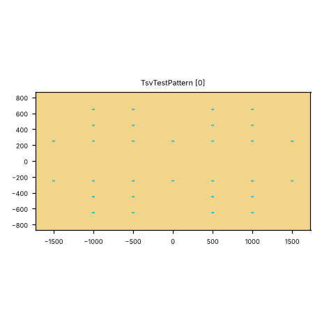

% generated by scripts/make_component_docs.py -- do not edit. Put hand-written notes in docs/components/notes/TsvTestPattern.md (included below).

# TsvTestPattern

PCell declaration for TSV test structures which resembles a TSV fencing for a CPW transmission line.

**Source:** KQC (KQCircuits). **Category:** test_structure. **Module:** `kqcircuits.test_structures.tsv_test_pattern`.

See also the [catalog](../CATALOG.md).

## Pins



Pin image (default parameters). Light = metal, dark = etched gap, colours = junction layers. A red dot and arrow is a pin and its direction (out of the cell); the red bar is the CPW width a + 2 b. Blue dot = a pin without direction. Units: µm.

No pins: this cell has no ports. Place it with `at=` / `rot=`.

## Parameters

| name | default | unit | description |
|---|---|---|---|
| `a` | `10` | μm | Width of center conductor |
| `b` | `6` | μm | Width of gap |
| `r` | `100` | μm | Turn radius |
| `tsv_elliptical_width` | `30` | μm | TSV elliptical width |
| `cpw_distance` | `100` | μm | CPW Placeholder distance |
| `hor_distance` | `200` | μm | Horizontal pitch on TSV |
| `ver_distance` | `500` | μm | Vertical pitch on TSV |
| `tsv_array_form` | `[2, 6, 6, 2, 6, 6, 2]` | – | TSV test layout |
| `tsv_type` | `"Tsv Ellipse"` | – | TSV type |
| `tsv_diameter` | `10` | μm | TSV diameter |
| `tsv_margin` | `30` | μm | TSV margin |

Electrically relevant parameters (sizes, gaps, junction, ports) come first, the rest follows.

## LOM model

none (a LOM build gives each pin its own bare node, without elements).

## How to use

In Python:

```python
from quantcore_circuits.designer import Designer

d = Designer("demo", box=(0, 0, 7500, 7500))
d.add("U1", "TsvTestPattern", at=(3750, 3750), a=10)   # parameters: see the table above
# no directed pin: place it with at= / rot=, or snap it with snap= / to=
```

Pin names go into `d.route(...)` as `INSTANCE.pin`, and into `snap=` / `to=` when placing. From the shell: `qcc components TsvTestPattern` lists the pins; add `--schema` for the parameters.

In KLayout: Quantcore panel ▸ Components ▸ double-click the cell, then click on the layout to place it. Rotate and mirror before the click; use Connect on two pins to route.
