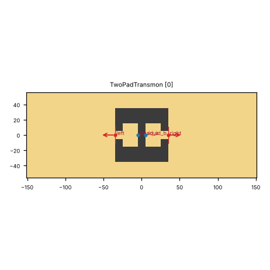

% generated by scripts/make_component_docs.py -- do not edit. Put hand-written notes in docs/components/notes/TwoPadTransmon.md (included below).

# TwoPadTransmon

Floating two-pad transmon (legacy ``Transmon``); ports ``left`` / ``right`` at the lead ends.

**Source:** Quantcore. **Category:** qubit. **Module:** `quantcore_circuits.layouts.qubits.legacy_transmon`.

See also the [catalog](../CATALOG.md).

## Pins



Pin image (default parameters). Light = metal, dark = etched gap, colours = junction layers. A red dot and arrow is a pin and its direction (out of the cell); the red bar is the CPW width a + 2 b. Blue dot = a pin without direction. Units: µm.

| pin | x (µm) | y (µm) | direction (°) | a (µm) | b (µm) | purpose |
|---|---|---|---|---|---|---|
| `left` | -35 | 0 | 180 | 10 | 6 | pad coupling port; LOM node `island1` |
| `right` | 35 | 0 | 0 | 10 | 6 | pad coupling port; LOM node `island2` |
| `squid_a` | -5 | 0 | none | 10 | 6 | junction pins (the LOM's L_J); LOM node `island1` |
| `squid_b` | 5 | 0 | none | 10 | 6 | junction pins (the LOM's L_J); LOM node `island2` |

Pins with direction `none`: `squid_a`, `squid_b`. They mark a point (a junction lead, a pad centre), not a CPW end. The KLayout ghost draws them as boxes. A route can start there only where the notes say so; it cannot be snapped to.

a, b: CPW centre width and gap where the pin declares them (`–` = not declared). Position and direction are in the cell's own frame (`at=(0, 0)`, `rot=0`).

## Parameters

| name | default | unit | description |
|---|---|---|---|
| `a` | `10` | μm | Width of center conductor |
| `b` | `6` | μm | Width of gap |
| `r` | `100` | μm | Turn radius |
| `pad_thickness` | `20` | μm | Pad thickness (along the axis) |
| `pad_height` | `30` | μm | Pad height |
| `gap` | `10` | μm | Gap between the pads (junction gap) |
| `lead_length` | `10` | μm | Lead length outside each pad |
| `junction_type` | `"No Squid"` | – | Junction across the gap: none (legacy) or a trilayer cell |
| `junction_params` | `"{}"` | – | Trilayer junction cell parameters (JSON dict, e.g. lj_nH) |
| `pocket_margin` | `20` | μm | Pocket beyond the pads in y (0 = no pocket, legacy) |

Electrically relevant parameters (sizes, gaps, junction, ports) come first, the rest follows.

## LOM model

The cell contributes to the lumped model:

| branch | type | nodes | value (estimate at defaults) |
|---|---|---|---|
| `C_X_1` | C | island1 – gnd | estimate=5.85, unit=fF, estimate_source=analytic: two 20×30 µm pads across 10 µm in a 20 µm pocket (coupled strips + CPW), estimate_kind=analytic, uncertainty=±25% |
| `C_X_2` | C | island2 – gnd | estimate=5.85, unit=fF, estimate_source=analytic: two 20×30 µm pads across 10 µm in a 20 µm pocket (coupled strips + CPW), estimate_kind=analytic, uncertainty=±25% |
| `C_X_12` | C | island1 – island2 | estimate=1.68, unit=fF, estimate_source=analytic: two 20×30 µm pads across 10 µm in a 20 µm pocket (coupled strips + CPW), estimate_kind=analytic, uncertainty=±25% |
| `J_X` | JJ | island1 – island2 | Lj_nH=–, Cj_fF=0 |

Nodes: `island1`, `island2`.

- X: no junction drawn (junction_type 'No Squid'); a JJ across the gap is assumed
- X: no junction.Lj_nH in the design; the qubit mode needs one to simulate
- X: two-pad transmon pads only (7.5 fF); the leads' loads set C_Σ

## Simulation export notes

- C4: galvanic lead port shorted to ground / leaving the box (status: fixed; fix in sim_tools/builder.py (lead_open_ends, galvanic_routes, build_simulation))

## How to use

In Python:

```python
from quantcore_circuits.designer import Designer

d = Designer("demo", box=(0, 0, 7500, 7500))
d.add("U1", "TwoPadTransmon", at=(3750, 3750), a=10)   # parameters: see the table above
d.add("PAD", "BondPad", at=(1125, 3750), rot=270)   # a launcher to connect to
d.route("L1", "PAD.a", "U1.left")                # a CPW from the pad to the pin
```

Pin names go into `d.route(...)` as `INSTANCE.pin`, and into `snap=` / `to=` when placing. From the shell: `qcc components TwoPadTransmon` lists the pins; add `--schema` for the parameters.

In KLayout: Quantcore panel ▸ Components ▸ double-click the cell, then click on the layout to place it. Rotate and mirror before the click; use Connect on two pins to route.

GUI status (`kplugin/COMPONENTS_STATUS.md`): places ok, edit ok, connect ok, build ok. SQUID ports have no direction (null): ghost draws them as boxes (was the crash).
