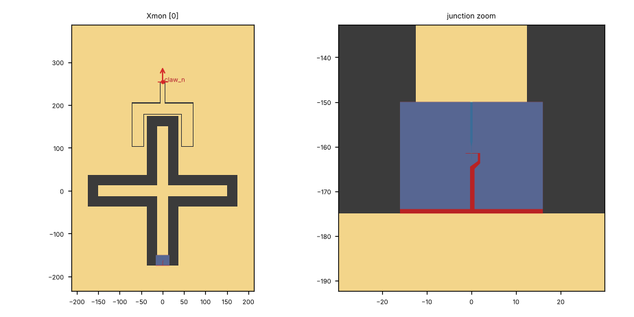

% generated by scripts/make_component_docs.py -- do not edit. Put hand-written notes in docs/components/notes/Xmon.md (included below).

# Xmon

Grounded cross transmon with claw couplers; junction below the south arm.

**Source:** Quantcore. **Category:** qubit. **Module:** `quantcore_circuits.layouts.qubits.xmon`.

See also the [catalog](../CATALOG.md) and the [duplicates decisions](../DUPLICATES.md).

## Pins



Pin image (default parameters). Light = metal, dark = etched gap, colours = junction layers. A red dot and arrow is a pin and its direction (out of the cell); the red bar is the CPW width a + 2 b. Blue dot = a pin without direction. Units: µm.

| pin | x (µm) | y (µm) | direction (°) | a (µm) | b (µm) | purpose |
|---|---|---|---|---|---|---|
| `claw_n` | 0 | 254 | 90 | 10 | 6 | readout claw (coupler; the readout CPW starts here); LOM node `claw_n` |

a, b: CPW centre width and gap where the pin declares them (`–` = not declared). Position and direction are in the cell's own frame (`at=(0, 0)`, `rot=0`).

**Notes from the catalog:** claw tails ('claw_n/w/e') start the readout CPW: their clearance is claw_tail_gap (-1 = the element b, the chip CPW gap; claw_ground: claw_ground_gap) and the port declares exactly that (a = claw_tail_width); the claw body keeps the claw_spacing clearance. junction_type 'Quantcore Junction' / 'Quantcore Squid' = the PDK trilayer junctions; 3/0 keep-out = the legacy cross grown by 2*claw_base + 10 + claw_finger_width.

## Parameters

| name | default | unit | description |
|---|---|---|---|
| `a` | `10` | μm | Width of center conductor |
| `b` | `6` | μm | Width of gap |
| `r` | `100` | μm | Turn radius |
| `mirror_squid` | `false` | – | Mirror SQUID by its Y axis |
| `junction_type` | `"Trilayer Junction"` | – | Junction Type |
| `junction_width` | `0.02` | μm | Junction width for code generated element |
| `arm_width` | `25` | μm | Cross arm width |
| `cross_length` | `300` | μm | Cross tip-to-tip length |
| `gap` | `25` | μm | Gap between cross and ground |
| `ground_sliver` | `2` | μm | Ground between cross gap and claw clearance |
| `claws` | `["n"]` | – | Claws to draw (any of n, w, e) |
| `claw_spacing` | `2` | μm | Claw clearance to ground |
| `claw_base` | `25` | μm | Claw base thickness |
| `claw_finger_width` | `25` | μm | Claw finger width |
| `claw_length` | `100` | μm | Claw finger length |
| `claw_tail` | `true` | – | Claw has a tail (connection stub) |
| `claw_tail_length` | `50` | μm | Claw tail length |
| `claw_tail_width` | `10` | μm | Claw tail width (CPW centre width at the port) |
| `claw_ground` | `false` | – | Ground frame around the claw |
| `claw_ground_gap` | `6` | μm | Claw ground gap |
| `claw_tail_gap` | `-1` | μm | Claw tail gap to ground (= the readout CPW gap; -1 = the element's b) |
| `flux_port` | `false` | – | Add flux-line port and current slot below the junction |
| `junction_params` | `"{}"` | – | Junction cell parameters (JSON dict) |
| `junction_window` | `[]` | – | Metal window [width, height(, offset)] in the junction gap (legacy CLEARER; offset > 0 = away from the cross; empty = none) |
| `loop_area` | `100` | μm^2 | Loop area |
| `fluxline_type` | `"none"` | – | Fluxline Type (KQC) |
| `flux_x` | `-10.5` | μm | Flux tip x offset from the qubit axis |
| `flux_tip_depth` | `0.5` | μm | Flux tip distance beyond the gap edge |
| `flux_slot` | `[28, 5]` | μm | Flux slot size [length, width] (empty = none) |

Electrically relevant parameters (sizes, gaps, junction, ports) come first, the rest follows.

## LOM model

The cell contributes to the lumped model:

| branch | type | nodes | value (estimate at defaults) |
|---|---|---|---|
| `C_X` | C | island – gnd | estimate=64.05, unit=fF, estimate_source=calibration Xmon.C_island (Q3D Q1R1 2026-11-02 (Si, rescaled (εr+1)/2)) |
| `J_X` | JJ | island – gnd | Lj_nH=202.033, Cj_fF=0.5 |
| `Cg_X_claw_n` | C | island – claw_n | estimate=3.17, unit=fF, estimate_source=calibration Xmon.Cg (Q3D Q1R1 2026-11-02 (Si, rescaled (εr+1)/2)) |
| `Cc_X_claw_n` | C | claw_n – gnd | estimate=76.4, unit=fF, estimate_source=calibration Xmon.C_claw (Q3D Q1R1 2026-11-02 (Si, rescaled (εr+1)/2)) |

Nodes: `island`, `claw_n`.

## How to use

In Python:

```python
from quantcore_circuits.designer import Designer

d = Designer("demo", box=(0, 0, 7500, 7500))
d.add("U1", "Xmon", at=(3750, 3750), a=10)   # parameters: see the table above
d.add("PAD", "BondPad", at=(1125, 3750), rot=270)   # a launcher to connect to
d.route("L1", "PAD.a", "U1.claw_n")                # a CPW from the pad to the pin
```

Pin names go into `d.route(...)` as `INSTANCE.pin`, and into `snap=` / `to=` when placing. From the shell: `qcc components Xmon` lists the pins; add `--schema` for the parameters.

In KLayout: Quantcore panel ▸ Components ▸ double-click the cell, then click on the layout to place it. Rotate and mirror before the click; use Connect on two pins to route.

GUI status (`kplugin/COMPONENTS_STATUS.md`): places ok, edit ok, connect ok, build ok.
