% generated by scripts/make_component_docs.py -- do not edit.

# Component reference

145 cells from the Quantcore, KQC and Metal libraries (chips and wafers are not listed). Each page shows the pins first, then the parameters, the LOM model and how to place the cell. See also the [catalog](../CATALOG.md).

## What a pin is

A pin (port) is a named connection point of a cell. It has:

- a **name**, such as `claw_n` or `a`; a route refers to it as `INSTANCE.pin`;
- a **position** (x, y in µm) in the cell's own frame;
- a **direction** in degrees, pointing **out of the cell** (0 = +x, 90 = +y). A route leaves along it. Some pins have no direction (a junction lead or a pad centre): they mark a point and cannot be snapped to;
- the CPW geometry it expects: centre width **a** and gap **b** (µm). A route that connects takes a and b from its start pin.

Connect (in KLayout, or `d.route(...)` / `snap=` in Python) joins two pins. Their directions must face each other, and a and b should match; the DRC warns otherwise. A pin that nothing connects to stays as drawn: the cell's own note on its page says where that matters (an open end with a gap capacitor, for instance).

```{toctree}
:hidden:
:maxdepth: 1

AlignmentMarkers
ArcPath
BondPad
BoundaryBox
ConnectorPad
CornerMarker
CoupledConnector
CoupledResonator
CpweBondPad
CpweFingerCapacitor
CpweFingerLine
CpweGapCapacitor
CpweMeanderLine
CpweOpenEnd
CpweQuarterWaveResonator
CpweTaper
CpwResonator
CpwSegment
CpwTsvTransition
CrossMarker
DicingMarker
EbeamMarker
Flipmon
FluxHoleArray
FluxHoles
Gatemon
GatemonCoupler
GlobalMarker
HyperbolicVertexCoupler
JJFingerBent
JJFingerStraight
JtwpaChain
JunctionGroundPad
JunctionTestPads
KiTwpaSerpentine
LumpedJpa
NeckTermination
PadCoupler
ProbePadPair
QcFlipChipConnectorRf
QuantcoreJunction
QuantcoreSquid
QubitResonator
SmoothCapacitorSemicircle
SpiralLine
SpiralPath
SquidTermination
SquidV0
TaperedPad
TextLabel
TransmonTaperedInsets
TrilayerConcentricTransmon
TrilayerJunction
TrilayerJunctionCompact
TrilayerJunctionHSQ
TrilayerSquid
TrilayerSquidHSQ
TwoPadTransmon
Xmon
AirbridgeConnection
AirbridgeDC
AirbridgeMultiFace
AirbridgeRectangular
CapacitiveXCoupler
ChipFrame
CircularCapacitor
CircularTransmonSingleIsland
ConcentricTransmon
CrossTest
DoublePads
DoublePadsSplines
FingerCapacitorSquare
FingerCapacitorTaper
FlipChipConnectorDc
FlipChipConnectorRf
FluxlineStandard
FluxlineStraight
HangerResonator
JunctionTestPadsSimple
Launcher
LauncherDC
Manhattan
ManhattanSingleJunction
MarkerStandard
MaskMarkerFc
Meander
NoSquid
QuarterWaveCpwResonator
Sim
SmoothCapacitor
SpiralCapacitor
SpiralResonatorPolygon
StripesTest
StripesTestIncreasingWidth
SuperInductor
Swissmon
TsvStandard
TsvTestPattern
WaveguideComposite
WaveguideCoplanar
WaveguideCoplanarCurved
WaveguideCoplanarSplitter
WaveguideCoplanarStraight
WaveguideCoplanarTaper
metal_Airbridge
metal_BridgeFreeJunction
metal_Cap3Interdigital
metal_CapFingerInFrame
metal_CapNInterdigital
metal_CapNInterdigitalTee
metal_CircleCaterpillar
metal_CircleRaster
metal_CoupledLineTee
metal_jj_dolan
metal_jj_manhattan
metal_LaunchpadWirebond
metal_LaunchpadWirebondCoupled
metal_LaunchpadWirebondDriven
metal_LineTee
metal_NGon
metal_NSquareSpiral
metal_OpenToGround
metal_PolylineCPW
metal_ReadoutResFC
metal_Rectangle
metal_RectangleHollow
metal_ResonatorCoilRect
metal_ResonatorLumped
metal_ShortToGround
metal_SmileyFace
metal_SNAIL
metal_SQUID_LOOP
metal_StarQubit
metal_TransmonConcentric
metal_TransmonConcentricType2
metal_TransmonCross
metal_TransmonCrossFL
metal_TransmonInterdigitated
metal_TransmonPocket
metal_TransmonPocket6
metal_TransmonPocketCL
metal_TransmonPocketTeeth
metal_TransmonStar
metal_TunableCoupler01
metal_TunableCoupler02
```

## Qubit

| cell | source | pins | image | description |
|---|---|---|---|---|
| [`Flipmon`](Flipmon.md) | Quantcore | 3 | 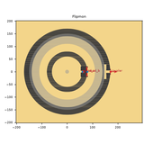 | Circular flip-chip transmon (QPDK ``flipmon_with_bbox``), optionally with its plate readout coupler. |
| [`Gatemon`](Gatemon.md) | Quantcore | 4 | 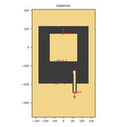 | Carbon-nanotube gatemon island in an etched pocket with a gate feed (QPDK ``gatemon``), M1 only. |
| [`TransmonTaperedInsets`](TransmonTaperedInsets.md) | Quantcore | 8 | 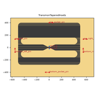 | Floating tapered-pad transmon in a filleted pocket (SQDMetal ``TransmonTaperedInsets``). |
| [`TrilayerConcentricTransmon`](TrilayerConcentricTransmon.md) | Quantcore | 4 | 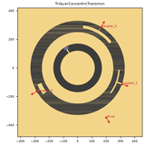 | Concentric transmon (KQC geometry) shunted by a Quantcore trilayer junction / SQUID. |
| [`TwoPadTransmon`](TwoPadTransmon.md) | Quantcore | 4 | 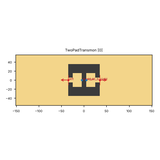 | Floating two-pad transmon (legacy ``Transmon``); ports ``left`` / ``right`` at the lead ends. |
| [`Xmon`](Xmon.md) | Quantcore | 1 | 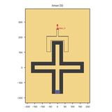 | Grounded cross transmon with claw couplers; junction below the south arm. |
| [`CircularTransmonSingleIsland`](CircularTransmonSingleIsland.md) | KQC | 4 | 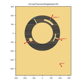 | The PCell declaration for a single island circular transmon. |
| [`ConcentricTransmon`](ConcentricTransmon.md) | KQC | 4 | 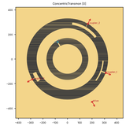 | The PCell declaration for a concentric transmon. |
| [`DoublePads`](DoublePads.md) | KQC | 2 | 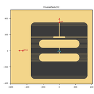 | A two-island qubit, consisting of two rounded rectangles shunted by a junction, with one capacitive coupler. |
| [`DoublePadsSplines`](DoublePadsSplines.md) (legacy) | KQC | 2 | 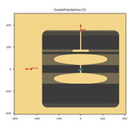 | A two-island qubit, consisting of two spline-constructed islands shunted by a junction, |
| [`Swissmon`](Swissmon.md) | KQC | 5 | 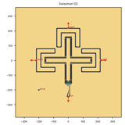 | The PCell declaration for a Swissmon qubit. |
| [`metal:StarQubit`](metal_StarQubit.md) | Metal | 7 | 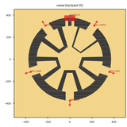 | A single configurable circle with multiple pads. |
| [`metal:TransmonConcentric`](metal_TransmonConcentric.md) | Metal | 5 | 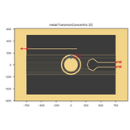 | The base `TrasmonConcentric` class . |
| [`metal:TransmonConcentricType2`](metal_TransmonConcentricType2.md) | Metal | 5 | 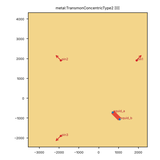 | TransmonConcentricType2.png |
| [`metal:TransmonCross`](metal_TransmonCross.md) | Metal | 2 | 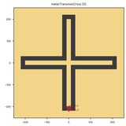 | The base `TransmonCross` class. |
| [`metal:TransmonCrossFL`](metal_TransmonCrossFL.md) | Metal | 3 | 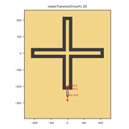 | The base `TransmonCrossFL` class. |
| [`metal:TransmonInterdigitated`](metal_TransmonInterdigitated.md) | Metal | 5 | 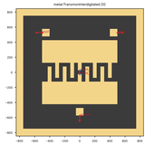 | The base "TransmonInterdigitated" inherits the "QComponent" class. |
| [`metal:TransmonPocket`](metal_TransmonPocket.md) | Metal | 2 | 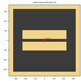 | The base `TransmonPocket` class. |
| [`metal:TransmonPocket6`](metal_TransmonPocket6.md) | Metal | 2 | 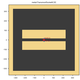 | Transmon pocket with 6 connection pads. |
| [`metal:TransmonPocketCL`](metal_TransmonPocketCL.md) | Metal | 3 | 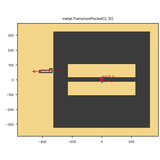 | The base `TransmonPocketCL` class. |
| [`metal:TransmonPocketTeeth`](metal_TransmonPocketTeeth.md) | Metal | 2 | 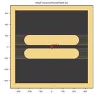 | Transmon pocket with 'Teeth' connection pads. |
| [`metal:TransmonStar`](metal_TransmonStar.md) | Metal | 2 | 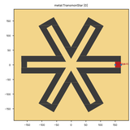 | The base `TransmonStar` class. |

## Junction

| cell | source | pins | image | description |
|---|---|---|---|---|
| [`QuantcoreJunction`](QuantcoreJunction.md) | Quantcore | 1 | 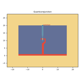 | The Quantcore PDK junction (``junction_type: "Quantcore Junction"`` in any KQC / Quantcore qubit): a |
| [`QuantcoreSquid`](QuantcoreSquid.md) | Quantcore | 1 | 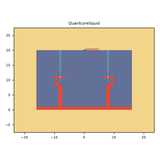 | The Quantcore PDK SQUID (``junction_type: "Quantcore Squid"``): a symmetric TrilayerSquid whose **whole SQUID** |
| [`SquidV0`](SquidV0.md) (legacy) | Quantcore | 1 | 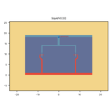 | Pre-HSQ SQUID (legacy ``junction_creator_sq.create_junction_squid``; ``junction_pad.py`` with |
| [`TrilayerJunction`](TrilayerJunction.md) | Quantcore | 1 |  | Single Nb trilayer cross junction (legacy ``xjc_junction_TL_mod.create_junction``). |
| [`TrilayerJunctionCompact`](TrilayerJunctionCompact.md) | Quantcore | 1 | 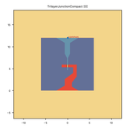 | Compact single trilayer junction for dense junction test arrays (legacy ``chip_11m_TestJJ16x_pads.py`` |
| [`TrilayerJunctionHSQ`](TrilayerJunctionHSQ.md) | Quantcore | 1 | 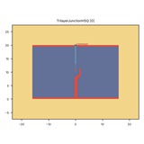 | Single trilayer junction, first HSQ generation (legacy ``junction_creator_HSQ.create_junction``). |
| [`TrilayerSquid`](TrilayerSquid.md) | Quantcore | 1 | 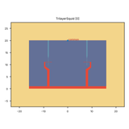 | Two trilayer junctions forming a SQUID (legacy ``xjc_squid_TL_mod.create_squid``). |
| [`TrilayerSquidHSQ`](TrilayerSquidHSQ.md) | Quantcore | 1 | 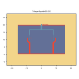 | Two trilayer junctions forming a SQUID, first HSQ generation (legacy ``squid_creator_HSQ.create_squid``). |
| [`Manhattan`](Manhattan.md) | KQC | 1 | 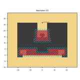 | The PCell declaration for a Manhattan style SQUID. |
| [`ManhattanSingleJunction`](ManhattanSingleJunction.md) (legacy) | KQC | 1 | 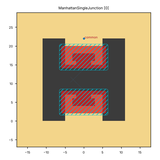 | The PCell declaration for a Manhattan style single junction. |
| [`NoSquid`](NoSquid.md) | KQC | 1 | 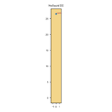 | The PCell declaration for a No SQUID junction. |
| [`Sim`](Sim.md) | KQC | 3 | 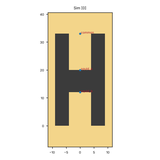 | The PCell declaration for a simulation type SQUID. |
| [`SuperInductor`](SuperInductor.md) | KQC | 1 | 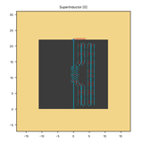 | The PCell declaration for a Manhattan style single junction. |
| [`metal:BridgeFreeJunction`](metal_BridgeFreeJunction.md) (legacy) | Metal | 0 | 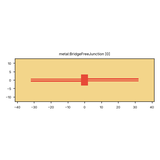 | user_bridgefreejj.png |
| [`metal:jj_dolan`](metal_jj_dolan.md) | Metal | 0 | 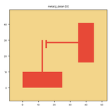 | Dolan-bridge Josephson junction. |
| [`metal:jj_manhattan`](metal_jj_manhattan.md) | Metal | 0 | 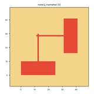 | Manhattan-style Josephson junction. |
| [`metal:SNAIL`](metal_SNAIL.md) | Metal | 4 | 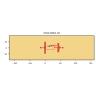 | A SNAIL (Superconducting Nonlinear Asymmetric Inductive eLement). |
| [`metal:SQUID_LOOP`](metal_SQUID_LOOP.md) (legacy) | Metal | 0 | 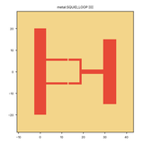 | The base "SQUID_LOOP" inherits the "QComponent" class. |

## Coupler

| cell | source | pins | image | description |
|---|---|---|---|---|
| [`GatemonCoupler`](GatemonCoupler.md) | Quantcore | 3 | 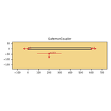 | Straight CPW ``o1`` → ``o2`` with a capacitive island reference port ``qubit`` (QPDK ``gatemon_coupler``). |
| [`HyperbolicVertexCoupler`](HyperbolicVertexCoupler.md) | Quantcore | 3 | 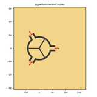 | ``q``-pin capacitive disk coupler at a hyperbolic-lattice vertex (QPDK ``hyperbolic_vertex_coupler``). |
| [`PadCoupler`](PadCoupler.md) | Quantcore | 2 | 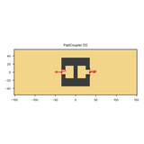 | Series gap capacitor of two facing pads (legacy ``Coupler``); ports ``left`` / ``right``. |
| [`CapacitiveXCoupler`](CapacitiveXCoupler.md) (legacy) | KQC | 4 | 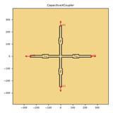 | Capacitive coupler for testing FEM computations. |
| [`metal:CapNInterdigitalTee`](metal_CapNInterdigitalTee.md) | Metal | 3 | 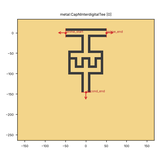 | Generates a three pin (+) structure comprised of a primary two pin CPW |
| [`metal:CoupledLineTee`](metal_CoupledLineTee.md) | Metal | 3 | 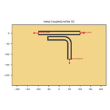 | Generates a three pin (+) structure comprised of a primary two pin CPW |
| [`metal:LineTee`](metal_LineTee.md) | Metal | 3 | 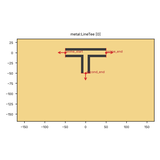 | Generates a three pin (+) structure comprised of a primary two pin CPW |
| [`metal:TunableCoupler01`](metal_TunableCoupler01.md) | Metal | 4 | 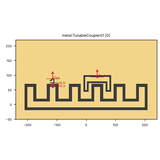 | One of the tunable couplers Based off the implementation in |
| [`metal:TunableCoupler02`](metal_TunableCoupler02.md) | Metal | 5 | 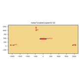 | TunableCoupler02.png |

## Capacitor

| cell | source | pins | image | description |
|---|---|---|---|---|
| [`CpweFingerCapacitor`](CpweFingerCapacitor.md) | Quantcore | 2 | 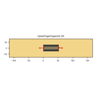 | Interdigital capacitor interrupting the centre line (legacy ``cpwe.finger_cap``); ports ``a`` (−x), ``b``. |
| [`CpweFingerLine`](CpweFingerLine.md) | Quantcore | 2 | 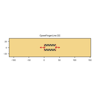 | CPW with interdigital fingers between centre line and ground on both sides (legacy ``cpwe.finger_line``); |
| [`CpweGapCapacitor`](CpweGapCapacitor.md) | Quantcore | 2 |  | Gap in the centre line (legacy ``cpwe.gap_cap``); ports ``a`` (−x), ``b`` (+x). |
| [`SmoothCapacitorSemicircle`](SmoothCapacitorSemicircle.md) | Quantcore | 2 |  | Coupling pad with a semicircular bite, placed on a qubit pin (SQDMetal ``Smooth_Capacitor_Semicircle``). |
| [`CircularCapacitor`](CircularCapacitor.md) | KQC | 2 |  | The PCell declaration for a circular capacitor. |
| [`FingerCapacitorSquare`](FingerCapacitorSquare.md) | KQC | 2 |  | The PCell declaration for a square finger capacitor. |
| [`FingerCapacitorTaper`](FingerCapacitorTaper.md) | KQC | 2 |  | The PCell declaration for a tapered finger capacitor. |
| [`SmoothCapacitor`](SmoothCapacitor.md) | KQC | 2 |  | The PCell declaration for a smooth finger capacitor. |
| [`SpiralCapacitor`](SpiralCapacitor.md) | KQC | 2 |  | The PCell declaration for a spiral capacitor. |
| [`metal:Cap3Interdigital`](metal_Cap3Interdigital.md) | Metal | 2 |  | Create a three finger planar capacitor with a ground pocket cuttout. |
| [`metal:CapFingerInFrame`](metal_CapFingerInFrame.md) | Metal | 2 |  | Two-pin gap capacitor with one electrode framing the other. |
| [`metal:CapNInterdigital`](metal_CapNInterdigital.md) | Metal | 2 |  | Generates a two pin (+) structure comprised of a north CPW transmission |

## Resonator

| cell | source | pins | image | description |
|---|---|---|---|---|
| [`CoupledResonator`](CoupledResonator.md) | Quantcore | 1 |  | λ/4 meander resonator with a straight coupler section on y = 0 (legacy ``Coupled Resonator``); port ``end``. |
| [`CpweQuarterWaveResonator`](CpweQuarterWaveResonator.md) | Quantcore | 0 |  | λ/4 resonator capacitively coupled through an open-ended arm parallel to the feedline (legacy |
| [`CpwResonator`](CpwResonator.md) | Quantcore | 2 |  | Meandered CPW resonator grounded at both ends (legacy ``CPW Resonator``); ports ``start`` and ``end``. |
| [`LumpedJpa`](LumpedJpa.md) | Quantcore | 3 |  | Lumped JPA: a trilayer junction or SQUID to ground, shunted by an interdigital capacitor (twpa-sim ``jpa`` / |
| [`QubitResonator`](QubitResonator.md) | Quantcore | 1 |  | λ/4 readout resonator with a coupler section and a mandatory tail to a qubit (legacy ``Qubit Resonator``). |
| [`SpiralLine`](SpiralLine.md) | Quantcore | 2 |  | Spiral line by angle (legacy ``draw.spiral``): Archimedean, Fermat or double Fermat; ports ``a`` / ``b``. |
| [`HangerResonator`](HangerResonator.md) | KQC | 4 |  | Hanger Resonator |
| [`QuarterWaveCpwResonator`](QuarterWaveCpwResonator.md) | KQC | 3 |  | CPW Resonator |
| [`SpiralResonatorPolygon`](SpiralResonatorPolygon.md) | KQC | 2 |  | The PCell declaration for a polygon shaped spiral resonator. |
| [`metal:ReadoutResFC`](metal_ReadoutResFC.md) | Metal | 1 |  | ReadoutResFC.png |
| [`metal:ResonatorCoilRect`](metal_ResonatorCoilRect.md) | Metal | 1 |  | A rectangle spiral resonator based on length input. The X dimension is |
| [`metal:ResonatorLumped`](metal_ResonatorLumped.md) | Metal | 8 |  | ResonatorLumped.png |

## Launcher

| cell | source | pins | image | description |
|---|---|---|---|---|
| [`BondPad`](BondPad.md) | Quantcore | 1 |  | Wire-bond pad tapering to a CPW (``a``/``b``); port ``a`` at the taper tip. |
| [`ConnectorPad`](ConnectorPad.md) | Quantcore | 1 |  | Wire-bond pad tapering to a CPW (legacy "Connector Pad", v1); port ``a`` at the taper tip. |
| [`CpweBondPad`](CpweBondPad.md) | Quantcore | 1 |  | Bond pad: open end ``tl``, wide line ``bl`` (``pad_width``/``pad_gap``), taper ``btl`` to the CPW ``a``/``b`` |
| [`Launcher`](Launcher.md) | KQC | 1 |  | The PCell declaration for a launcher for connecting wirebonds. |
| [`LauncherDC`](LauncherDC.md) | KQC | 1 |  | The PCell declaration for a DC launcher for connecting wirebonds. |
| [`metal:LaunchpadWirebond`](metal_LaunchpadWirebond.md) | Metal | 1 |  | Launch pad to feed/read signals to/from the chip. |
| [`metal:LaunchpadWirebondCoupled`](metal_LaunchpadWirebondCoupled.md) | Metal | 1 |  | Launch pad to feed/read signals to/from the chip. |
| [`metal:LaunchpadWirebondDriven`](metal_LaunchpadWirebondDriven.md) | Metal | 2 |  | Launch pad to feed/read signals to/from the chip. |

## Termination

| cell | source | pins | image | description |
|---|---|---|---|---|
| [`CpweOpenEnd`](CpweOpenEnd.md) | Quantcore | 1 |  | Open CPW termination (legacy ``cpwe.term_open``): the gap box of ``length``; port ``a`` at the origin (−x). |
| [`NeckTermination`](NeckTermination.md) | Quantcore | 1 |  | Shorted CPW end through a taper and a narrow neck in an etched window (QPDK ``neck_termination``). |
| [`SquidTermination`](SquidTermination.md) | Quantcore | 4 |  | CPW lead shorted to ground through a trilayer SQUID, with a shorted pump / flux line (QPDK ``squid_termination`` |
| [`metal:OpenToGround`](metal_OpenToGround.md) | Metal | 1 |  | A sample_shapes open to ground termination. Functions as a pin for auto drawing. |
| [`metal:ShortToGround`](metal_ShortToGround.md) | Metal | 1 |  | ShortToGround.png |

## Waveguide

| cell | source | pins | image | description |
|---|---|---|---|---|
| [`CoupledConnector`](CoupledConnector.md) | Quantcore | 2 |  | Meandered CPW connector from the origin downwards (legacy ``Coupled Connector``); ports ``start``, ``end``. |
| [`CpweMeanderLine`](CpweMeanderLine.md) | Quantcore | 2 |  | Meandered CPW (legacy ``cpwe.meander_line``; with ``lead`` > 0 it is legacy ``cpwe.quarter_wave``: lead, |
| [`CpweTaper`](CpweTaper.md) | Quantcore | 2 |  | Taper from ``a``/``b`` to ``a_end``/``b_end`` (legacy ``cpwe.tapper``: linear or exponential profiles). |
| [`CpwSegment`](CpwSegment.md) | Quantcore | 2 |  | Straight CPW segment centred at the origin (legacy "Coplanar Waveguide"); ports ``a`` (−x) and ``b`` (+x). |
| [`JtwpaChain`](JtwpaChain.md) | Quantcore | 2 |  | Series chain of ``cells`` trilayer junctions along +x (4WM JTWPA; twpa-sim ``jtwpa4wm``; QPDK resonantly |
| [`KiTwpaSerpentine`](KiTwpaSerpentine.md) | Quantcore | 2 |  | Kinetic-inductance TWPA serpentine (twpa-sim ``KITLayout`` / ``kit.primitives``, the NY CREATES research |
| [`Meander`](Meander.md) | KQC | 2 |  | The PCell declaration for a meandering waveguide. |
| [`WaveguideComposite`](WaveguideComposite.md) | KQC | 2 |  | A composite waveguide made of waveguides and other elements. |
| [`WaveguideCoplanar`](WaveguideCoplanar.md) | KQC | 2 |  | The PCell declaration for an arbitrary coplanar waveguide. |
| [`WaveguideCoplanarCurved`](WaveguideCoplanarCurved.md) (legacy) | KQC | 2 |  | The PCell declaration of a curved segment of a coplanar waveguide. |
| [`WaveguideCoplanarSplitter`](WaveguideCoplanarSplitter.md) | KQC | 3 |  | The PCell declaration of a multiway waveguide splitter. The number of ports is defined by the length of the |
| [`WaveguideCoplanarStraight`](WaveguideCoplanarStraight.md) | KQC | 0 |  | The PCell declaration of a straight segment of a coplanar waveguide. |
| [`WaveguideCoplanarTaper`](WaveguideCoplanarTaper.md) | KQC | 2 |  | The PCell declaration of a taper segment of a coplanar waveguide. |
| [`metal:PolylineCPW`](metal_PolylineCPW.md) | Metal | 2 |  | A coplanar waveguide drawn along an explicit polyline. |

## Airbridge

| cell | source | pins | image | description |
|---|---|---|---|---|
| [`AirbridgeConnection`](AirbridgeConnection.md) | KQC | 2 |  | The PCell declaration of an Airbridge with tapered waveguides in both ends. |
| [`AirbridgeMultiFace`](AirbridgeMultiFace.md) | KQC | 2 |  | PCell declaration for a multi-face equivalent for an airbridge. |
| [`AirbridgeRectangular`](AirbridgeRectangular.md) | KQC | 2 |  | PCell declaration for a rectangular airbridge. |
| [`metal:Airbridge`](metal_Airbridge.md) (legacy) | Metal | 2 |  | A single airbridge: two base-metal landing pads joined by an elevated |

## Marker

| cell | source | pins | image | description |
|---|---|---|---|---|
| [`AlignmentMarkers`](AlignmentMarkers.md) | Quantcore | 0 |  | E-beam alignment squares at the four chip corners (legacy ``draw.marker_align``); origin = chip lower-left. |
| [`BoundaryBox`](BoundaryBox.md) | Quantcore | 0 |  | Chip boundary square with corner crosses (legacy ``BoundBox``, layer 9/0 → qcc ``chip_boundary``). |
| [`CornerMarker`](CornerMarker.md) | Quantcore | 0 |  | L-shaped chip-corner alignment marker (legacy ``Marker``); ``hsq=True`` draws the HSQ variant. |
| [`CrossMarker`](CrossMarker.md) | Quantcore | 0 |  | Small alignment cross (legacy ``draw.marker``, used beside the ``cpwe`` bond pads). |
| [`DicingMarker`](DicingMarker.md) | Quantcore | 0 |  | Dicing cross (legacy ``draw.marker_dicing``). |
| [`EbeamMarker`](EbeamMarker.md) | Quantcore | 0 |  | E-beam marker: four metal squares in an etched window (legacy ``die_creator``). |
| [`GlobalMarker`](GlobalMarker.md) | Quantcore | 0 |  | Global alignment marker: six squares in two columns (legacy ``draw.global_marker``). |
| [`ChipFrame`](ChipFrame.md) | KQC | 0 |  | The PCell declaration for a chip frame. |
| [`MarkerStandard`](MarkerStandard.md) | KQC | 0 |  | The PCell declaration for the Standard Marker. |
| [`MaskMarkerFc`](MaskMarkerFc.md) | KQC | 0 |  | The PCell declaration for a MaskMarkerFc. |

## Test structure

| cell | source | pins | image | description |
|---|---|---|---|---|
| [`JunctionGroundPad`](JunctionGroundPad.md) | Quantcore | 0 |  | Rounded probe pad joined to ground by a bridge carrying a trilayer junction (legacy ``testPad.py``). |
| [`JunctionTestPads`](JunctionTestPads.md) | Quantcore | 0 |  | Two probe pads with a trilayer junction between their tips (legacy ``testPad_*`` / ``xtp_testpads``). |
| [`ProbePadPair`](ProbePadPair.md) | Quantcore | 0 |  | Probe-pad pair of the chip_11m junction test array (legacy ``chip_11m_TestJJ16x_pads.create_testPad``, whose |
| [`TaperedPad`](TaperedPad.md) | Quantcore | 1 |  | Probe pad tapering to a junction finger (legacy "Pad"); port ``finger`` at the taper tip. |
| [`AirbridgeDC`](AirbridgeDC.md) | KQC | 0 |  | The PCell declaration for an airbridge test structure for four-point DC measurements. |
| [`CrossTest`](CrossTest.md) | KQC | 0 |  | PCell declaration for optical lithography test alignment cross markers. |
| [`JunctionTestPadsSimple`](JunctionTestPadsSimple.md) | KQC | 0 |  | Junction test structures. |
| [`StripesTest`](StripesTest.md) (legacy) | KQC | 0 |  | PCell declaration for optical lithography test stripes. |
| [`StripesTestIncreasingWidth`](StripesTestIncreasingWidth.md) | KQC | 0 |  | PCell declaration for optical lithography test stripes. |
| [`TsvTestPattern`](TsvTestPattern.md) | KQC | 0 |  | PCell declaration for TSV test structures which resembles a TSV fencing for a CPW transmission line. |

## Flip chip

| cell | source | pins | image | description |
|---|---|---|---|---|
| [`CpwTsvTransition`](CpwTsvTransition.md) | Quantcore | 2 |  | CPW transition through one chip: a pad on each face, joined by signal TSVs, with ground TSVs around them. |
| [`QcFlipChipConnectorRf`](QcFlipChipConnectorRf.md) | Quantcore | 2 |  | KQC's flip-chip bump transition (FlipChipConnectorRf) with a bump size and named ports a and b. |
| [`FlipChipConnectorDc`](FlipChipConnectorDc.md) | KQC | 0 |  | PCell declaration for an inter-chip dc connector. |
| [`FlipChipConnectorRf`](FlipChipConnectorRf.md) | KQC | 2 |  | PCell declaration for an inter-chip rf connector. |
| [`TsvStandard`](TsvStandard.md) | KQC | 0 |  | Connector between faces of two sides of a substrate. |

## Shape

| cell | source | pins | image | description |
|---|---|---|---|---|
| [`ArcPath`](ArcPath.md) | Quantcore | 0 |  | Circular arc path starting at the origin (legacy "Arc"): ``length`` ≥ ``arc_length`` → half circle of that |
| [`JJFingerBent`](JJFingerBent.md) | Quantcore | 0 |  | Bent junction finger with its holder (legacy "JJ_finger Bottom"), on ``SIS_junction_2`` (4/0). |
| [`JJFingerStraight`](JJFingerStraight.md) | Quantcore | 0 |  | Straight junction finger (legacy "JJ_finger Top"), on ``SIS_junction`` (2/0). |
| [`SpiralPath`](SpiralPath.md) (legacy) | Quantcore | 0 |  | Archimedean spiral path from ``inner_r`` to ``outer_r`` (legacy "Spiral"). |
| [`TextLabel`](TextLabel.md) | Quantcore | 0 |  | Text etched into the ground (legacy chips 01–06: ``TextGenerator.default_generator().text(text, dbu, mag, |
| [`metal:CircleCaterpillar`](metal_CircleCaterpillar.md) | Metal | 0 |  | A single configurable circle. |
| [`metal:CircleRaster`](metal_CircleRaster.md) | Metal | 0 |  | A single configurable circle. |
| [`metal:NGon`](metal_NGon.md) | Metal | 0 |  | A n-gon polygon. Eg. n = 3 : triangle, n = infinity : circle |
| [`metal:NSquareSpiral`](metal_NSquareSpiral.md) (legacy) | Metal | 1 |  | A n count square spiral. |
| [`metal:Rectangle`](metal_Rectangle.md) | Metal | 0 |  | A single configurable square. |
| [`metal:RectangleHollow`](metal_RectangleHollow.md) | Metal | 0 |  | A single configurable square. |
| [`metal:SmileyFace`](metal_SmileyFace.md) | Metal | 0 |  | TEST COMPONENT It is for fun only. Can view a smiley face. Can make it |

## Other

| cell | source | pins | image | description |
|---|---|---|---|---|
| [`FluxHoleArray`](FluxHoleArray.md) | Quantcore | 0 |  | Array of square flux-trapping holes in the ground plane (legacy chips' ``flux_holes``). |
| [`FluxHoles`](FluxHoles.md) | Quantcore | 0 |  | Square flux-trapping holes at explicit centres (legacy notebook 14 ``FluxHoles`` QComponent, ``size`` 5 µm). |
| [`FluxlineStandard`](FluxlineStandard.md) | KQC | 1 |  | Fluxline variant "standard". |
| [`FluxlineStraight`](FluxlineStraight.md) | KQC | 1 |  | Fluxline variant "straight vertical". |
