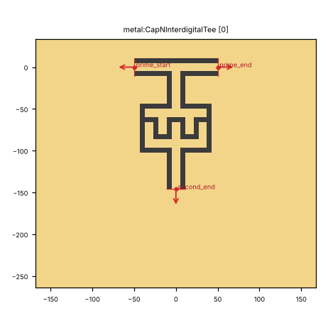

% generated by scripts/make_component_docs.py -- do not edit. Put hand-written notes in docs/components/notes/metal_CapNInterdigitalTee.md (included below).

# metal:CapNInterdigitalTee

Generates a three pin (+) structure comprised of a primary two pin CPW

**Source:** Metal (Qiskit Metal). **Category:** coupler. **Module:** `qiskit_metal.qlibrary.couplers.cap_n_interdigital_tee`.

See also the [catalog](../CATALOG.md) and the [duplicates decisions](../DUPLICATES.md).

## Pins



Pin image (default parameters). Light = metal, dark = etched gap, colours = junction layers. A red dot and arrow is a pin and its direction (out of the cell); the red bar is the CPW width a + 2 b. Blue dot = a pin without direction. Units: µm.

| pin | x (µm) | y (µm) | direction (°) | a (µm) | b (µm) | purpose |
|---|---|---|---|---|---|---|
| `prime_end` | 50 | 0 | 0 | 10 | 6 | LOM node `prime` |
| `prime_start` | -50 | 0 | 180 | 10 | 6 | LOM node `prime` |
| `second_end` | 0 | -146 | 270 | 10 | 6 | LOM node `second` |

a, b: CPW centre width and gap where the pin declares them (`–` = not declared). Position and direction are in the cell's own frame (`at=(0, 0)`, `rot=0`).

## Parameters

| name | default | unit | description |
|---|---|---|---|
| `a` | `10` | μm | Width of center conductor |
| `b` | `6` | μm | Width of gap |
| `r` | `100` | μm | Turn radius |
| `junction_type` | `"Metal"` | – | Junction as fabricated: Metal footprint, or a trilayer cell placed on each junction line |
| `junction_params` | `"{}"` | – | Trilayer junction cell parameters (JSON dict, e.g. lj_nH) |
| `metal_class` | `"CapNInterdigitalTee"` | – | Quantum Metal component |
| `options` | `"{}"` | – | Metal options as JSON (bare numbers on length options are µm) |
| `open_pins` | `""` | – | Pins left open (comma-separated): keep Metal's etch beyond them, as drawn with no route attached |

Electrically relevant parameters (sizes, gaps, junction, ports) come first, the rest follows.

## LOM model

The cell contributes to the lumped model:

| branch | type | nodes | value (estimate at defaults) |
|---|---|---|---|
| `C_X` | C | prime – second | estimate=5.26, unit=fF, estimate_source=analytic: IDC, estimate_kind=analytic, uncertainty=±25% |
| `C_X_second` | C | second – gnd | estimate=7.4, unit=fF, estimate_source=rough: second-line stub to ground, estimate_kind=rough, uncertainty=±50% |

Nodes: `prime`, `second`.

## Simulation export notes

- C10: route gap strip misses the cell's etch by < 1 nm at an angled / off-grid port (fab build) (status: fixed; fix in route/waveguide.py (joined_nodes, misses_etch); layouts/chips/design_chip.py (DesignChip._join_ends); assembly/plan.py (RoutePlan.joins))

Details: [SIM_EXPORT_AUDIT](../SIM_EXPORT_AUDIT.md).

## How to use

In Python:

```python
from quantcore_circuits.designer import Designer

d = Designer("demo", box=(0, 0, 7500, 7500))
d.add("U1", "metal:CapNInterdigitalTee", at=(3750, 3750), a=10)   # parameters: see the table above
d.add("PAD", "BondPad", at=(1125, 3750), rot=270)   # a launcher to connect to
d.route("L1", "PAD.a", "U1.prime_end")                # a CPW from the pad to the pin
```

Pin names go into `d.route(...)` as `INSTANCE.pin`, and into `snap=` / `to=` when placing. From the shell: `qcc components metal:CapNInterdigitalTee` lists the pins; add `--schema` for the parameters.

In KLayout: Quantcore panel ▸ Components ▸ double-click the cell, then click on the layout to place it. Rotate and mirror before the click; use Connect on two pins to route.
