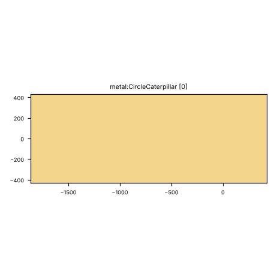

% generated by scripts/make_component_docs.py -- do not edit. Put hand-written notes in docs/components/notes/metal_CircleCaterpillar.md (included below).

# metal:CircleCaterpillar

A single configurable circle.

**Source:** Metal (Qiskit Metal). **Category:** shape. **Module:** `qiskit_metal.qlibrary.sample_shapes.circle_caterpillar`.

See also the [catalog](../CATALOG.md).

## Pins



Pin image (default parameters). Light = metal, dark = etched gap, colours = junction layers. A red dot and arrow is a pin and its direction (out of the cell); the red bar is the CPW width a + 2 b. Blue dot = a pin without direction. Units: µm.

No pins: this cell has no ports. Place it with `at=` / `rot=`.

## Parameters

| name | default | unit | description |
|---|---|---|---|
| `a` | `10` | μm | Width of center conductor |
| `b` | `6` | μm | Width of gap |
| `r` | `100` | μm | Turn radius |
| `junction_type` | `"Metal"` | – | Junction as fabricated: Metal footprint, or a trilayer cell placed on each junction line |
| `junction_params` | `"{}"` | – | Trilayer junction cell parameters (JSON dict, e.g. lj_nH) |
| `metal_class` | `"CircleCaterpillar"` | – | Quantum Metal component |
| `options` | `"{}"` | – | Metal options as JSON (bare numbers on length options are µm) |
| `open_pins` | `""` | – | Pins left open (comma-separated): keep Metal's etch beyond them, as drawn with no route attached |

Electrically relevant parameters (sizes, gaps, junction, ports) come first, the rest follows.

## LOM model

none (a LOM build gives each pin its own bare node, without elements).

## How to use

In Python:

```python
from quantcore_circuits.designer import Designer

d = Designer("demo", box=(0, 0, 7500, 7500))
d.add("U1", "metal:CircleCaterpillar", at=(3750, 3750), a=10)   # parameters: see the table above
# no directed pin: place it with at= / rot=, or snap it with snap= / to=
```

Pin names go into `d.route(...)` as `INSTANCE.pin`, and into `snap=` / `to=` when placing. From the shell: `qcc components metal:CircleCaterpillar` lists the pins; add `--schema` for the parameters.

In KLayout: Quantcore panel ▸ Components ▸ double-click the cell, then click on the layout to place it. Rotate and mirror before the click; use Connect on two pins to route.
