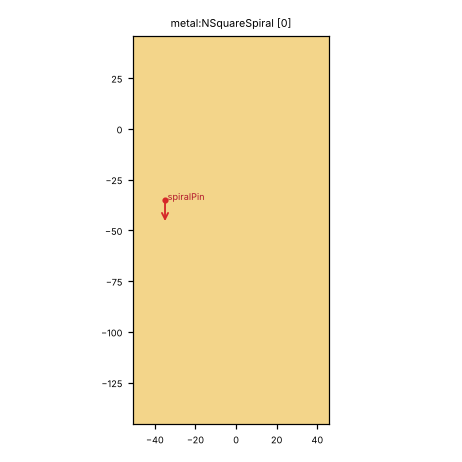

% generated by scripts/make_component_docs.py -- do not edit. Put hand-written notes in docs/components/notes/metal_NSquareSpiral.md (included below).

# metal:NSquareSpiral

A n count square spiral.

**Source:** Metal (Qiskit Metal). **Category:** shape. **Module:** `qiskit_metal.qlibrary.sample_shapes.n_square_spiral`.

:::{warning}
Legacy cell. Metal sample shape (metal only, no pocket); unused; the same job as metal:ResonatorCoilRect
:::

See also the [catalog](../CATALOG.md).

## Pins



Pin image (default parameters). Light = metal, dark = etched gap, colours = junction layers. A red dot and arrow is a pin and its direction (out of the cell); the red bar is the CPW width a + 2 b. Blue dot = a pin without direction. Units: µm.

| pin | x (µm) | y (µm) | direction (°) | a (µm) | b (µm) | purpose |
|---|---|---|---|---|---|---|
| `spiralPin` | -35 | -35 | 270 | 1 | 0.6 | LOM node `spiral` |

a, b: CPW centre width and gap where the pin declares them (`–` = not declared). Position and direction are in the cell's own frame (`at=(0, 0)`, `rot=0`).

**Notes from the catalog:** draws metal only, no pocket (a metal spiral path; LOM on a pocket: an open line of the drawn length (rough)): alone it is empty in the negative mask, as in Metal's own GDS (metal on the ground plane). Place it on a pocket, e.g. metal:Rectangle with subtract: true; its metal goes to base_metal_addition, which the fab export removes from the etch. Metal's defaults are mm-scale.

## Parameters

| name | default | unit | description |
|---|---|---|---|
| `a` | `10` | μm | Width of center conductor |
| `b` | `6` | μm | Width of gap |
| `r` | `100` | μm | Turn radius |
| `junction_type` | `"Metal"` | – | Junction as fabricated: Metal footprint, or a trilayer cell placed on each junction line |
| `junction_params` | `"{}"` | – | Trilayer junction cell parameters (JSON dict, e.g. lj_nH) |
| `metal_class` | `"NSquareSpiral"` | – | Quantum Metal component |
| `options` | `"{}"` | – | Metal options as JSON (bare numbers on length options are µm) |
| `open_pins` | `""` | – | Pins left open (comma-separated): keep Metal's etch beyond them, as drawn with no route attached |

Electrically relevant parameters (sizes, gaps, junction, ports) come first, the rest follows.

## LOM model

The cell contributes to the lumped model:

- no lumped branches

| line | node | length (µm) | a (µm) | b (µm) | ends |
|---|---|---|---|---|---|
| `X` | `spiral` | 630 | 1 | 4 | open / open |

Nodes: `spiral`.

- X: spiral trace of 630 µm as an open-ended line (rough: turns' mutual coupling not included)

## How to use

In Python:

```python
from quantcore_circuits.designer import Designer

d = Designer("demo", box=(0, 0, 7500, 7500))
d.add("U1", "metal:NSquareSpiral", at=(3750, 3750), a=10)   # parameters: see the table above
d.add("PAD", "BondPad", at=(1125, 3750), rot=270)   # a launcher to connect to
d.route("L1", "PAD.a", "U1.spiralPin")                # a CPW from the pad to the pin
```

Pin names go into `d.route(...)` as `INSTANCE.pin`, and into `snap=` / `to=` when placing. From the shell: `qcc components metal:NSquareSpiral` lists the pins; add `--schema` for the parameters.

In KLayout: Quantcore panel ▸ Components ▸ double-click the cell, then click on the layout to place it. Rotate and mirror before the click; use Connect on two pins to route.
