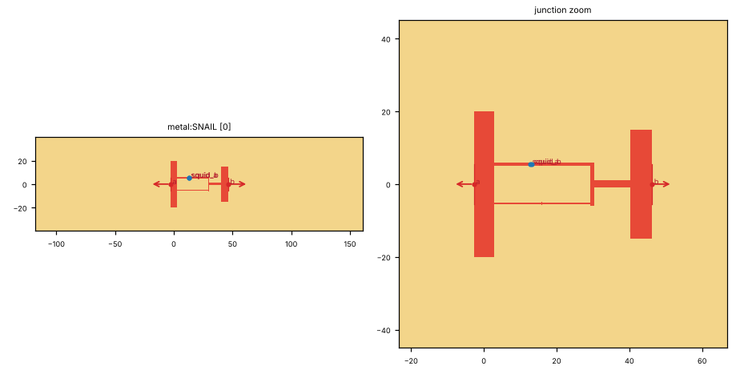

% generated by scripts/make_component_docs.py -- do not edit. Put hand-written notes in docs/components/notes/metal_SNAIL.md (included below).

# metal:SNAIL

A SNAIL (Superconducting Nonlinear Asymmetric Inductive eLement).

**Source:** Metal (Qiskit Metal). **Category:** junction. **Module:** `qiskit_metal.qlibrary.qubits.SNAIL`.

See also the [catalog](../CATALOG.md).

## Pins



Pin image (default parameters). Light = metal, dark = etched gap, colours = junction layers. A red dot and arrow is a pin and its direction (out of the cell); the red bar is the CPW width a + 2 b. Blue dot = a pin without direction. Units: µm.

| pin | x (µm) | y (µm) | direction (°) | a (µm) | b (µm) | purpose |
|---|---|---|---|---|---|---|
| `a` | -2.75 | 0 | 180 | 5 | 3 | CPW end; LOM node `a` |
| `b` | 46.25 | 0 | 0 | 5 | 3 | CPW end; LOM node `b` |
| `squid_a` | 12.75 | 5.5 | none | 10 | 6 | junction pins (the LOM's L_J); LOM node `a` |
| `squid_b` | 13.25 | 5.5 | none | 10 | 6 | junction pins (the LOM's L_J); LOM node `b` |

Pins with direction `none`: `squid_a`, `squid_b`. They mark a point (a junction lead, a pad centre), not a CPW end. The KLayout ghost draws them as boxes. A route can start there only where the notes say so; it cannot be snapped to.

a, b: CPW centre width and gap where the pin declares them (`–` = not declared). Position and direction are in the cell's own frame (`at=(0, 0)`, `rot=0`).

## Parameters

| name | default | unit | description |
|---|---|---|---|
| `a` | `10` | μm | Width of center conductor |
| `b` | `6` | μm | Width of gap |
| `r` | `100` | μm | Turn radius |
| `junction_type` | `"Metal"` | – | Junction as fabricated: Metal footprint, or a trilayer cell placed on each junction line |
| `junction_params` | `"{}"` | – | Trilayer junction cell parameters (JSON dict, e.g. lj_nH) |
| `metal_class` | `"SNAIL"` | – | Quantum Metal component |
| `options` | `"{}"` | – | Metal options as JSON (bare numbers on length options are µm) |
| `open_pins` | `""` | – | Pins left open (comma-separated): keep Metal's etch beyond them, as drawn with no route attached |

Electrically relevant parameters (sizes, gaps, junction, ports) come first, the rest follows.

## LOM model

The cell contributes to the lumped model:

| branch | type | nodes | value (estimate at defaults) |
|---|---|---|---|
| `J_X` | JJ | a – b | Lj_nH=0.075, Cj_fF=0 |

Nodes: `a`, `b`.

- X: SNAIL as a single JJ (linear inductance only)

## Simulation export notes

- C5: Metal-wrapped junction pins off the metal edges (stand-in sheet is wrong) (status: fixed; fix in sim_tools/builder.py (FaceMetal, junction_gap, junction_sheet, sheet_junction_port))

## How to use

In Python:

```python
from quantcore_circuits.designer import Designer

d = Designer("demo", box=(0, 0, 7500, 7500))
d.add("U1", "metal:SNAIL", at=(3750, 3750), a=10)   # parameters: see the table above
d.add("PAD", "BondPad", at=(1125, 3750), rot=270)   # a launcher to connect to
d.route("L1", "PAD.a", "U1.a")                # a CPW from the pad to the pin
```

Pin names go into `d.route(...)` as `INSTANCE.pin`, and into `snap=` / `to=` when placing. From the shell: `qcc components metal:SNAIL` lists the pins; add `--schema` for the parameters.

In KLayout: Quantcore panel ▸ Components ▸ double-click the cell, then click on the layout to place it. Rotate and mirror before the click; use Connect on two pins to route.
