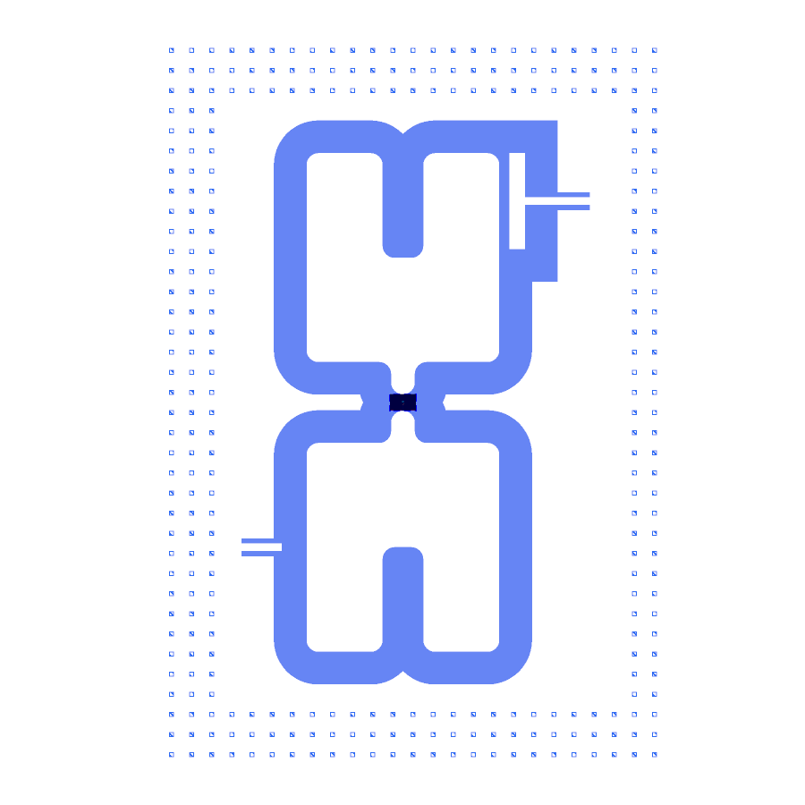
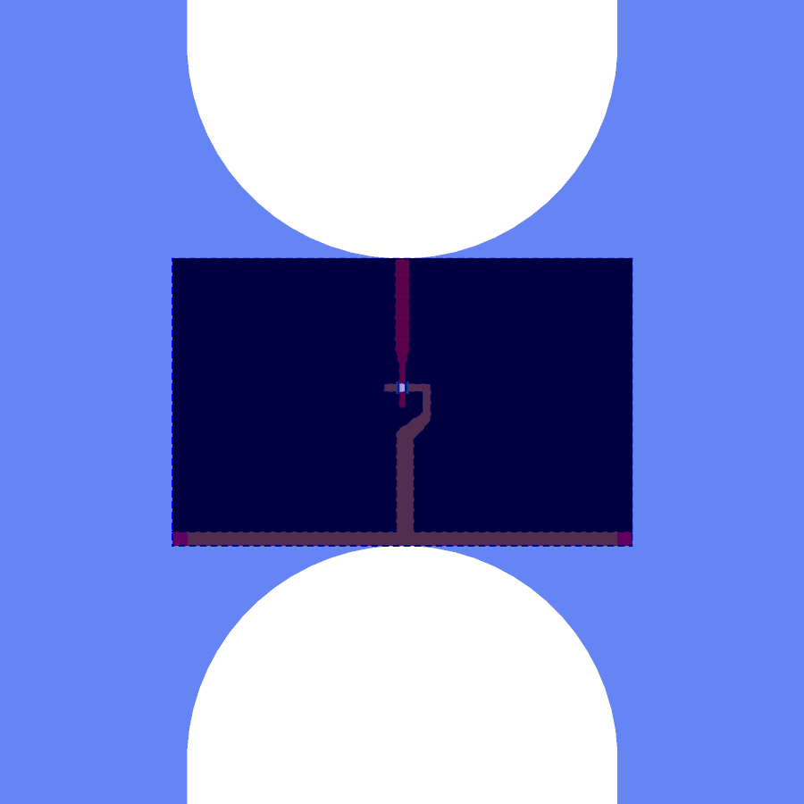
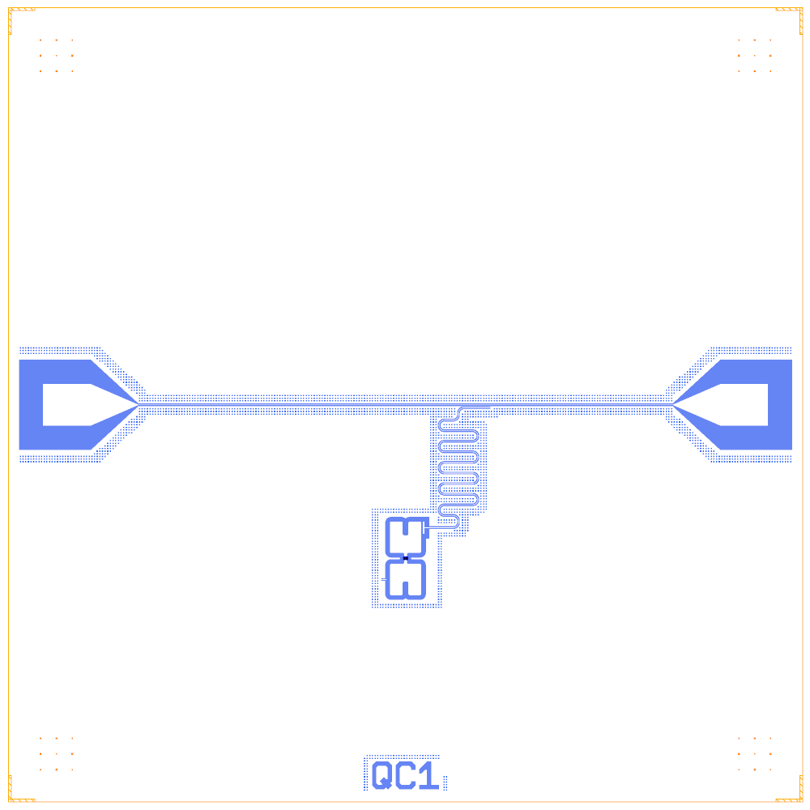
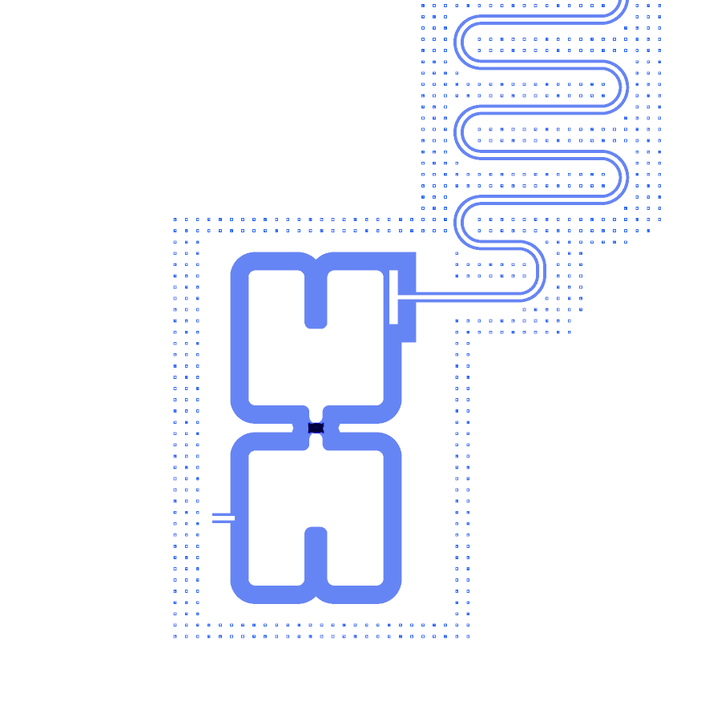

# A custom qubit with its junction

This page builds a qubit that is not in the library: a floating transmon whose two islands are forks. It takes one
Python class (`examples/custom_component/custom_qubit.py`) with the shape, two pins, a Quantcore trilayer junction
across the gap and a LOM model. Afterwards `Designer.add`, `d.route`, `d.drc()` and `d.lom()` work with it as with any
library qubit. The notebook that runs every step is `examples/custom_component/custom_qubits.ipynb`.

## What we build

| Part | Choice |
|---|---|
| Islands | Two equal islands, a neck (30 µm wide) towards the junction, a body with a slot cut from the outer end (the fork), rounded corners |
| Junction | The PDK trilayer junction across a 20 µm gap between the two necks |
| Pin `claw` | A readout claw beside the top island, with a tail that continues as the readout CPW. Direction +x |
| Pin `drive` | An open-ended drive stub that ends beside the bottom island. Direction -x |
| LOM | Two islands, C between them, the junction between them, the claw as a node, the drive as a control line |

## 1 · The class and its parameters

Every number of the shape is a parameter, so the plugin panel and `design.json` can change it. The two junction
parameters are the ones every Quantcore qubit has: `junction_type` picks the trilayer cell, `junction_params` sizes it.

```python
from kqcircuits.elements.element import Element
from kqcircuits.pya_resolver import pya
from kqcircuits.util.parameters import Param, pdt


class ForkTransmon(Element):
    qcc_category = "qubit"      # panel filter, DRC, fab export and LOM read this
    qcc_junction = True

    body_w = Param(pdt.TypeDouble, "Island body width", 240, unit="μm")
    body_len = Param(pdt.TypeDouble, "Island body length", 260, unit="μm")
    neck_w = Param(pdt.TypeDouble, "Neck width (towards the junction)", 30, unit="μm")
    neck_len = Param(pdt.TypeDouble, "Neck length", 40, unit="μm")
    slot_w = Param(pdt.TypeDouble, "Fork slot width (0 = no fork)", 50, unit="μm")
    slot_len = Param(pdt.TypeDouble, "Fork slot depth from the outer end", 130, unit="μm")
    gap = Param(pdt.TypeDouble, "Junction gap between the two necks", 20, unit="μm")
    clearance = Param(pdt.TypeDouble, "Etched clearance around the islands", 40, unit="μm")
    # ... claw_w, claw_len, claw_gap, tail_len, drive_gap, corner_r
    junction_type = Param(pdt.TypeString, "Junction across the gap", "Quantcore Junction",
                          choices=["No Squid", "Quantcore Junction", "Quantcore Squid", "Trilayer Junction",
                                   "Trilayer Squid", "Sim"])
    junction_params = Param(pdt.TypeString, "Trilayer junction cell parameters (JSON dict, e.g. lj_nH)", "{}")
```

## 2 · The geometry

`build()` works in the cell's own frame, with the junction gap centred on the origin: island 1 below, island 2 above.
Each island is one polygon (neck, body, slot), the corners are rounded with `Region.round_corners`.

```python
def _island(self, sign):                       # +1 top island, -1 bottom island
    g, nl, bl = self.gap / 2, self.neck_len, self.body_len
    bw, nw = self.body_w, self.neck_w
    y0, y1, y2 = g, g + nl, g + nl + bl        # gap edge, neck/body step, outer end
    hs, sd = self.slot_w / 2, self.slot_len
    pts = [(-nw/2, y0), (nw/2, y0), (nw/2, y1), (bw/2, y1), (bw/2, y2),
           (hs, y2), (hs, y2 - sd), (-hs, y2 - sd), (-hs, y2),      # the fork slot
           (-bw/2, y2), (-bw/2, y1), (-nw/2, y1)]
    return pya.DPolygon([pya.DPoint(x, sign * y) for x, y in pts])
```

The cell draws a negative mask, so it draws what is removed. The etched pocket is the clearance around the
islands and the claw, plus a CPW gap `b` along each tail, minus all the metal:

```python
islands = self._round(pya.Region([self._island(1).to_itype(dbu), self._island(-1).to_itype(dbu)]))
metal = islands + claw + tails                                  # claw bar and the two tails
clear = (islands + claw).sized(round(self.clearance / dbu), 2)  # clearance around the islands
etch = (clear + corridors) - metal                              # corridors: gap b beside each tail
self.cell.shapes(self.get_layer("base_metal_gap_wo_grid")).insert(etch)
self.add_protection(pya.Region(etch.bbox()).sized(round(self.margin / dbu)))   # no cheese here
```

## 3 · The pins

A pin is a name, a position and the direction that points out of the component. A route leaves or arrives along it.
The tail ends at the pin, and the route continues as a CPW of centre width `a` and gap `b`.

```python
self.add_port("claw", pya.DPoint(self._x_claw_port(), yc), pya.DVector(1, 0))
self.add_port("drive", pya.DPoint(self._x_drive_port(), yd), pya.DVector(-1, 0))
```

## 4 · The junction

`place_trilayer` inserts the Quantcore trilayer junction cell across the gap. You give it the two ends of the junction
line: the island side first, the ground side (here the other island) second. It sizes the window to the gap, draws the
fingers on 2/0 and 4/0 (KQC layers `SIS_junction` and `SIS_junction_2`), the clearer metal box and the spacer. The two
refpoints `port_squid_a` / `port_squid_b` mark the junction ends for the simulation export.

```python
a_pt, b_pt = pya.DPoint(0, self.gap / 2), pya.DPoint(0, -self.gap / 2)
self.refpoints["port_squid_a"], self.refpoints["port_squid_b"] = b_pt, a_pt
if self.junction_type not in ("No Squid", "Sim"):
    from quantcore_circuits.layouts.junctions.trilayer import place_trilayer

    gaps = pya.Region(self.cell.begin_shapes_rec(self.get_layer("base_metal_gap_wo_grid")))
    place_trilayer(self, self.junction_type, gaps, a_pt, b_pt, self.junction_params)
```

Simulation builds set `junction_type` to `"Sim"`, so the clearer never shorts a FEM model.

## 5 · Register it and look at it

A class outside the package registers itself into the KQC library when its module is imported (the last lines of
`custom_qubit.py`). Put the folder on `sys.path` and use the dotted path as the cell reference.

```python
import sys
sys.path.insert(0, "examples/custom_component")
from quantcore_circuits.designer import Designer
from quantcore_circuits.layouts.registry import trilayer_junction
from quantcore_circuits.live.snapshot import snapshot

params, junction = trilayer_junction("custom_qubit.ForkTransmon")      # the PDK nominal junction
d = Designer("qc_fork_alone", box=(0, 0, 7500, 7500), live=False)
d.add("Q1", "custom_qubit.ForkTransmon", at=(3750, 3750), junction=junction, **params)
d.show()
snapshot(d.out, "qubit_cell.png", box=(3250, 3300, 4250, 4200))
```



Blue is what is etched. The islands are the white shapes inside the etch, the claw is the bar to the right of the top
island and the drive stub is the short line to the left of the bottom island. At the centre is the junction:



`trilayer_junction(cell, lj_nH=...)` returns the two things a qubit needs: the cell parameters (`junction_type`,
`junction_params`) that make the junction the PDK trilayer junction sized for that L_J, and the drawn junction's
`{"Lj_nH", "Cj_fF"}` for the instance's `junction`. The L_J comes out slightly different from the one you asked for,
because the fingers sit on the PDK grid.

## 6 · The LOM model

The model is a `qcc_lom` class method that returns a `Fragment`: the nodes of the component, the elements between them
and which pin is which node. The component has no calibration, so the capacitances are formulas from
`quantcore_circuits.lom.estimates`, marked as `"rough"`.

```python
@classmethod
def qcc_lom(cls, name, inst, pdk):
    p = cell_params(inst)                       # the defaults merged with the instance's parameters
    eps = est.substrate_eps(pdk)
    c_island = est.pad_to_ground(bw, bl, clr, clr, eps) + ...        # body + neck + the slot walls
    c_mut = est.coplanar_coupling(nw, nl, nl, gap, eps) + ...        # the necks facing across the gap
    frag = Fragment(
        nodes={"island1": {"island": f"{name}.island1"}, "island2": {"island": f"{name}.island2"},
               "claw": {"island": f"{name}.claw"}},
        port_nodes={"claw": "claw", "drive": "control:drive", "squid_a": "island1", "squid_b": "island2"},
    )
    frag.elements += [
        LomElement(f"C_{name}_1", "C", ("island1", "gnd"), est.cap(c_island, "rough", formula)),
        LomElement(f"C_{name}_2", "C", ("island2", "gnd"), est.cap(c_island, "rough", formula)),
        LomElement(f"C_{name}_12", "C", ("island1", "island2"), est.cap(c_mut, "rough", formula)),
        # ... Cg_<name>_claw (claw to island 2) and Cc_<name>_claw (claw to ground)
        junction_element(name, "island1", "island2", inst, "JJ", drawn_params=p),    # L_J from the PDK rule
    ]
    return frag
```

Notes on the model:

- `"island"` names the FEM net of each node (`Q1.island1`, ...). A Q3D C-matrix of the cell fills the capacitances by
  these names.
- `port_nodes` says which node each pin is. `"control:drive"` marks a pin that carries a control line (a drive or flux
  line), not a circuit connection.
- `junction_element` takes L_J from the instance's `junction` if the design gives one, else from the drawn trilayer
  junction on the PDK rule. It never invents a value.

An alternative to the class method is `@register_lom("ForkTransmon")` from `quantcore_circuits.lom.fragment`, as in
`pad_gap_capacitor.py`. Both work; subclasses inherit the model.

## 7 · Place it on a chip

The chip is two bond pads, a feedline, the qubit and a λ/4 readout resonator. The first step sizes the junction for
the target: the LOM gives the capacitances, `size_junction` the L_J and the R_n it implies.

```python
from quantcore_circuits.circuit.bridges import size_junction, tl_resonator
from quantcore_circuits.pdk import get_pdk

pdk = get_pdk()
d = Designer("qc_fork_chip", box=(0, 0, 7500, 7500), chip={"name_chip": "QC1"}, live=False)
pw = d.add("PAD_W", "BondPad", at=(1125, 3750), rot=270, edge="auto")
pe = d.add("PAD_E", "BondPad", at=(6375, 3750), rot=90, edge="auto")
fl = d.route("FL", pw.a, pe.a)

params, junction = trilayer_junction("custom_qubit.ForkTransmon")
q1 = d.add("Q1", "custom_qubit.ForkTransmon", at=(3750, 2300), body_w=300, body_len=300,
           junction=junction, **params)
c = {n: b.value["estimate"] for n, b in d.lom().model.branches.items() if b.type == "C"}
c_sigma = c["C_Q1_1"] * c["C_Q1_2"] / (c["C_Q1_1"] + c["C_Q1_2"]) + c["C_Q1_12"] + c["Cg_Q1_claw"]
s = size_junction(5.5, c_sigma, c_includes_junction=False)          # L_J and R_n for 5.5 GHz
params, junction = trilayer_junction("custom_qubit.ForkTransmon", lj_nH=s.lj_nH)
q1.set(junction=junction, **params)
```

With the 300 × 300 µm body, C_Σ is about 99 fF, so 5.5 GHz needs L_J = 6.96 nH, R_n = 46.5 kΩ: inside the PDK window of
40-50 kΩ. A smaller body would need a higher R_n, which the DRC reports as a PDK design warning.

The readout is a route from the claw to a hanger on the feedline. Routes start at any pin, so `q1.claw` works like the
Xmon's `claw_n`.

```python
vp = tl_resonator(4500, pdk.cpw_a, pdk.cpw_b)["vp_m_s"]
L_R1 = vp / (4 * 7.0e9) * 1e6                                        # bare λ/4 for 7 GHz (µm)
r1 = d.route("R1", q1.claw, fl.hanger(near=(4400, 3750), length=300, side="right"), meander=L_R1, r=50)
d.targets(Q1={"f_q_GHz": 5.5}, R1={"f_GHz": 7.0})
```





The DRC finds no error. It lists three warnings: the `drive` pin is not connected (nothing is routed to it on this
chip), and `squid_a` / `squid_b` are not routed (they are the junction-end markers of the simulation export).

```python
d.drc()
```

## 8 · What the LOM says

```python
from quantcore_circuits.circuit.fill import fill
from quantcore_circuits.lom.simulate import simulate

lb = d.lom()                                      # the netlist built from the component's fragment
res = simulate(fill(lb.model, d.design), max_modes=2)    # QuCat normal modes + QuTiP dressed values
```

The netlist has five nodes (`FL`, `Q1.island1`, `Q1.island2`, `Q1.claw`, ground) and ten branches. The values of
`custom_qubits.ipynb`, after one rescale of the resonator length (R1 = 4355 µm):

| Quantity | LOM |
|---|---|
| C to ground, each island | 160 fF |
| C between the islands | 12 fF |
| C_g, island 2 to claw | 6.6 fF |
| Junction | L_J 7.01 nH, C_J 14.4 fF |
| f_q | 5.595 GHz (target 5.5) |
| α | -193 MHz |
| f_r | 6.992 GHz (target 7.0) |
| χ | -0.61 MHz |
| κ | 0.21 MHz |

These are lumped-model estimates (rough formulas for a shape with no calibration), not FEM results; see
[the LOM page](../lom.md) for how far to trust them. The next step for a real design is a Q3D C-matrix of the cell
(`q3d_cmatrix`, nets `Q1.island1`, `Q1.island2`, `Q1.claw`): it replaces the three formulas by FEM values, and the LOM
runs again unchanged.

## Next

[From a drawn shape: the spiralmon](spiralmon.md) builds a qubit from polygons instead of parameters.
