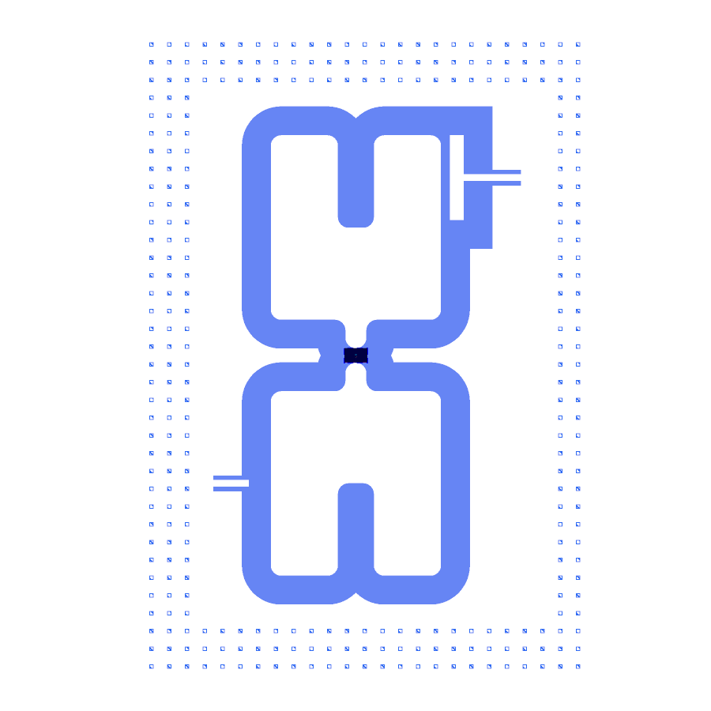
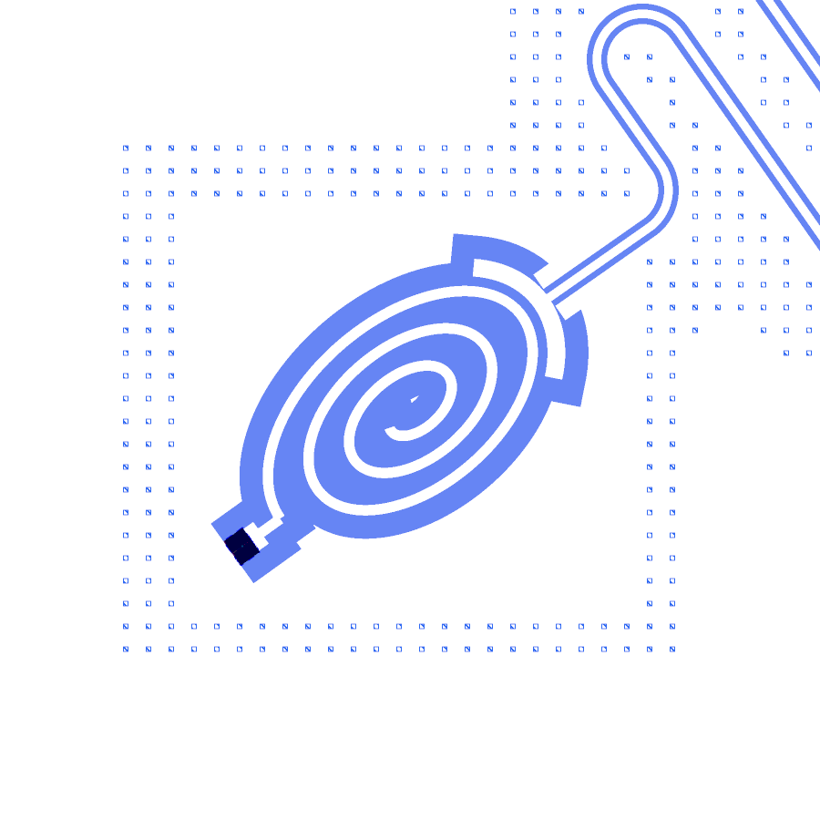

# Your own components

The Quantcore library has 143 components, but a chip often needs a shape that is not among them. This series covers
adding your own: a qubit with a custom island shape, a spiral capacitor, a tunable resonator, and a shape you
drew by hand. A new component works like a library cell: you place it with `Designer.add`, route to its pins, run the
DRC and get it into the LOM. Read the next section for what a component is, then pick the example closest to what you need.

## What a component is

A component has four parts. Placement, routing, DRC, the dashboard and the fab export read them.

| Part | What it is | In the code |
|---|---|---|
| Geometry | The shapes the cell draws, as a negative mask: it draws what is etched, on `base_metal_gap_wo_grid` | `build()` of a KQC `Element` class |
| Pins | Named connection points: a position and a direction pointing out of the component | `self.add_port(name, position, direction)` |
| Junction | Where a qubit's Josephson junction sits. The Quantcore trilayer junction (PDK junction rule) is drawn across a gap | `place_trilayer(...)` and the parameters `junction_type`, `junction_params` |
| LOM model | The lumped circuit of the component: nodes, capacitances, the junction, which pin is which node | `qcc_lom(name, inst, pdk)` returning a `Fragment` |

The existing example `examples/custom_component/pad_gap_capacitor.py` has the first two and a small LOM model. The
series adds a junction and bigger LOM models, and a helper that builds a component from drawn polygons.

## The four examples

| Page | Component | What it shows | Picture |
|---|---|---|---|
| [A custom qubit with its junction](custom-qubit.md) | `ForkTransmon`: two forked islands, claw and drive pins, trilayer junction | A qubit class written by hand: shape from parameters, pins, junction, LOM fragment |  |
| [A spiral capacitor](spiral-capacitor.md) | A spiral or twisted coaxial capacitor | A passive component with two pins and a capacitance model | see the page |
| [A tunable resonator](tunable-resonator.md) | A λ/4 resonator with a SQUID array at its shorted end | A resonator with a junction tree and a flux pin | see the page |
| [From a drawn shape: the spiralmon](spiralmon.md) | `Spiralmon`: an oblique spiral island with a junction to ground | Polygons (drawn in Python or in KLayout) + pins + a junction location become a component |  |

The code is in `examples/custom_component/`. The notebook `custom_qubits.ipynb` places the two qubits on a small chip
with a readout, builds them, runs the DRC and the LOM (no FEM). `custom_passives.ipynb` does the same for the two
passive components.

## Make your own, step by step

1. Pick the closest example in the table and copy its file. Name the class after the shape.
2. Write the parameters (`Param(pdt.TypeDouble, "text", default, unit="μm")`) for every number the shape needs. The
   panel, `design.json` and the LOM read them.
3. Write `build()`. Draw the metal as regions, etch a clearance around it, add the protection region, add the pins
   (position and outward direction). For a qubit, call `place_trilayer` across the junction gap.
4. Set `qcc_category` (`"qubit"`, `"capacitor"`, `"resonator"`, ...). The panel's class filter, the DRC and the
   fab export read it.
5. Check the picture. Build the cell alone on a die and look at it (`snapshot`). Check that every pin leaves the
   component along its direction.
6. Add the LOM model. Give each conductor a node, each pin a node (`port_nodes`), and each branch a value from a
   formula in `quantcore_circuits.lom.estimates`. Mark honest values as `"rough"`. A Q3D C-matrix of the cell replaces
   them later by net name.
7. Register the class. A class inside `src/quantcore_circuits/layouts/` is registered automatically. A class in
   your own folder registers itself with `quantcore_circuits.layouts.register_pcell_classes([MyClass])` and is
   referred to by its dotted path, `"my_module.MyClass"`.
8. Place it on a chip with a readout, route to the pins, run `d.drc()`, and run the LOM.

```{note}
A component that lives outside the package is found by its dotted path only while its folder is on `sys.path`. To
make it a permanent library cell (plugin panel, `qcc components`, `design.json` anywhere), copy the file into
`src/quantcore_circuits/layouts/qubits/` (or `others/`) and restart KLayout. See [Components](../components.md).
```

## Where to read more

- [Components](../components.md): the libraries and how pins connect.
- [LOM](../lom.md): what the lumped model does and how far to trust it.
- [Routing and DRC](../routing-drc.md): what the DRC checks on pins and routes.
- [PDK](../pdk.md): the junction rule and the clearances.

```{toctree}
:maxdepth: 1
:hidden:

custom-qubit
spiral-capacitor
tunable-resonator
spiralmon
```
