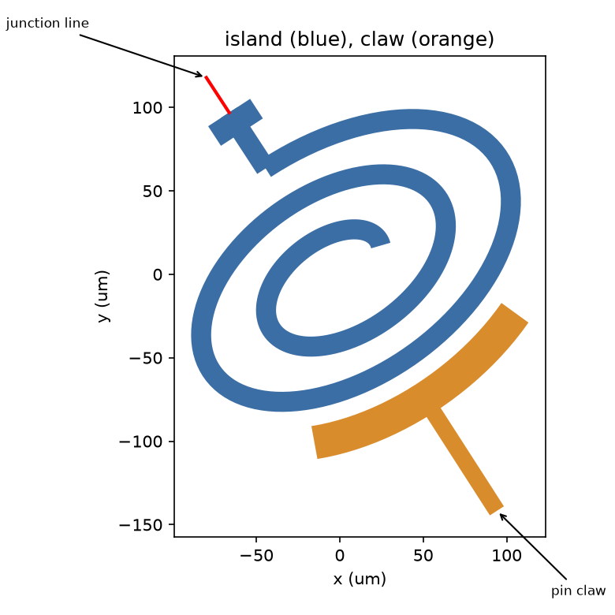
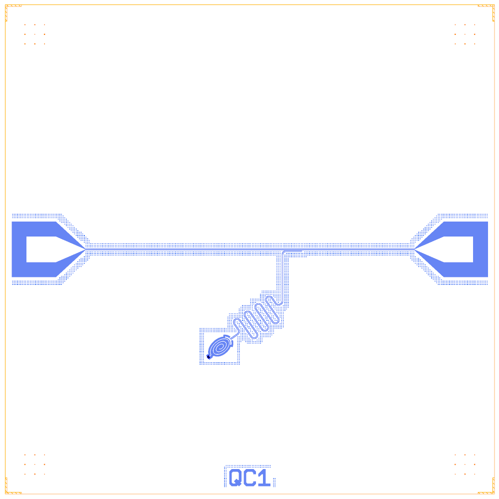

# From a drawn shape: the spiralmon

Sometimes the shape is a drawing, not a formula: an island someone sketched in KLayout, or a curve you generate in
Python. This page turns such a shape into a component. The example is the spiralmon: a transmon whose island is an
oblique spiral, with a qubit junction to ground and a curved readout claw. A component needs three things from the
drawing: polygons, named pins and a junction location. A small helper, `examples/custom_component/freeform.py`,
turns them into a cell. The notebook is `examples/custom_component/custom_qubits.ipynb`.

## What we build

| Part | Choice |
|---|---|
| Island | A thin wire wound as a spiral (2.25 turns by default), squashed to an ellipse (0.6) and tilted by 35°, ending in a tail and a landing pad |
| Junction | The PDK trilayer junction from the landing pad to the ground plane, across the clearance |
| Pin `claw` | A readout claw that follows the outer turn, and a straight tail that continues as the readout CPW |
| LOM | Island to ground, junction to ground, the claw as a node |

The same shape also works with a junction between two islands: draw the second island and put the junction line
between them.

## 1 · The polygons

Everything that is metal is a `pya.DPolygon` in µm. The spiral centre line is Archimedean in an ellipse, rotated by the
tilt. A `DPath` of the wire width turns it into a polygon.

```python
def _point(theta, p):                      # centre line of the spiral at angle theta (rad)
    r = p["r_in"] + p["pitch"] * theta / (2 * math.pi)
    x, y = r * math.cos(theta), p["squash"] * r * math.sin(theta)
    c, s = math.cos(math.radians(p["tilt"])), math.sin(math.radians(p["tilt"]))
    return x * c - y * s, x * s + y * c    # squashed, then tilted

centre = [_point(t1 * i / steps, p) for i in range(steps + 1)]
wire = pya.DPath([pya.DPoint(x, y) for x, y in centre], p["wire_w"], 0, 0, True).polygon()
```

`spiralmon.spiral_shapes()` returns the island polygons (wire, tail, landing pad), the claw polygons (the curved bar and
its tail), the pins, the junction line and some numbers for the LOM model.

```python
import spiralmon
shape = spiralmon.spiral_shapes()
shape["pins"][0]        # Pin(name='claw', x=94.2, y=-141.7, angle=-57.2, a=10.0, b=6.0, tail=70.0)
shape["junction"]       # ((-66.3, 96.9), (-79.9, 117.8)): island side first, then the ground side
```



## 2 · From a drawing in KLayout

If someone drew the shape in KLayout, save it as `.oas` or `.gds`, with the island on one layer and the claw on another.
`read_polygons(path, layer)` reads the polygons of one layer, merged, in µm.

```python
import freeform
path = spiralmon.drawn_spiralmon_file()            # writes a stand-in drawing: island on 10/0, claw on 11/0
island = freeform.read_polygons(path, (10, 0))
claw = freeform.read_polygons(path, (11, 0))
```

What the file does not hold is where the pins and the junction are. Read them off the drawing with KLayout's ruler (or
the cursor coordinates in the status bar) and type them in:

| Measure in KLayout | Becomes |
|---|---|
| The end of each tail: a point, and the direction pointing out of the component (degrees, 0 = +x) | `Pin("claw", x, y, angle, a=10, b=6, tail=70)` |
| The CPW that continues from the pin: centre width `a`, gap `b` | `a`, `b` of the `Pin` (default: the element's) |
| The length of the tail polygon behind the pin | `tail` of the `Pin` |
| A line across the junction gap, from the island to the ground | `junction_line=((xa, ya), (xb, yb))` |

Use one drawing frame: the origin of the file is the origin of the component, and the pins are in the same units (µm).

## 3 · The component

`FreeformComponent` is a KQC `Element` that builds a cell from three methods you override: `polygons()`, `pins()` and
`junction_line()`. They may read the cell's parameters through `self`, so a parametric shape and a fixed drawing use
the same class. What it does for you:

- it etches `clearance` around all polygons (a negative mask) and keeps a CPW gap `b` along each pin's tail, so a route
  continues cleanly from the pin;
- it adds the protection region and the ports;
- it places the trilayer junction across the junction line with `place_trilayer`.

The spiralmon is a subclass. The spiral numbers are parameters, so the panel and the design file can change them.

```python
class Spiralmon(FreeformComponent):
    qcc_category = "qubit"

    turns = Param(pdt.TypeDouble, "Turns of the spiral", 2.25)
    pitch = Param(pdt.TypeDouble, "Radial advance per turn", 44, unit="μm")
    wire_w = Param(pdt.TypeDouble, "Spiral wire width", 12, unit="μm")
    squash = Param(pdt.TypeDouble, "Minor / major axis of the spiral ellipse", 0.6)
    tilt = Param(pdt.TypeDouble, "Tilt of the ellipse (oblique angle)", 35, unit="deg")
    # ... r_in, claw_w, claw_span, claw_gap

    def polygons(self):
        s = self._shapes()                 # spiral_shapes(...) with the cell's parameters
        return s["island"] + s["claw"]

    def pins(self):
        return self._shapes()["pins"]

    def junction_line(self):
        return self._shapes()["junction"]
```

For a fixed drawing, `component_from_polygons` makes the class in one call. It registers the class, so
`"spiralmon.DrawnSpiralmon"` works as a cell reference once the module is imported.

```python
shape = spiralmon.spiral_shapes()
polys = freeform.read_polygons(path, (10, 0)) + freeform.read_polygons(path, (11, 0))
DrawnSpiralmon = freeform.component_from_polygons(
    "DrawnSpiralmon", polys, shape["pins"], shape["junction"], module="spiralmon", clearance=25
)
```

The parametric and the drawn component draw the same etched pattern and the same junction: the XOR of the two cells is
empty on 1/0 and on the two finger layers (the notebook prints it).

```{note}
`freeform.py` is example code, not a library module. To use it from the library, copy it into
`src/quantcore_circuits/layouts/` next to your component. Classes there are registered automatically; a class outside
the package calls `freeform.register(MyClass)` (or `quantcore_circuits.layouts.register_pcell_classes`).
```

## 4 · The LOM model

The spiral island is one conductor: its turns are all the same node, so the island's capacitance to ground comes from
the outline, not from the gaps between the turns. The model treats the outline as a disk of the same area in the
clearance, which is rough. The claw is a second node.

```python
@classmethod
def qcc_lom(cls, name, inst, pdk):
    shape = spiral_shapes(a=..., b=..., **{k: float(p[k]) for k in cls._SHAPE_KEYS})
    g = shape["geometry"]                              # hull area, claw length, wire length
    r_eq = math.sqrt(g["hull_area_um2"] / math.pi)
    c_island = est.disk_to_ground(r_eq, clearance, eps)
    c_g = est.coplanar_coupling(g["claw_length_um"], claw_w, wire_w, claw_gap, eps)   # claw to the outer turn
    c_claw = est.cpw_line(g["claw_length_um"] + claw_tail, claw_w, clearance, eps)
    frag = Fragment(nodes={"island": {"island": f"{name}.island"}, "claw": {"island": f"{name}.claw"}},
                    port_nodes={"claw": "claw", "squid_a": "island", "squid_b": "gnd"})
    frag.elements += [
        LomElement(f"C_{name}", "C", ("island", "gnd"), est.cap(c_island, "rough", formula)),
        LomElement(f"Cg_{name}_claw", "C", ("island", "claw"), est.cap(c_g, "rough", "...")),
        LomElement(f"Cc_{name}_claw", "C", ("claw", "gnd"), est.cap(c_claw, "rough", "...")),
        junction_element(name, "island", "gnd", inst, "JJ", drawn_params=p),    # junction to ground
    ]
    return frag
```

The model does not include the inductance of the spiral wire itself (about 1 nH per mm of wire as a rule of thumb: here
1.7 mm for three turns, which is small against the 6 nH of the junction but not zero). The fragment says so in a note.

## 5 · Place it on a chip

The chip is the same as for the fork transmon: two pads, a feedline, the qubit, a hanger resonator. Two details are
specific to a drawn shape.

The pin is oblique. The claw pin points at -57° in the cell's own frame. Routes follow any pin direction, but the
resonator should leave towards the feedline, so rotate the whole cell: `rot = 35 - pin angle` puts the pin at 35°.
The pin angle depends on the number of turns (the claw sits opposite the end of the spiral), so read it from the shape.

The size sets the junction. The first spiral (2.25 turns) has C_Σ of about 81 fF, which would need R_n = 55.8 kΩ for
5.5 GHz: outside the PDK window (40-50 kΩ). Three turns with a wider pitch give 115 fF and L_J = 6.03 nH (R_n = 40.3 kΩ).

```python
params, junction = trilayer_junction("spiralmon.Spiralmon")
q2 = d.add("Q1", "spiralmon.Spiralmon", at=(3300, 2250), rot=35 - shape["pins"][0].angle,
           junction=junction, **params)

pin_angle = spiralmon.spiral_shapes(turns=3.0, pitch=52.0)["pins"][0].angle
q2.set(turns=3.0, pitch=52.0, rot=35 - pin_angle)          # one change: the geometry and the LOM follow
# ... size_junction for 5.5 GHz, then trilayer_junction(..., lj_nH=...) and q2.set(junction=..., **params)
d.route("R1", q2.claw, fl.hanger(near=(4400, 3750), length=300, side="right"), meander=L_R1, r=50)
d.drc()
```




The DRC finds no error and two warnings: `squid_a` and `squid_b` (the junction-end markers of the simulation export)
are not routed.

## 6 · What the LOM says

The netlist has four nodes (`FL`, `Q1.island`, `Q1.claw`, ground) and eight branches. Values of the notebook for the
three-turn spiral, after two rescales of the resonator (R1 = 4211 µm):

| Quantity | LOM |
|---|---|
| C to ground, island | 100 fF |
| C_g, island to claw | 15 fF |
| C, claw to ground | 30 fF |
| Junction | L_J 6.01 nH, C_J 16.8 fF |
| f_q | 5.480 GHz (target 5.5) |
| α | -150 MHz |
| f_r | 6.997 GHz (target 7.0) |
| χ | -7.3 MHz |
| κ | 0.19 MHz |

The χ is large because the claw is long and close to the island. These are lumped-model estimates (rough formulas on the
shape), not FEM results; see [the LOM page](../lom.md) for how far to trust them. The next step for a real design is a Q3D
C-matrix of the cell (`q3d_cmatrix`, nets `Q1.island`, `Q1.claw`), which replaces the three capacitances by FEM values.

## Next

[A custom qubit with its junction](custom-qubit.md) builds a qubit from parameters instead of polygons.
