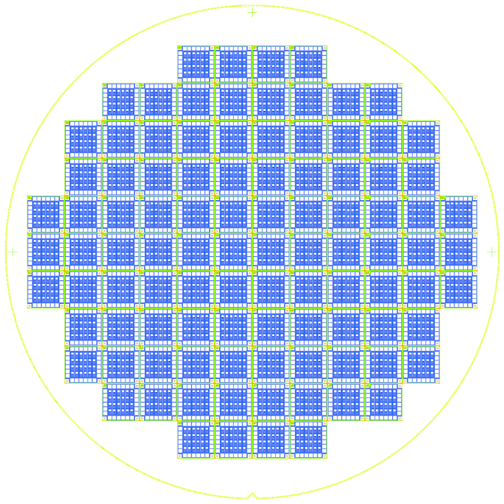
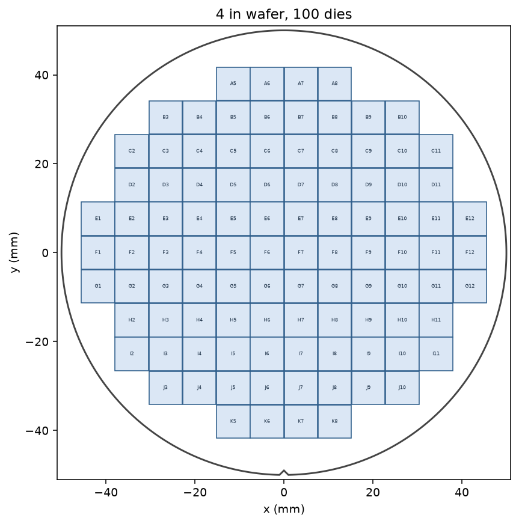
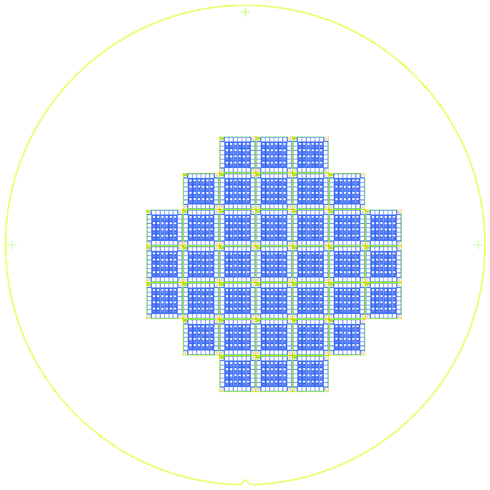
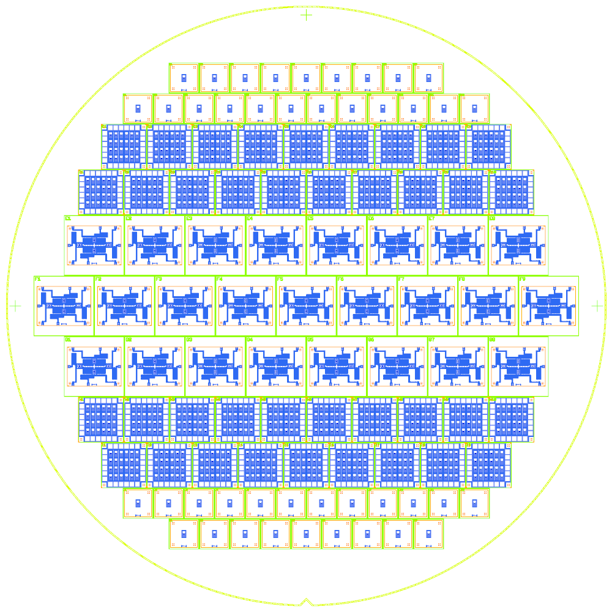
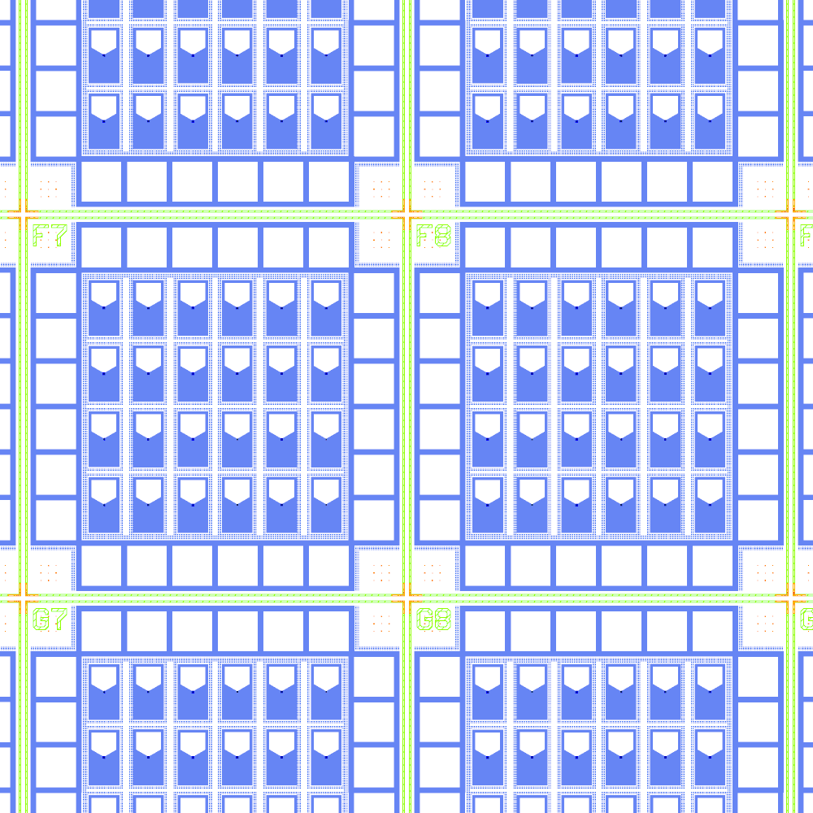
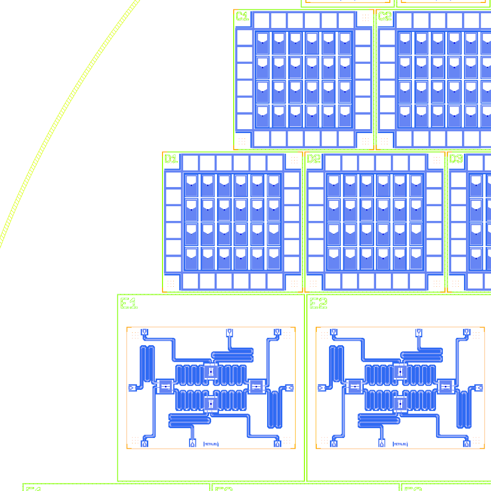
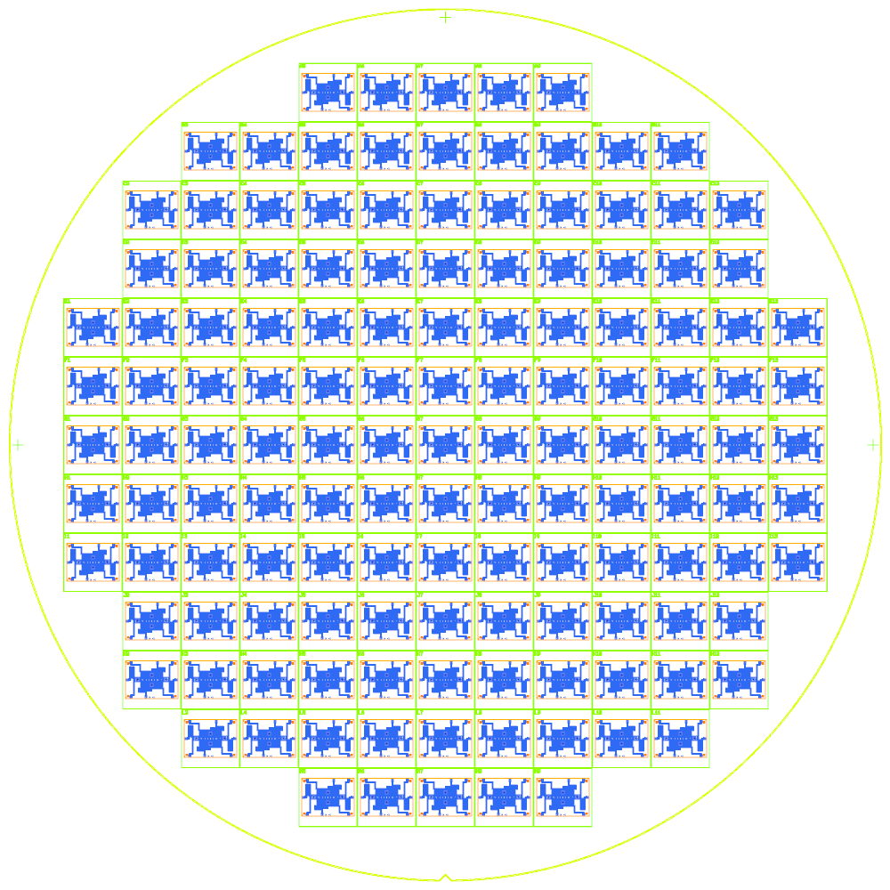
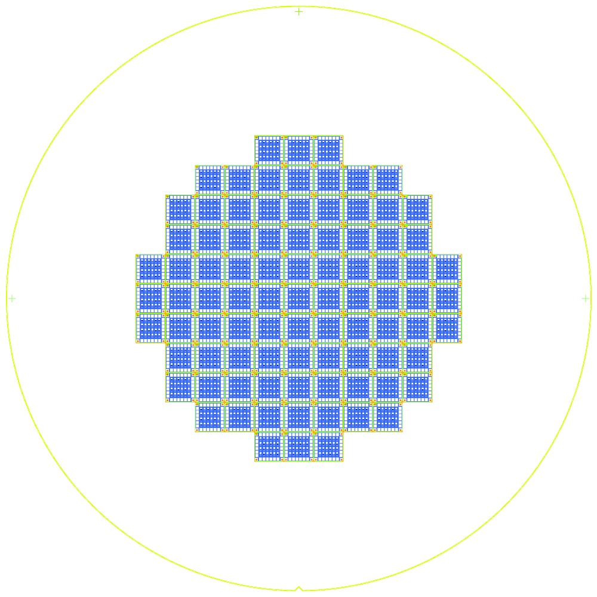

# Wafer assembly

Wafer assembly packs square dies on a round wafer, names every die and puts a chip layout on each one. The result is
one wafer OAS file with the wafer outline, the die labels, the alignment marks and your chips. Use it when a set of
chips goes to the fab on one wafer, or when you want to know how many dies of a given size fit.

The code is `quantcore_circuits.layouts.wafers.wafer` (class `Wafer`). The demo notebook is
`examples/wafer/wafer_assembly.ipynb`.

## A first wafer

```python
from quantcore_circuits.layouts.wafers.wafer import Wafer

w = Wafer(diameter_mm=100, die_mm=7.5)        # 4 inch, dense, notch on the bottom edge
print(w.die_count)                            # 100
w.write("build/wafer/wafer.oas", chips="examples/designs/legacy/chip_06_test_cyro_tlq.json")
print(w.table_markdown(limit=5))              # die, size, centre, chip
```

`write` builds the wafer, writes the OAS and a `.csv` with the same die table next to it.

## Parameters

All lengths are in mm. The layout itself is written in µm, like every other Quantcore layout. The wafer centre is the
origin, x points right, y points up.

| Parameter | Default | Meaning |
|---|---|---|
| `diameter_mm` | 100 | wafer diameter: 100 (4 in) and 150 (6 in) are the presets, any value works |
| `die_mm` | 7.5 | die side (square): 5, 7.5, 10 or any size |
| `street_mm` | 0.1 | dicing street between neighbouring dies |
| `edge_mm` | 3.0 | edge exclusion: no die closer than this to the rim, the notch or the flat |
| `orientation` | `"notch"` | `"notch"` (V-notch, 1 mm deep), `"flat"` (32.5 mm on 100 mm, 57.5 mm on 150 mm) or `"none"` |
| `orientation_side` | `"bottom"` | `"bottom"`, `"right"`, `"top"` or `"left"` |
| `packing` | `"dense"` | `"dense"` or `"centred"` (see below) |
| `radius_mm` | none | radius of the packing circle, needed for `packing="centred"` |
| `offset_mm` | (0, 0) | x, y shift of the packing centre from the wafer centre |
| `align` | `"auto"` | how the die grid sits on the packing centre: `"centre"` (a die centred there), `"corner"` (a street crossing there), `"row"`, `"column"`, or `"auto"` (the one that fits most dies) |
| `bands` | none | mixed die sizes: `[(die_mm, n_rows), ...]` |
| `die_outline`, `labels` | on | draw a thin frame and the name of every die on 501/0 |

## The two packings

Dense fills the whole wafer. A die is placed where it lies completely inside the usable disc: the wafer radius
minus `edge_mm`, and clear of the notch (the notch is cut out of the outline before the edge exclusion is applied).

Centred fills only a circle of `radius_mm` around the packing centre (the wafer centre plus `offset_mm`). A die
counts when all four corners are inside that circle and it is also inside the usable disc. The die grid is laid out
around the packing centre, so the pattern follows the offset. Use it for a small run in the middle of the wafer, or
a run away from a bad wafer region.

Mixed sizes (`bands`): rows of one die size are stacked from top to bottom, the stack is centred on the packing
centre, and each row takes as many dies as fit. The demo uses `[(5, 2), (7.5, 2), (10, 3), (7.5, 2), (5, 2)]`.

## Naming

Rows are letters from the top (`A`, `B` ... `Z`, `AA` ...), columns are numbers from the left (`1`, `2` ...). A die is
`<row><column>`, for example `F7`.

On a one-size wafer the column number counts from the leftmost occupied column of the whole wafer, so a short top row
starts at a higher number, like a wafer map. On a mixed wafer the rows do not share a grid, so each row is counted
from its own leftmost die.

## Layers

| Layer | PDK name | What is drawn on it |
|---|---|---|
| 500/0 | `wafer_boundary` | the wafer outline: a 200 µm ring just inside the rim, with the notch or flat |
| 501/0 | `wafer_markers` | die labels and thin die frames, and a small cross at each axis point in the edge band (alignment and orientation marks; none at the notch) |

The chips keep their own layers. Earlier versions of the PDK used 500/0 and 501/0 for these two; the layer map is on
the [PDK page](pdk.md).

## Placing chips

`chips=` takes a source for the dies:

| Value | Meaning |
|---|---|
| one source | the same chip on every die |
| `{7.5: src, 10: src2}` | by die size in mm (`"*"` is the default) |
| `{"B3": src}` | by die name |
| `lambda die: src or None` | a function of the die |

A source is a design `.json` (built headless), an `.oas` / `.gds` file, or a `BuildResult` from
`quantcore_circuits.assembly.build`. Each distinct chip is loaded once and placed as a sub-cell. The chip is centred on
its die using its `100/0` chip boundary; a chip larger than its die raises an error. Dies without a chip stay empty
(label and frame only). The design JSON files are only read.

## Pictures

`Wafer.plot_map(path)` draws the die map (outline, notch, names) with matplotlib. KLayout pictures come from
`quantcore_circuits.live.snapshot.snapshot(oas, png, box=...)`; `box` (µm) zooms to a region. Both are used in the
notebook.

## Four inch



Dense, 7.5 mm dies, 100 dies, the Quantcore cryogenic test chip on every die. The notch is at the bottom.





Centred, radius 30 mm, offset (6, -4) mm: 37 dies.



Mixed sizes: 42 dies of 5 mm, 38 of 7.5 mm, 25 of 10 mm (105 dies). The three chips are a 4.5 mm test-pad chip, the
cryogenic test chip and the Metal four-qubit chip (9.0 x 6.5 mm).



A zoom on two dies: the label is the top-left corner of the die on 501/0, the green frame is the die outline.



## Six inch



150 mm wafer, dense, 10 mm dies: 137 dies with the Metal four-qubit chip on each.



150 mm wafer, centred, 7.5 mm dies, radius 45 mm: 89 dies.

## Die counts

Edge exclusion 3 mm, street 0.1 mm, notch at the bottom.

| Wafer | Die | Packing | Dies |
|---|---|---|---|
| 4 in | 7.5 mm | dense | 100 |
| 4 in | 7.5 mm | centred, radius 30 mm, offset (6, -4) | 37 |
| 4 in | 5 mm | dense | 238 |
| 4 in | 10 mm | dense | 52 |
| 4 in | 5 / 7.5 / 10 mm | bands (2, 2, 3, 2, 2 rows) | 105 |
| 6 in | 10 mm | dense | 137 |
| 6 in | 7.5 mm | centred, radius 45 mm | 89 |

## Run the notebook

```bash
cd examples/wafer
QCC_LIVE=0 jupyter lab wafer_assembly.ipynb
```

It builds the chips headless, writes every wafer to `build/wafer/` (OAS, CSV table, PNG pictures) and does not touch
`examples/designs/`. The tests are `pytest tests/test_wafer.py`.

## Limits

- Dies are squares on a regular grid; there is no stepper-field or reticle model.
- The notch and flat are cut into the outline and kept clear by the edge exclusion; no SEMI notch tolerances are checked.
- The wafer OAS is written by `Wafer.write`, not by `qcc mask`.
