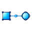
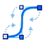
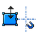

# Place and route

This page shows how to put components on the chip, snap them together, and draw the lines between their ports. A **component** is a library cell (a qubit, a pad, a launcher). A **port**
is a connection point of a component, such as `Q1.claw_n`. A **route** is a coplanar waveguide (CPW) between two
ports, a port and a line, or a port and a free end.

## The three tools

After the install the KLayout toolbar has three Quantcore tools. KLayout's own Select tool also works on components.

| Icon | Tool | Use it to |
|---|---|---|
|  | **Connect** | Draw a route: click a start port, optional nodes, then a finish |
|  | **Route handles** | Move, add or delete the nodes of a route; double-click a route for its dialog |
|  | **Move/Snap** | Pick up a component, move it, drop it; ports snap to ports. Double-click a component to edit it |

Keys go mostly to KLayout, so every key action is a Quantcore menu item with a shortcut (see the
[menu](index.md#the-quantcore-menu)). **Right-click cancels** a placement, a move or a route in progress.

## Place a component

1. Open the panel (**Ctrl+Shift+P**) and the **Components** tab.
2. Pick the library in the first drop-down (`quantcore`, `kqc`, `metal`, `all`) and the class in the second (qubit,
   resonator, capacitor, launcher, and so on).
3. Click a cell to see its parameters in the table below the list.
4. **Double-click** the cell. Its outline, with the port arrows, follows the mouse.
5. Press `[` or `]` to turn it by 90°, then click to drop it. Right-click cancels.
6. Double-click the placed component (with Move/Snap) to edit position, rotation and parameters. Only values that
   differ from the defaults are written to `design.json`.

The GUI names a component after its cell (`BP1`, `X1`). Rename it with **Edit > Rename selected component...**; its
routes, snaps, targets, sim groups and couplings follow. Every qubit gets the targets f_q and α in its dialog, every
resonator f and κ. The pins of each cell are listed under [components](../library/components.md).

```{figure} ../images/plugin/tab_components.png

The Components tab: library and class drop-downs, the cell list, the parameter table.
```

```{note}
The component list and parameters are loaded by `qcc` in the background and cached. The first time, the panel shows
"loading...". Use **Refresh list** to forget the cache after a library change.
```

A qubit gets its junction value when you place it (`junction = {Lj_nH, Cj_fF}`, the PDK value of the drawn junction).
The status bar says so. These are simulation values and are not drawn. Change them in the component dialog.

```{figure} ../images/plugin/dialog_component.png
:width: 80%

The component dialog of an Xmon: position, parameters, targets, junction and circuit rows.
```

Other ways to place: **Duplicate** (Ctrl+Shift+U) and **Mirror** (Ctrl+Shift+F) work on the selected component. The
copy follows the mouse until you click. The experimental **Live PCells** setting (off by default) also lets KLayout's
own Instance tool place components; see the plugin README.

## Snap and rotate

Drag a component with Move/Snap, or move a new one. A port that comes within the capture radius of a compatible port
(same CPW a and b) snaps, and the component **turns to face it**. The preview shows the turned outline and a label such
as `snap SQ2.pin_cpl4 -> SQ1.pin_cpl2, turn -36.0°`. It works for angled ports too: a StarQubit's pins are 72° apart, a
ConcentricTransmon's couplers 60°.

```{figure} ../images/plugin/rotation_snap_preview.png
:width: 80%

The preview while dragging a StarQubit onto the pin of another: it turns by −36° to face it.
```

```{figure} ../images/plugin/rotation_snap_built.png
:width: 80%

After the click the pins sit on each other and face each other.
```

- A snap is stored as `place.snap`. Without a snap, `place.at` is rounded to the grid and the rotation stays on the 90°
  steps.
- Hold **Ctrl** for no rotation snap: only ports that already face each other (within 2.5°) snap.
- Snapping to a line (a route) while dragging is not built. Routes attach to a line with the Connect tool.

## Draw a route

1. Pick **Connect**.
2. Click a start port. A click on empty canvas starts a free end instead.
3. Click to add nodes. Each click adds a node on the grid.
4. Finish by clicking a port, a line (for example the feedline), or the last node again (a free end).
5. A dialog asks for the name, the type (CPW or meander), the length and the bend radius. **OK** builds it.

```{figure} ../images/plugin/dialog_route.png
:width: 80%

The route dialog of a hanger resonator.
```

How the segments turn while you click:

| Keys | The segment |
|---|---|
| none | One square corner, exactly as the preview shows |
| **Shift** | A straight line at the nearest 0°, 45°, 90°, ... from the previous point, or along the start port's own axis |
| **Ctrl** | The node goes where you click and the segment is one oblique straight |

The rubber band shows the CPW with every corner bent to the route's radius, and a cross marks the snapped point. Between
two ports that face an angle the router draws one oblique straight instead of a stair, where the bends fit.

## Hang a resonator on a feedline

A readout resonator is a λ/4 line, shorted at one end, coupled to the feedline along a straight stretch. In the plugin
the **hanger** is that coupler, so there is no coupler component to place.

1. Draw the feedline first with **Connect**, from pad port to pad port.
2. Still in Connect, start at the qubit's claw port (`Q1.claw_n`), or on empty canvas for a bare resonator. Click any
   nodes the meander should pass through.
3. Click **on the feedline** where the coupler goes.
4. The hanger dialog sets the meander length (about 4300 µm for 7 GHz), the coupler length, the side, *short* (λ/4) or
   open, and the ground strip.

```{figure} ../images/plugin/dialog_hanger.png
:width: 70%

The hanger dialog.
```

To merge instead of hang, press **Ctrl+Shift+J** (Edit > Connect on a line) and a click on a line merges the route into
it with a T-junction, instead of hanging beside it. The route dialog's *Merge into ... (T-junction)* checkbox decides
per route and can convert it later.

The library cells `CoupledResonator`, `QubitResonator` and similar are for scripts, not for this flow. In the GUI, use
Connect.

## Edit a route

Pick **Route handles**. Every node is a filled square. Each free straight has a hollow insert handle that adds a node.

- Click a node to pick it up, move, click to drop it. Shift aligns it with its neighbours; Ctrl is the plain grid point.
- A selected corner shows a green curvature handle. Move it along the bisector to set that corner's bend radius.
- **Ctrl+Shift+X** or a right-click on a node deletes it. **Ctrl+Shift+N** opens the node properties (x, y, corner
  radius, airbridge, taper).
- **Ctrl+Shift+M** puts a meander on the segment under the cursor.
- Double-click a route for its dialog: length, radius, line width and gap, the hanger rows, targets.

```{figure} ../images/plugin/route_handles.png
:width: 100%

A node of the `FLUX` line picked up. The status bar says how to drop it.
```

Port stubs and hanger couplers are fixed segments and get no handles.

## When a route fails

The plugin builds with `qcc build --keep-going`. A route that cannot be built (a bend too tight for its straight, a
missing hanger host) does not stop the design. The route is left out, drawn **in red**, and the status bar names the
reason. In Route handles you can still move or delete its nodes, or delete it with **Edit > Delete route...**.

```{figure} ../images/plugin/failed_route.png
:width: 100%

A failed route: the 40 µm leg between two bends needs 200 µm.
```

The LOM uses the last good route of a failed one and prints a warning. The fab export refuses while a route has failed.

## Simulation groups

A **sim group** is the set of components, routes and ports that one simulation solves. You pick it with KLayout's
Select tool and the Simulate dialog, which draws the group over the layout while it is open: the box, the selected
components, the junction and 50 Ω ports.

The panel's **Sim groups** tab lists the groups saved in `design.json`. Click one to draw its box, components and ports.
The drop-down picks the analysis; **Hide** removes the drawing. The overlay is made of plugin markers. It is never on a
fab layer, never in an export, and looking at it writes nothing to `design.json`.

```{figure} ../images/plugin/tab_simgroups.png

The Sim groups tab.
```

```{figure} ../images/plugin/sim_group_saved.png
:width: 80%

A saved group drawn on the layout.
```

How to run a simulation is on [the Flow strip](flow-strip.md#simulate).

## Next steps

- Undo and redo: Ctrl+Shift+Z and Ctrl+Shift+Y. Every step is one undo step.
- Check your work with [the Flow strip](flow-strip.md#check).
- Not built: freeform shapes to component capture, per-instance values on hover, snapping a component to a line.
