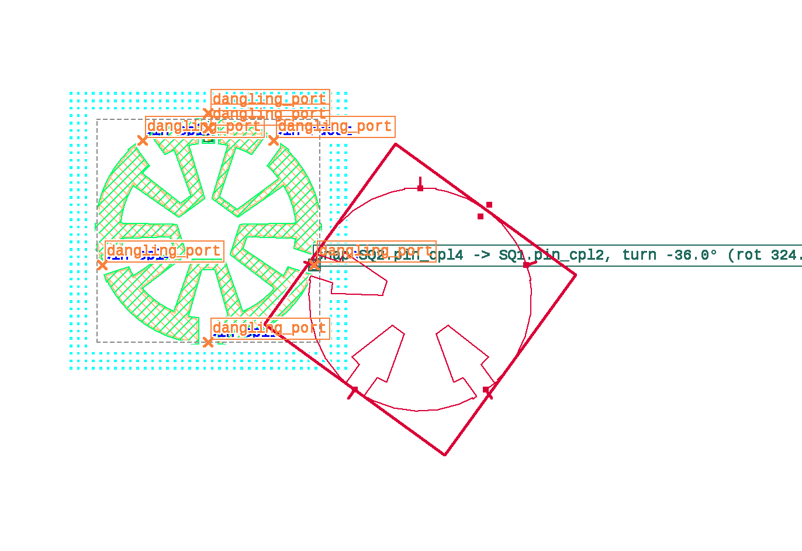
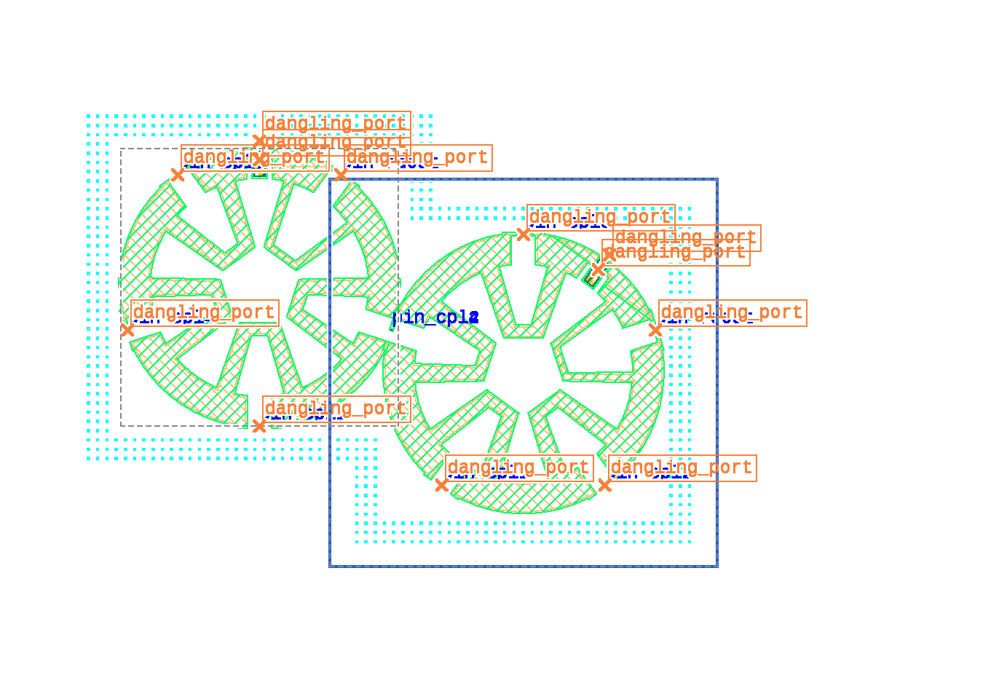
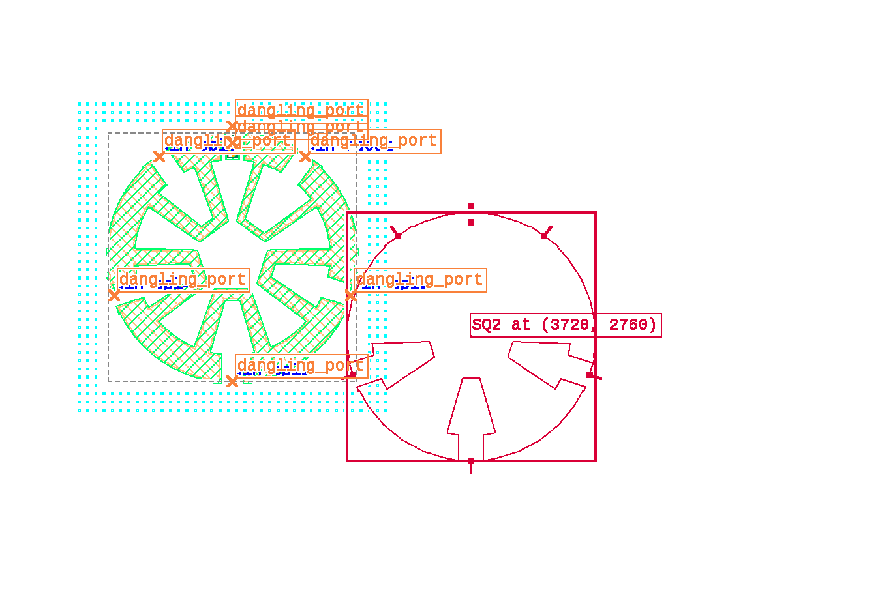
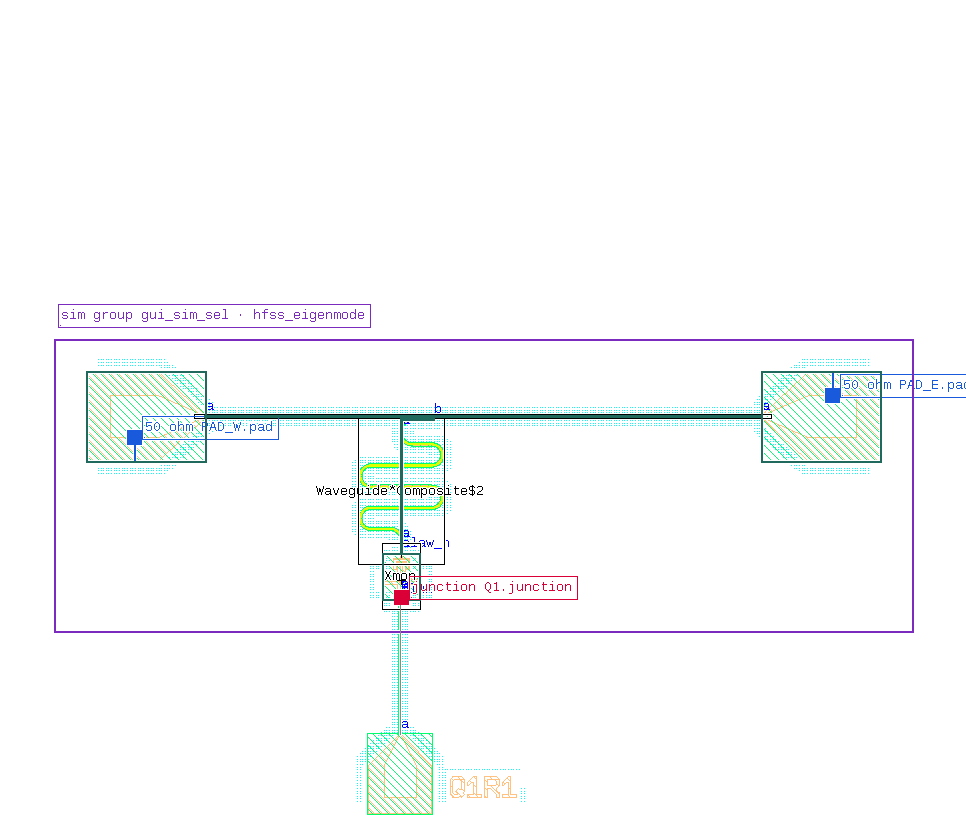
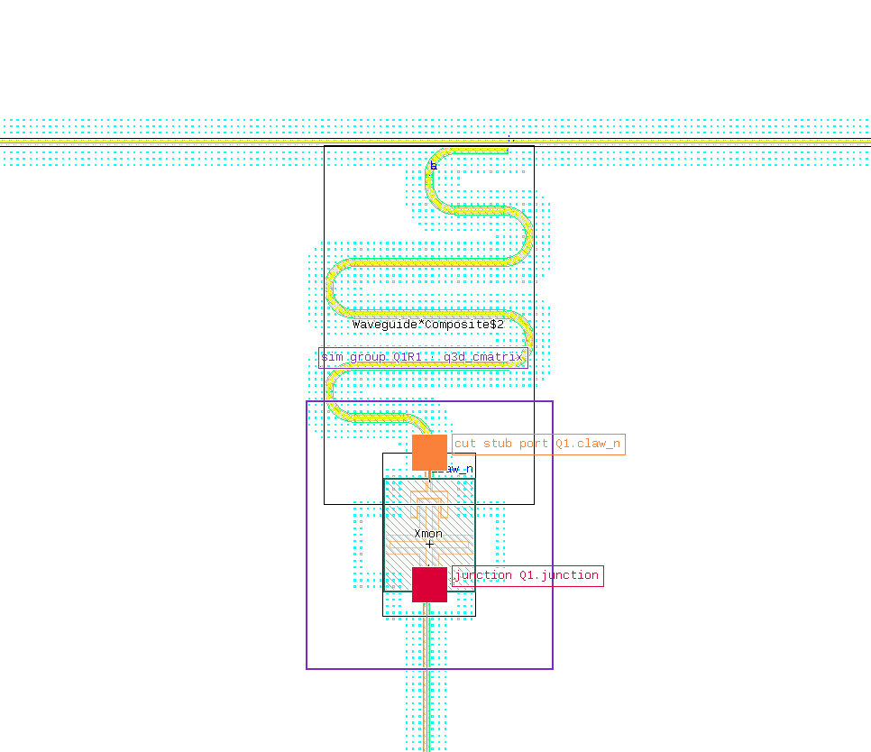

# Tutorial: draw Q1 + R1 in KLayout with the Quantcore plugin

You build `examples/q1_r1_feedline.json` by hand: one Xmon qubit (Q1) with a flux line, a λ/4 readout resonator (R1)
hanging off a feedline (FL), and three bond pads. Then you run the loop without simulating: Check → LOM → design.py →
Fab. It takes about 15 minutes. Nothing here edits JSON by hand.

The finished design:

| Name | What | Where / values |
|---|---|---|
| PAD_W, PAD_E | `BondPad` | (1125, 3750) rot 270 · (6375, 3750) rot 90 |
| PAD_F | `BondPad`, flux pad | (2964.5, 750) rot 0; a 4, b 6, pad_width 300, pad_height 300, pad_gap 150, taper_length 300 |
| Q1 | `Xmon` | (2975, 2200); cross_length 300, arm_width 25, gap 25, claws `["n"]`, flux_port true, junction_type `Trilayer Squid`; junction Lj 12 nH, Cj 2 fF; targets f_q 5.1 GHz, α −220 MHz |
| FL | route, cpw | PAD_W.a → PAD_E.a |
| R1 | route, meander hanger | Q1.claw_n → on FL at x ≈ 3125; length 4200 µm, coupler 300 µm, side right, ground strip 6 µm; targets f 7.2 GHz, g 90 MHz |
| FLUX | route, cpw | PAD_F.a → node (2964.5, 1967) → Q1.flux; a 4, b 6; taper at the node to a 1, b 7.5 |

## Before you start

- **Restart KLayout** after the plugin code changes (a `git pull` or an update). KLayout keeps the modules it loaded at
  start, so a half-updated plugin can show an `ImportError` box when the panel opens.
- The three toolbar modes: **Move/Snap** (place, move, double-click to edit), **Connect** (draw routes), **Route
  handles** (edit route nodes). KLayout's own **Select** tool also works on components.
- Undo / redo any design edit: **Ctrl+Shift+Z** / **Ctrl+Shift+Y**. Every step below is one undo step.
- Clicks don't need to be exact: each component's dialog has exact **x / y** fields, and each route node has a node
  dialog. Zoom in when two ports are close; the capture radius is 12 pixels, so a click near a port takes the port.

## 1. New design

1. **Quantcore ▸ Design ▸ New design…** and save as, for example, `examples/hand_q1r1.json`.
2. The *New design* dialog asks for **Die width µm** and **Die height µm**. Leave **Square die** ticked and the width
   at 7500. (Untick it for a non-square die.)
3. The empty die builds and opens: frame, label, and the cheese band along the edge.
4. Optional: **Design ▸ Chip settings…** sets the label on the die to `Q1R1`. Leave the KQC grid unticked.
5. The same dialog sets the design's **substrate**: thickness µm, εr (dk), loss tangent tan δ. The PDK's sapphire
   values are preset (650 µm, 10.25, 1e-6). A changed value is stored in design.json as
   `"pdk": "quantcore_nb_sapphire_v1+substrate(eps_r=11.45)"`. The length estimates in the route dialogs, the LOM
   and the simulation exports all use it. For example, εr 11.45 moves Q1 + R1's LOM resonator from 6.65 to
   6.33 GHz.

## 2. Place the pads

1. **Ctrl+Shift+P** opens the Quantcore panel. In the *Components* tab, choose the library `quantcore`.
2. **West pad.** Double-click `BondPad`. The outline follows the mouse. Press **]** until the port arrow points
   east (into the chip), then click near (1125, 3750).
3. **East pad.** Double-click `BondPad` again, press **[** until the arrow points west, and click near (6375, 3750).
4. **Flux pad.** Click `BondPad` once to show its parameters in the table, then set `a` 4, `b` 6, `pad_width` 300,
   `pad_height` 300, `pad_gap` 150 and `taper_length` 300. Double-click `BondPad`, check that the arrow points up
   (north), and click near (2964.5, 750).
5. **Exact positions.** Switch to **Move/Snap** and double-click each pad. Type the **x µm**, **y µm** and **rotation**
   from the table above and press OK.
6. **Names.** The plugin names parts `BP1`, `BP2`, `BP3`. Select one and use **Edit ▸ Rename selected component…** to
   rename them `PAD_W`, `PAD_E`, `PAD_F`. Optional, but the rest of this guide uses these names.

**Snapping while you drag or place.** A component that follows the mouse (picked up in **Move/Snap**, or armed with a
double-click in the panel or **Duplicate**) snaps by its ports. When one of its ports comes within the capture radius
of a compatible port (same CPW a / b) the component **turns to face it** and sits on it: the green square marks the
target and the label says which ports and how far it turned. Without a snap the rotation stays on the 90° steps of
**[** / **]**. The turn is any angle, not only 90°, so the angled ports work: a Quantum Metal `StarQubit` has pins 72° apart,
a `ConcentricTransmon` couplers 60° apart.

Click, and the placement is stored as `place.snap` (the port and its target); the build solves the same rotation, so
the built component lies exactly where the preview was:

Hold **Ctrl** while moving for **no rotation snap**: only ports that already face each other (within 2.5°) snap, and
the rotation stays what you set with **[** / **]**.

## 3. Place the qubit

1. Click `Xmon` in the list. In the table set `junction_type` `Trilayer Squid` and `flux_port` true. `claws` is
   `["n"]` and `cross_length` 300 already.
2. Double-click `Xmon` and click near (2975, 2200).
3. In **Move/Snap**, double-click it and set x 2975, y 2200. Set the **targets**: f_q 5.1 GHz, α −220 MHz. Press OK.
4. Rename it `Q1`.
5. **Junction.** The same dialog has a section **"Junction (simulation and LOM only, not drawn, not in the fab
   mask)"**. These are simulation values: the junction you draw (`junction_type`) is for fab only, and the value the
   LOM and the eigenmode run use is fixed per component in design.json. Enter **L_J** 12 nH and **C_J** 2 fF. L_J,
   I_c and R_n are one value (L_J = Φ0/2πI_c, I_c·R_n = πΔ/2e with the PDK's Nb gap Δ = 1.4 meV), so you can type any
   one of them and the other two follow: L_J 12 nH is I_c 27.4 nA, R_n 80.2 kΩ. design.json keeps L_J and C_J
   (`junction.Lj_nH`, `junction.Cj_fF`). A SQUID (this `Trilayer Squid`) also has **flux Φ/Φ0** and **asymmetry d**
   (empty = 0, the sweet spot; L_J is then its value at zero flux), and the read-only rows show **L at this bias**
   (L_J / √(cos² πΦ + d² sin² πΦ), live while you type), the **source** of the value and the **drawn junction
   (PDK)** the cell draws, so you can see when a fixed simulation value no longer matches the drawing. Φ = ½ with
   d = 0 has no finite L and is shown in red. Without L_J the LOM has no qubit, and an eigenmode simulation cannot
   model the junction.

   A qubit you place gets its junction at placement: a drawn trilayer junction gives its PDK value (a KQC qubit left
   at its default junction is drawn as the PDK Quantcore Squid), a chosen KQC type (Manhattan, ...) the PDK nominal
   SQUID (L_J 6.73 nH, C_J 15 fF), and the status bar says so ("Q1: junction L_J
   6.73 nH (PDK nominal SQUID; simulation value, edit in the component dialog)"). Edit it here whenever you like.
6. **Circuit rows.** At the bottom, the component dialog lists the component's circuit as the last build's LOM sees
   it (read-only): C_Q1 to ground, the claw coupling, J_Q1 with L_J / C_J, each with where the value comes from.
   A route's dialog lists its line (length → bare frequency, Z0) and its hanger coupling (κ). Run LOM and Simulate
   refine these values.

## 4. Feedline

1. Switch to **Connect**. Click `PAD_W.a` (the port arrow turns red under the cursor), then click `PAD_E.a`.
2. In the route dialog, set the name `FL` and the type `cpw`, and press OK. The feedline builds straight across.

## 5. Readout resonator (the hanger)

There is no coupler component: the hanger is the coupler. Any qubit port works the same way (Xmon claw,
TwoPadTransmon `left`/`right`, Flipmon `coupler`, a Metal qubit's pin). A port that faces the line gives the cleanest
route. A port that faces sideways also works: the router goes around with extra corners. A Gatemon's `readout` is
the island edge, not a CPW end. Route from it and the dialog presets the PDK line width (10 / 6 µm), or snap a
`GatemonCoupler` to it and route from the coupler.

1. Still in **Connect**, click Q1's claw port `Q1.claw_n` (at the top of the qubit).
2. Move up to the feedline. The preview shows a square corner, and the label reads "hang from FL here". Click **on
   the feedline** at about x 3125, just above and right of the claw.
3. The hanger dialog opens:
   - leave **Merge into FL (T-junction)** unticked (that is section 11);
   - Name `R1`, type `meander`;
   - **Meander length µm** 4200. The dialog shows the bare λ/4 frequency on the design's εr as you type. A claw or a
     coupler pulls it lower: 7.5 GHz bare, 6.65 GHz in Q1 + R1's LOM;
   - **Coupler length** 300, **Side** right, **Coupler end** short (λ/4), **Ground strip** 6;
   - **Line width a** and **Line gap b**: leave them empty. They are R1's own CPW (centre line and the gap on both
     sides), over its whole length; empty takes the claw port's;
   - the two **Coupler: … facing …** rows: leave them empty for this design (both 6 µm). They are not another b:
     each narrows one gap along the coupler only, R1's gap on the feedline's side and FL's gap on R1's side. See
     step 7;
   - **Direction:** leave the preset.
4. Press OK. The meander fills the longest free straight between the claw and the coupler.
5. **Targets.** Switch to **Route handles** and double-click R1 on a straight, away from its nodes. The route dialog
   opens with a targets section: set f 7.2 GHz and g 90 MHz.

   **Meander on straight** chooses which straight of the route holds the meander. The straights count from the
   route's start (segment 1 leaves the claw), and the port stubs and the coupler are left out. Each entry shows the
   straight's length, and the one you double-clicked is marked. *automatic* is the longest free straight. Leave it
   on automatic unless you want the meander elsewhere (Ctrl+Shift+M in Route handles does the same for the straight
   under the cursor).
6. **Change it later.** The same dialog holds everything the hanger was drawn with:
   - **Coupler length**, **Side**, **Coupler end**, **Ground strip**, **Open gap**, **Direction**;
   - the meander's **length**, **Meander turns** (empty = automatic) and **Meander first turn** (flips the meander
     to the other side of its straight);
   - **Merge into FL**.

   The dialog opens three ways: double-click the route in **Route handles**, double-click it in **Move/Snap** (a
   route is not a component, so this opens the route dialog), or select it with KLayout's **Select** tool and
   press **Ctrl+Shift+Q** (*Edit selected*). KLayout's own *Object properties ▸ User properties* only shows the
   instance's `id`. It is KLayout's dialog and does not write design.json.
7. **A closer, stronger coupler: narrower facing gaps.** Along the coupler, the resonator's gap on the feedline's
   side and the feedline's gap on the resonator's side can be narrower than the CPW's 6 µm. Set **Coupler: this
   route's gap facing the line** and **Coupler: FL's gap facing this route**, for example 3 µm each, and the
   **Ground strip**, for example 4 µm. The two centre
   lines come closer by what the gaps save (28 µm apart becomes 20 µm). The outer gaps keep 6 µm. The build draws the
   extra ground over the coupler length, so it is in the fab mask and in the simulations. The LOM's κ estimate
   follows: Q1 + R1 goes from 0.16 to 0.79 MHz. Empty fields mean the normal gap. A gap narrowed by more than the
   facing gap plus the ground strip is refused, because the etch would cut into the other line.

## 6. Flux line, with a taper

1. In **Connect**, click `PAD_F.a`.
2. Hold **Shift** and click at about (2964.5, 1967), straight above the pad. Shift snaps the segment to 0°, 45° or
   90°, so this one is exactly vertical. (Hold **Ctrl** instead to place a node at any angle: the segment to it is one oblique straight.)
3. Click `Q1.flux` (the small port under the qubit; zoom in if the claw or the cross takes the click).
4. In the route dialog, set the name `FLUX`, type `cpw`, **Line width a** 4 and **Line gap b** 6. Press OK.
5. **The taper.** Switch to **Route handles** and **double-click the node** at (2964.5, 1967). The node dialog opens
   (the same as **Edit ▸ Route node properties…**, Ctrl+Shift+N, for a selected node). Set x 2964.5 and y 1967
   exactly, **Taper: line width a** 1 and **Taper: line gap b** 7.5, and press OK. From that node to the qubit the
   line narrows to 1 / 7.5 µm.

## 7. Shape the routes (optional)

In **Route handles**:
- click a node to pick it up and click again to drop it (any angle on the grid; Shift aligns it with its neighbours
  at 0° / 45° / 90°, or onto an angled port's axis; a node off the axes makes an oblique straight, which a meander
  can use too); double-click a node for its dialog (exact x / y, corner radius, airbridge, taper);
- **filled squares are nodes**: every corner of a route, including the corners the router drew by itself (a hanger
  meander from Connect without clicks). Move one, double-click it for its dialog, right-click it, or select it and
  press **Ctrl+Shift+X** (or Delete) to delete it. The first edit of a router corner writes all of that route's
  corners to design.json, so the route keeps the shape the red preview shows;
- **hollow squares are not nodes**: each sits in the middle of a straight and *adds* a node there (pick it up, drop
  it where the new corner goes). Nothing to delete. Port stubs and the hanger coupler have neither: the router keeps
  them straight;
- **lengthen a meander's straight** by moving its nodes apart, or **move the meander** to another straight
  (Ctrl+Shift+M, or *Meander on segment* in the dialog). When the meander no longer fits on its straight after an
  edit, the build puts it on the next longest free straight. If none can take it, the status bar says to lengthen
  one. A node moved off the coupler's approach gets the corner that enters the coupler straight;
- a selected corner shows a **green curvature handle**: drag it to set that corner's bend radius by eye. For an exact
  value, use the node dialog (*Corner radius µm*). Leave it empty to use the route's radius;
- point at a straight and press **Ctrl+Shift+M** to move R1's meander there;
- double-click a route to reopen its dialog (length, radius, a / b, targets, and for a route that ends on a line:
  merge or hang, section 11);
- **a route that fails** (for example two nodes 14 µm apart, too close for the bends) does not block the design: the
  rest builds, the status bar says `Route FLUX failed: ...`, and the route is drawn in red with its handles. Move or
  delete its nodes, double-click it for the reason and *Delete this route*, or press Undo. Once it builds again the red
  goes away. The LOM keeps using its last good route (with a warning) meanwhile, and the fab export refuses until it is
  fixed.

KLayout's **Select** tool now draws a route's selection box around the route itself (a meander's box includes its
meander). It used to stretch from the die's corner, because KQC route cells were drawn in chip coordinates.

## 8. Check

Click **Check** in the Flow strip at the top of the panel, or press **Ctrl+Shift+D**. The *DRC* tab lists:
- **errors** (open ports, overlaps, crossings, opens or shorts): there should be none;
- **design warnings** (PDK margins, the 100 µm pad-edge rule). At the positions above they should be clean. If a pad
  warns, **Check and LOM ▸ Fix pad edge warnings** moves it onto the edge rule.

Click a line in the DRC tab to zoom to it.

## 9. LOM

Click **LOM** in the Flow strip (or **Ctrl+Shift+O**). The *LOM* tab shows:
- a **progress bar** with the stage (export, read, QuCat + QuTiP, write, draw) and the elapsed time;
- a **log** of what `qcc` prints while it runs;
- when it ends (a few seconds for Q1 + R1): parameters against your targets (green = within tolerance, red = off),
  the modes, the netlist values, the circuit picture (click *Open the circuit picture full size*), and the
  connectivity of the layout.

Press **Stop** (beside Run LOM) to cancel a run: only the LOM process the panel started is killed, its partial output
is discarded and the tab shows what it showed before the run.

A LOM run stops by itself when it fails, with the error in the log and a hint. It also stops after the time limit
(**Quantcore ▸ Settings… ▸ Run LOM time limit**, default 30 minutes), so a QuCat solve that never ends can't hang
the panel. Q1 + R1 should land near f_q 5.1 GHz and f_r 7.2 GHz. To compare, run
`qcc circuit simulate examples/q1_r1_feedline.json` in a terminal.

## 10. Save as Python and export for fab

- **Design ▸ Save as Python script (design.py)…** writes a Designer script that rebuilds this exact design (the
  design hash is checked). Continue the chip in code from there.
- **Fab ▸ Export for fab (mask, netlist, design.py, PNG)…** writes `<name>_fab.oas` (PDK layers, cheese, frame),
  `circuit.json`, `design.py` and a PNG into a folder you choose. It warns first if Check found errors.

Results / Propose / Apply come after a simulation (section 14).

## 11. More ways to end a route on a line

### A resonator that is not attached to a qubit

A route can start on empty canvas: that start is a **free end**, open or shorted, so you need no open/short
component.

1. In **Connect**, click empty canvas where the resonator should start. A hollow red square marks the free end.
2. Click nodes as usual (Shift for straight 0 / 45 / 90° segments), then click **on the feedline**.
3. In the hanger dialog, **Free end (start)** chooses `open` (with the **Open gap µm**) or `short`. Type `meander`
   and a length make it a λ/4 (short) or λ/2 (open) resonator hanging off the line.

A route can also *end* free: click the last node again. The route dialog then asks for the end's open/short.
`CpweOpenEnd` (Quantcore) and `metal:OpenToGround` / `metal:ShortToGround` are termination components, if you want a
named part at the end. A free end does the same job without one.

### Merge into the line (T-junction) instead of hanging beside it

A hanger couples *beside* the line. To join the line itself, for example a finger capacitor between the feedline and
a resonator, merge into the line:

1. Place the capacitor (for example `CpweFingerCapacitor`, rotated so a port faces the feedline).
2. In **Connect**, click the capacitor's port, then press **Ctrl+Shift+J** (Quantcore ▸ Edit ▸ *Connect on a
   line: hang / merge*). The label changes from "hang from FL here" to "merge into FL here (T-junction)". Press it
   again to switch back. The default is hang. Plain T would be KLayout's own *Selection ▸ Tap*.
3. Click on the feedline. The dialog opens with **Merge into FL (T-junction)** ticked and the type `cpw`. Ticking or
   unticking the box in the dialog decides for this route, whatever T was set to.
4. OK splits FL into `FL` and `FL_1`, joined by a T (`T1`, a KQC `WaveguideCoplanarSplitter` drawn in the line's
   width), and the route ends on the T's stem `T1.c`. A hanger on the second half moves to `FL_1`. The T needs
   11 µm + 2 bend radii of straight line on both sides; closer to a corner, the status bar says so.

To change it later, double-click the route in **Route handles**. A route that ends on a line shows the same checkbox.
Untick it and the T goes away: the two halves become one line again, and the route ends in a 300 µm hanger coupler
there. Tick it again to merge. In the LOM the T is one conductor, so the capacitor sits galvanically on the line.

## 12. Component classes

Every component has a class: `qubit`, `junction`, `coupler`, `capacitor`, `resonator`, `launcher`, `termination`,
`waveguide`, `airbridge`, `marker`, `test_structure`, `flip_chip`, `shape`, `other`. Use the second drop-down in the
*Components* tab to filter by class. Hover over a component to see its class and description. `qcc components` lists
them by class from the command line.

What the class gives a component:
- **qubit**: the edit dialog offers qubit targets (f_q, α). Junction values (Lj, Cj) feed the LOM's junction. Every
  qubit cell gets them, from any library (Xmon, TwoPadTransmon, KQC `DoublePads`, `Swissmon`, Metal
  `TransmonPocket`, …).
- **resonator**: resonator targets (f, κ). A route gets resonator targets whatever its type.
- **launcher**: the pad-edge rule (100 µm from the die edge) and the device-ID placement.
- **junction**: valid as any qubit's `junction_type`, and never offered qubit targets.

Each component still has its own parameters (the table) and its own LOM model. Classes share behaviour through
Python inheritance. A cell that subclasses a KQC `Qubit` gets the junction parameters (`junction_type`, …), and a
LOM model registered for a class name also covers its subclasses.

## 13. Make your own component

A component is a KQCircuits `Element` class in one Python file. The worked example is
[examples/custom_component/pad_gap_capacitor.py](../examples/custom_component/pad_gap_capacitor.py): two pads
facing across a gap in a CPW line.

1. **Write the class.** Subclass `kqcircuits.elements.element.Element` and add:
   - `qcc_category = "capacitor"` (the class, section 12);
   - one `Param(...)` per parameter, with a description, default and unit. The panel's table shows these;
   - `build(self)`, which draws the **etched** region (negative mask) on `self.get_layer("base_metal_gap_wo_grid")`.
     Call `self.add_protection(...)` where no cheese may go;
   - `self.add_port("a", pya.DPoint(x, y), pya.DVector(dx, dy))` for each port, with the direction pointing out of
     the component. A route leaves and arrives along that direction. Without a direction the port is a point,
     like a squid's ends.
2. **Put it in the library.** Copy the file into `src/quantcore_circuits/layouts/others/` (or `qubits/`,
   `junctions/`); file names starting with `_` are skipped. A separate package can instead declare a
   `quantcore_circuits.cells` entry point (see `src/quantcore_circuits/plugins.py`).
3. **Check it in a terminal:**
   - `qcc components PadGapCapacitor` lists its ports;
   - `qcc components PadGapCapacitor --schema` lists its parameters.
4. **Restart KLayout.** The component is now in the *Components* tab (library `quantcore`, class `capacitor`). Place
   it, edit its parameters, and Connect to its ports like any other.
5. **LOM model (optional).** Decorate a function with `@register_lom("PadGapCapacitor")` that returns a `Fragment`:
   - `nodes`: the component's conductors;
   - `port_nodes`: which conductor each port touches;
   - `elements`: C / L / JJ between conductors or to `"gnd"`, with values from `quantcore_circuits.lom.estimates`.
   The example keeps its model in the same file. Without a model, Run LOM notes that the component has none.

The example was checked through the whole chain: listed with class `capacitor`, built in a design (pad → capacitor →
λ/4 meander), DRC clean, and LOM 7.37 GHz with κ 6.6 MHz from its own model.

## What to look for (please report)

- anything that needs a second try: a click that took the wrong port, a preview that differs from what is placed, a
  dialog that loses a value;
- a Script Error box (there should be none: errors go to the status bar and `%TEMP%\qcc_kplugin.log`);
- a panel that grows and squeezes the layout view;
- values that differ from the table above after a rebuild.

Known gaps:
- simulation groups are made by Simulate, not drawn;
- segments at angles other than 0 / 45 / 90° need an extra corner and the node dialog;
- a route that fails to build has no handles until it builds;
- a merge T sits on a straight part of the line, not on a corner.

## 14. Simulate: Q3D for qubits, eigenmode for resonators and lines

Select what to simulate with KLayout's **Select** tool, then press **Simulate** in the Flow strip. The dialog shows
what it will render and lets you choose the analysis:

- **Q3D capacitance**: for qubits (alone, or with couplers and capacitors). The qubit's islands and couplers become
  nets, and the resonator is cut to a short stub port, so only the qubit is drawn. The result is the C matrix the
  LOM uses (C_Σ, the claw coupling). This is preselected when you select only qubits.
- **HFSS eigenmode**: for a resonator, a feedline, pads, or a qubit with its readout. Everything selected is drawn,
  plus the routes that join two selected parts and the pads at the ends of a selected line. The junction is a lumped
  L‖C port with your L_J / C_J, and the pads and any line cut by the box end in 50 Ω ports. The result is the modes'
  f and Q (κ, χ). This is preselected when the selection has a line, a resonator or a pad. A qubit without L_J is
  named in red, with where to set it, and the run and export buttons stay disabled until you set it (L_J, I_c or
  R_n in the component dialog's junction section). With nothing selected the default subset is checked the same way.
- Nothing selected: the default subset (the first qubit with its readout) or the whole chip.

**Open simulation layout…** (a button of this dialog and Simulate ▸ Open simulation layout…) exports the job geometry
of the selection, the default subset or a saved sim group, with no AEDT, and opens the GDS that AEDT imports in a new
layout tab: the cut-out metal and gaps on readable layers, the junction sheet and the port polygons as extra layers.
It is the quick way to see what HFSS gets before you solve. Your design and its build are not touched; closing the tab
may ask to save (answer No). For eigenmode it checks the junctions first, like the dialog: a qubit of your own without
an L_J opens a window that names it, with a button for the Q3D layout instead.

**What will be simulated is drawn in the layout** while the dialog is open (and follows the analysis you pick): a
**purple box** (the box of the export, with its group, analysis and size), the selected components in green frames, the
routes that stay in the simulation as green lines (a grey one only passes through the box, like a feedline the box
cuts), other components that reach into the box dashed grey, and the **ports**: the junction in red, 50 Ω terminations
(the pads, or a line cut by the box) in blue, a cut resonator's stub port in orange with the stub drawn from the
component's port. The drawing comes from `qcc sim preview` (the library's own `build_simulation`, so the box, ports
and routes are exactly those of the job folder that *Export the job only* writes) and exists only in KLayout: it is
never on a fab layer and is not in any export. It disappears when the dialog closes.

**Saved groups.** The panel's **Sim groups** tab lists the `sim_groups` of design.json (the Simulate dialog writes
`gui_sim…` groups there). Click one to draw it the same way, pick the analysis it is drawn for, and press *Hide* to
remove it. It stays until hidden, is drawn again after each rebuild, and is previewed again when the design changes.

To go qubit by qubit: select Q1 alone → Q3D (its capacitances), then Q1 + R1 + FL (+ pads) → eigenmode (the readout
and the qubit together). The two runs fill different parts of the LOM.

**Solver settings**: below the analysis, the dialog shows the settings of the run, filled with the fast values
(minutes; the values move with the design but are not converged):
- Q3D: convergence ΔC per pass 2 %, at most 8 adaptive passes, 1 converged pass in a row;
- eigenmode: 2 modes above 3 GHz, Δf per pass 1 %, at most 3 passes, 1 converged pass, 30 % mesh refinement per
  pass, and mesh seeds of 40 µm on the CPW gaps and 10 µm on the junction islands (empty = no seed).

Change any of them before you press Simulate (for example 12 passes and 0.5 % for a finer Q3D). Your values are kept
for the next run; *Reset to the fast values* puts the fast ones back. Full-wave driven (S-parameter) runs are left to
scripts (`qcc sim … -a hfss_driven`).

**Convergence, and a finer run**: after each Simulate run Quantcore reads AEDT's convergence table by itself and
stores it in `build/<design>/convergence.json`. The next Simulate dialog shows it, for example "Last Q3D run:
converged in 4 passes" or "NOT converged after 3 passes (last Δ 2.1 vs target 1.0): raise the maximum passes in AEDT,
solve there and import the job folder". For a converged result:
1. open the job's `<sim>_project.aedt` in AEDT (the job folder is under `build/jobs/`), change the setup (passes,
   convergence, mesh) and solve;
2. in that AEDT, run the job's `scripts/qcc_collect.py` (*Tools ▸ Run Script…*, no arguments). It exports what you
   solved, results and convergence table, into the job folder, without solving again or saving. If the link to
   that AEDT is broken, close the project there and run `qcc hfss collect <job folder>` instead (a new
   non-graphical AEDT does the same);
3. **Simulate ▸ Import results…** and pick the job folder. A folder whose AEDT outputs are newer than its results is
   read again, and its convergence table with it; the status bar and the Results tab show the new values.

**Closing KLayout while it runs**: Simulate runs detached, so quitting KLayout does not end it. Open the design
again later (or restart KLayout with it): a run that finished meanwhile is imported and shown in the Results tab, and
one still going is reported and imported when it ends. Its output is in `build/<design>.flow/sim_run.log`, and what the
solve returned is saved as `build/<design>/<design>_<group>_results.json`. **Simulate ▸ Import results…** reads such
a file (pick "A results.json file") or a solved job folder.

**Export the job only** (a button of the Simulate dialog) writes the job folder (geometry, AEDT scripts, README) with
the same analysis and settings, to solve by hand or on another machine.

**The same from a terminal (`qcc`)**: in the conda environment, from the design's folder:

| What | Command |
|---|---|
| what a selection would render: box, components, ports as JSON (nothing is written) | `qcc sim preview design.json -i Q1,R1,FL -a hfss_eigenmode` (`-g Q1R1` for a saved group) |
| export the job of a selection (no solve) | `qcc sim subset design.json -i Q1 -a q3d_cmatrix -o build/jobs/q1_q3d` |
| eigenmode of qubit + readout + feedline (the pads come with the line) | `qcc sim subset design.json -i Q1,R1,FL -a hfss_eigenmode -o build/jobs/q1r1_eig` |
| your own settings on top of the defaults | add `--full --set maximum_passes=12 --set percent_error=0.5` (eigenmode: `--set max_delta_f=0.2 --set gap_seed=20`) |
| check an exported job before AEDT (what Simulate does) | `python scripts/check_sim_export.py check build/jobs/q1_q3d` |
| export, solve in a new non-graphical AEDT and analyse (what Simulate does) | `qcc sim auto design.json -i Q1 -a q3d_cmatrix` (`--aedt gui` shows the AEDT window) |
| solve an exported job | `qcc hfss solve build/jobs/q1_q3d` |
| re-export what you solved in AEDT (no re-solve; close the project there first) | `qcc hfss collect build/jobs/q1_q3d` |
| read a solved job folder (or a `results.json`) back into the design | `qcc results import design.json build/jobs/q1_q3d` |
| the results format | `qcc results template --format x.json` |

A Q3D run needs no junction values; an eigenmode run needs L_J on every qubit in the box. Never point `qcc` at the
AEDT you have open: `qcc sim auto` and `qcc hfss collect` start their own.

### Propose the next revision

Set targets first (in the qubit's and the resonator's edit dialog, or `targets` in design.json: f_q and α for Q1, f_r
and g for R1). Then
**Results ▸ Propose next revision…** (`qcc results propose design.json -o proposal.json` in a terminal) turns the
values against the targets into new knob values. It uses the last simulation's results, or the layout's own LOM
estimates when there is no simulation yet, and it tunes every qubit with a readout resonator, whatever its class
(Xmon, Swissmon, DoublePads, TwoPadTransmon, Flipmon, Gatemon, the Metal pockets and crosses, …) and whether the readout
is λ/4 or λ/2. For each qubit–readout pair it moves:

- L_J (`Q1.junction.Lj_nH`) for f_q,
- the island knob for α (here the Xmon's `cross_length`; a TransmonPocket's `pad_width`, …),
- the coupler knob for g (here `claw_length`; a pocket's `connection_pads.<pad>.pad_width`, …),
- the resonator length (`R1.length`) for f_r.

A knob whose target is not set stays where it is. The window lists each knob's value now and proposed, the waypoints
that follow a moved port (*also: …*, e.g. the flux line's taper when the cross grows), the predicted distance from the
targets, and under *Not tuned* what it could not change and why: a junction drawn without an L_J in design.json, a
readout drawn as a plain route without a length, a qubit with no readout. On `examples/q1_r1_feedline.json` (targets
f_q 5.1 GHz, α −220 MHz, f_r 7.2 GHz, g 90 MHz) it proposes cross 300 → 415.8 µm, claw 100 → 187.9 µm, L_J 12 →
9.28 nH and R1 4200 → 3555.6 µm.

**Apply and rebuild** writes the values to design.json (one undo step) and rebuilds; then simulate (or Run LOM) again
to check: the prediction comes from a surrogate of the LOM, and a second Propose closes what is left. A second Propose
without a change in between, or one right after *Import results*, reuses the analysis (`build/<name>/
estimates_cache.json`) and takes a few seconds. From a terminal: `qcc results apply design.json proposal.json -o
design_rev1.json` (it refuses when the design changed since the proposal).

